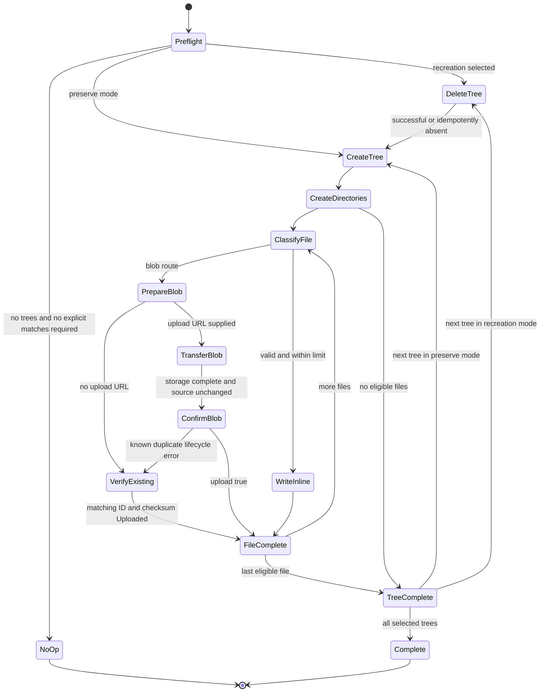

# Data Model: Parameter Uploads

All public models live in `rapyuta_io_sdk_v2/models/parameter.py` and are exported through `models/__init__.py` and the package root. They inherit `SDKModel`, use snake_case attributes and explicit wire aliases, and have runtime validation. Response contracts describe the source-backed service schema; do not add null success variants to accommodate legacy mocks.

## Individual operation models

### ParameterNodeType

String enum members: `VALUE = 'ValueNode'`, `ATTRIBUTE = 'AttributeNode'`, `FOLDER = 'FolderNode'`, `FILE = 'FileNode'`. Serialized values must remain exactly these strings.

### ParameterNode

| Python field | Type and presence | Wire key / meaning |
| --- | --- | --- |
| `node_type` | Required `ParameterNodeType` | `type` |
| `version` | Required integer >= 0 | Current optimistic concurrency version |
| `name` | Required string | Node name; root name is tree name |
| `path` | Required string | Service-relative node path; root is `/` |
| `updated_at` | Required datetime | `updatedAt`, RFC3339 timestamp |
| `user_guid` | Required string | `userGUID`, may be empty for historical metadata |
| `children` | List of `ParameterNode`, default empty | Recursive children; omitted for leaves |
| `data` | Optional string | Original inline file text; distinguish omitted and empty text |
| `content_type` | Optional string | `contentType` |
| `blob_ref_id` | Optional nonzero decimal string | `blobRefId`; this wire field is a string |
| `checksum` | Optional string | Blob content checksum |
| `upload_url` | Optional string | `uploadUrl`; ephemeral preparation authorization |

Missing optional wire values remain absent in `model_fields_set`. Serialization uses aliases and `exclude_unset=True`, preserving explicitly provided supported values. Required node metadata comes from server output; malformed nodes fail validation. Unknown fields follow the shared SDKModel compatibility behavior. Tree roots and directories are nodes rather than v2 resource objects.

### ParameterNodeWrite

Fields: required `node_type`; `version: int >= 0 = 0`; optional `data: str`, `content_type: str`, `blob_ref_id: str`, `checksum: str`, and `upload_url: str` with the same aliases as the node request schema. These fields describe the server's `apiNodeRequest`, not recursively writable children or server-owned name/path/timestamps.

Validation: a file requires a valid content type. Inline YAML/JSON uses original text; a blob-backed file requires a nonzero decimal reference. Nonempty data and a blob reference are mutually exclusive. Version `0` means create-only; modifying an existing node requires its current version. Wire omission retains the server's default version `0`. Direct client operations do not read versions, infer hierarchy, parse source files, or transfer blobs.

### ParameterNodeDelete

Fields: required `version: int >= 0` and `node_type: ParameterNodeType`; optional `content_type` aliased to `contentType`. File-node deletion requires content type. The public contract requires sufficient node metadata to avoid depending on the server's lenient missing-type decoding. An existing node requires its stored version; `0` can describe an absent child. The route and payload remain one DELETE operation.

### ParameterTreeQuery and ParameterBlobQuery

- `ParameterTreeQuery.instances: tuple[str, ...] = ()`: repeated `instances` regex query values supported by ListTrees; omitted/empty means no server filtering. This low-level filter is distinct from the helpers' exact local directory selection.
- `ParameterBlobQuery.tree_names: tuple[str, ...]`: non-empty tree-name selection, serialized as repeated `treeNames` values. Reject duplicates only by normalizing once in helpers; direct query contracts retain caller ordering and values. These are query models, not JSON request bodies.

### ParameterUploadMetadata

Fields: `version: int >= 0 = 0`, required `checksum` matching lowercase `[0-9a-f]{32}`, required `content_type` matching the server MIME syntax, optional `content_encoding`.

Header projection is explicit: `version` → `X-Rapyuta-Params-Version`, `checksum` → `Checksum`, `content_type` → `Content-Type`, `content_encoding` → `Content-Encoding`. Projection emits decimal version text and no absent encoding. No JSON body or binary file bytes are sent by prepare. Blob ID and tree name are scalar routing arguments for completion, which has no request payload.

### Response envelopes

| Model | Required `data` type | Validation |
| --- | --- | --- |
| `ParameterTreeListResponse` | `list[str]` | Empty array valid; null/missing data invalid |
| `ParameterTreeCreateResponse` | `str` | Created tree name |
| `ParameterNodeResponse` | `ParameterNode` | Recursive reads and child PUT |
| `ParameterDeleteResponse` | `Literal['ok']` | No invented empty acknowledgment |
| `ParameterUploadResponse` | `ParameterNode` | File node with required nonzero decimal `blob_ref_id`; URL optional |
| `ParameterCommitResponse` | `ParameterCommitData` | `upload: Literal[True]` |
| `ParameterBlobListResponse` | `ParameterBlobListData` | Required completion flag and list |

Use a small private generic envelope base if useful, but public method annotations retain the named contracts. Responses do not have a fabricated `success` property. `ParameterErrorResponse.error: str` models service errors; clients use existing SDK HTTP exception mappings, not error envelopes as successful return values.

### ParameterBlobStatus, ParameterBlobRef, and associations

`ParameterBlobStatus`: `Pending`, `Deferred`, `Unknown`, `Uploaded`. Only `Uploaded` establishes completed binary availability.

| Blob reference field | Type | Alias |
| --- | --- | --- |
| `id` | Required positive integer | `ID` |
| `created_at` / `updated_at` | Required datetime | `CreatedAt` / `UpdatedAt` |
| `deleted_at` | Required nullable datetime | `DeletedAt` |
| `checksum` | Required string | Unchanged |
| `owner_project` | Required string | `ownerProject` |
| `signed_url` | Required string, may be empty | `signedUrl` |
| `status` | Required `ParameterBlobStatus` | Unchanged |
| `association` | List of `ParameterBlobAssociation`, default empty | Omitted when no associations are returned |

`ParameterBlobAssociation`: required positive `id` alias `ID`; required datetimes `created_at`/`updated_at` aliased to `CreatedAt`/`UpdatedAt`; required nullable `deleted_at` alias `DeletedAt`; required `project`, positive integer `blob_ref_id` alias `blobRefId`, `application`, `collection`, and `sub_ref` alias `subRef`.

`ParameterBlobListData`: required `is_complete: bool` alias `isComplete`, required `blob_refs: list[ParameterBlobRef]` alias `blobRefs`. Empty list with `isComplete:true` is valid but does not prove a particular prepared ID is uploaded. A helper matches the exact ID, checksum, and status, not the overall flag alone. Node IDs remain decimal strings; blob-list IDs remain integers.

## Helper models

### ParameterUploadOptions

- `tree_names: tuple[str, ...] = ()`: exact immediate child directory names. Deduplicate while retaining stable selection. Empty selects all eligible tree directories.
- `delete_existing_trees: bool = False`: explicit recreation of selected trees.
- `as_folder: bool = True`: folder mode; false selects legacy alternating hierarchy.

Boolean options use strict validation; a single string is not accepted as a sequence of tree names. The maximum blob size (209715200000 bytes) and block size (4194304 bytes) are documented constants rather than public tuning options.

### ParameterFileUploadResult and ParameterSkippedEntry

`ParameterFileUploadResult`: `tree_path: str`, `storage: Literal['inline','blob']`, `checksum: str`, and optional decimal `blob_ref_id`. Checksum is the hexadecimal MD5 of original bytes in both storage modes, used for compatibility verification, not a security signature.

`ParameterSkippedEntry`: `path: str` and `reason` enum: `unmatched_tree`, `root_file`, `symbolic_link`, `special_entry`, or `legacy_attribute_file`. For an unmatched tree, path is the requested name; other paths are local-source relative paths. No contents or signed URLs are included.

### ParameterUploadResult

Fields: `selected_trees: tuple[str, ...]`, `completed_trees: tuple[str, ...]`, `completed_files: tuple[ParameterFileUploadResult, ...]`, `created_directories: tuple[str, ...]`, `deleted_trees: tuple[str, ...]`, and `skipped_entries: tuple[ParameterSkippedEntry, ...]`. Defaults are empty tuples. Completed trees are added only after all their eligible entries finish. Empty directories can complete without files. Deletion can be recorded even when subsequent creation fails.

Returned results are immutable snapshots; a private progress accumulator may be mutable while uploading. A no-op returns an empty completed selection and records any loose source files as skipped. Unstarted entries are not reported as completed.

### ParameterUploadFailure, ParameterUploadError, and ParameterUploadCancelled

Failure model fields: `path: str`, `stage: ParameterUploadStage`, `message: str`. Stages: `validate_source`, `delete_tree`, `create_tree`, `create_node`, `read_file`, `prepare_upload`, `transfer_blob`, `confirm_upload`, `verify_blob`.

`ParameterUploadError` in `exceptions.py` is an exception, not an API payload. It contains `.failure: ParameterUploadFailure` and `.partial_result: ParameterUploadResult` and chains its underlying error. Display text contains stage/path and a useful cause description without embedding signed authorization queries. HTTPX errors and Pydantic errors remain inspectable through the cause.

Ordinary helper failures use `ParameterUploadError`, including preflight failures with an empty partial result. `ParameterUploadCancelled` in `exceptions.py` subclasses `asyncio.CancelledError` and exposes the same `.failure: ParameterUploadFailure` and `.partial_result: ParameterUploadResult` attributes. The helper raises it from the original cancellation after snapshotting known progress and arranging owned-resource cleanup. It remains cancellation for await/task handling and is never converted to `ParameterUploadError`. Optional safe notes may supplement the structured fields but must not replace them.

The partial result includes completed item identities, skipped entries, deleted trees, and created directories known when cancellation was observed. An in-flight remote operation may have taken effect without a received acknowledgment; it must not be counted as confirmed completion. Disk workers finish their own cleanup without starting subsequent platform operations.

## Private source state and transitions

A preflight manifest records local path, tree-relative POSIX path, entry type, parent-first order, size, modification time, device/inode where available, and intended node type. It retains no collection of file contents. Open/check/classify/hash one file at a time. Preflight checks permissions and known path constraints before optional deletion.

Any state can fail with a partial result. Preparation creates a remote node/association before byte transfer; failures can therefore leave incomplete references. Cancellation snapshots known progress into `ParameterUploadCancelled`, stops scheduling subsequent operations, closes owned resources, and leaves existing remote changes in place. No rollback, retry, or snapshot guarantee is implied.
