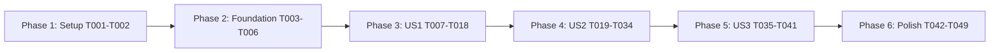

# Tasks: Parameter Uploads

**Input**: Design documents from `specs/001-parameter-uploads/`

**Prerequisites**: [plan.md](plan.md), [spec.md](spec.md), [research.md](research.md), [data-model.md](data-model.md), [SDK contract](contracts/sdk.md), [storage contract](contracts/storage.md), and [quickstart.md](quickstart.md).

**Tests**: Included to implement the specification's independent tests, acceptance scenarios, and injected-failure outcome SC-005, and the constitution's required serialization/response/client verification. Test tasks cover these contracts rather than unrelated behavior. Author cases before their implementation; run them once prerequisite imports exist so failures demonstrate missing behavior rather than only missing modules.

**Organization**: Six phases, with one complete increment per user story. This file schedules implementation; no implementation or test result is implied by its generation.

## Format: `[ID] [P?] [Story] Description`

- Tasks start with an unchecked box and a unique sequential `Tnnn` ID.
- `[P]` means the task can run alongside the named companion once its dependency barrier is complete. It never overrides an incomplete prerequisite.
- `[US1]`, `[US2]`, and `[US3]` map to the stories in the specification. Setup, foundation, and final tasks have no story labels.
- Descriptions contain exact repository-relative paths. All new public models inherit `SDKModel`, use snake_case attributes and wire aliases, and preserve omitted versus explicitly supplied values.

## Path Conventions

The SDK package is `rapyuta_io_sdk_v2/`, with existing `tests/sync_tests/` and `tests/async_tests/`. New helpers are in `rapyuta_io_sdk_v2/helpers/`, shared fixture/verification code is in `tests/`, and runnable examples are in `examples/parameters/`. Keep the package name, Python 3.13+ compatibility, existing runtime dependencies, and Ruff 0.16.9 configuration in `pyproject.toml` unchanged.

## Phase 1: Setup (Shared Infrastructure)

**Purpose**: Prepare the existing repository and feature package layout without replacing its tooling.

- [X] T001 Prepare the Python 3.13+ environment and establish the existing test/Ruff baseline using `pyproject.toml`, `uv.lock`, `CONTRIBUTING.md`, and `.specify/memory/constitution.md`; add a test-only `reference` dependency group pinning `rapyuta-io @ git+https://github.com/rapyuta-robotics/rapyuta-io-sdk@739a6fe44600ff0964fa56b04878ddb21e76b5be`, resolve it in `uv.lock`, and install with `uv sync --group dev --group reference`; record baseline/unavailable checks in `specs/001-parameter-uploads/quickstart.md` without weakening rules or changing runtime dependencies. The required reference gate cannot be replaced by a skipped dependency import or unavailable-live-check note.
- [X] T002 Establish the helper package in `rapyuta_io_sdk_v2/helpers/__init__.py` with its module documentation and create the planned `tests/helpers/` and `examples/parameters/` directories; retain the repository's existing pytest namespace layout and defer entry-point imports until their implementations exist.

**Checkpoint**: The development environment and source layout are ready; no API behavior has changed.

---

## Phase 2: Foundational (Blocking Prerequisites)

**Purpose**: Supply core routing/configuration, resilient existing error handling, and source-backed response fixtures needed by every story.

- [X] T003 Append `core_api_host: str | None = None` to `Configuration` in `rapyuta_io_sdk_v2/config.py`; normalize blank overrides, resolve `hosts['core_api_host']` to the documented production/staging values or `LOCAL_COREAPI_HOST` in local mode, load the optional file key, and recompute defaults when environments change without changing existing v2/rip behavior; extend `tests/sync_tests/test_config.py` to verify precedence, positional compatibility, invalid origin handling, and local v2 usability when the core endpoint is absent.
- [X] T004 Add pure core-endpoint/path utilities in `rapyuta_io_sdk_v2/_parameter_api.py`: resolve the core slot at call time, fail only Parameter operations for an unconfigured endpoint, append `/api/paramserver` once, enforce tree names `^[0-9A-Za-z][0-9A-Za-z._-]{0,49}$`, reject absolute/traversal/backslash/empty child paths, and percent-encode components without changing their literal names; leave all network calls and workflows outside these utilities.
- [X] T005 Make error-body extraction in `rapyuta_io_sdk_v2/utils.py` tolerate JSON arrays/scalars/null and non-JSON error bodies if needed, preserving the existing status-to-exception mapping; extend `tests/sync_tests/test_utils.py` for these cases and the unchanged 400/403, 401, 404, and 409 mappings rather than duplicate the global error taxonomy.
- [X] T006 Add source-backed JSON fixture factories in `tests/data/parameter_data.py` for tree-name arrays, tree creation strings, recursive nodes, deletion `"ok"`, prepared file nodes, `{upload:true}`, and blob lists/associations with timestamps and numeric `ID`; include empty, malformed, pending, and uploaded variants from `research.md`, without copying legacy `null` success mocks or using live credentials.

**Checkpoint**: T001–T006 are complete before story work. Configuration and existing error behavior have their regression coverage; response fixtures are independent of new model imports.

---

## Phase 3: User Story 1 - Manage individual Parameter resources (Priority: P1)

**Goal**: Deliver all nine individual Parameter operations with equivalent typed synchronous/asynchronous contracts. This is the foundational SDK MVP, independently usable without directory helpers.

**Independent Test**: Using one project represented by source-backed responses, list/create/read trees, create or version-update child nodes, discover blobs, prepare/confirm uploads as separate operations, and delete children/trees through both clients. Assert exact request routes/headers/bodies and equivalent validated outcomes; inject HTTP, transport, and schema failures.

### Tests for User Story 1

- [X] T007 [P] [US1] Add model serialization/validation cases in `tests/test_parameter_models.py` for every API model in `data-model.md`: required/nullable fields, aliases, enum values, recursive nodes, omitted versus empty values, version/checksum/blob-ID constraints, empty lists, exact acknowledgments, and rejection of missing/null `data` or malformed authorizations; use T006 fixtures and keep helper-model cases for US2.
- [X] T008 [P] [US1] Add contract cases for all nine methods in `tests/sync_tests/test_parameter.py`, covering core/environment/per-call context overrides, repeated query keys, aliased JSON, bodyless requests, child DELETE JSON, version conflicts, 400/401/403/404/409/5xx mappings, transport failures, malformed successful envelopes, and rejected redirects; assert one platform request per method.
- [X] T009 [P] [US1] Add corresponding awaited contract cases in `tests/async_tests/test_parameter_async.py`, using the same T006 fixtures and expectations as T008; assert identical signatures/models, awaited use of `AsyncClient.c`, and no calls to `sync_client` or synchronous network operations.

### Implementation for User Story 1

- [X] T010 [US1] Implement `ParameterNodeType` and recursive `ParameterNode` in `rapyuta_io_sdk_v2/models/parameter.py` with enum members exactly "`VALUE = 'ValueNode'`, `ATTRIBUTE = 'AttributeNode'`, `FOLDER = 'FolderNode'`, `FILE = 'FileNode'`"; `node_type` is "Required `ParameterNodeType`", `version` is "Required integer >= 0", `name`/`path`/`user_guid` are "Required string", `updated_at` is "Required datetime", `children` is "List of `ParameterNode`, default empty", `data`/`content_type`/`checksum`/`upload_url` are "Optional string", and `blob_ref_id` is "Optional nonzero decimal string"; preserve aliases `type`, `updatedAt`, `userGUID`, `contentType`, `blobRefId`, `uploadUrl` and original text including empty values.
- [X] T011 [US1] Implement `ParameterNodeWrite`, `ParameterNodeDelete`, `ParameterTreeQuery`, `ParameterBlobQuery`, and `ParameterUploadMetadata` in `rapyuta_io_sdk_v2/models/parameter.py`; preserve write fields "required `node_type`; `version: int >= 0 = 0`; optional `data: str`, `content_type: str`, `blob_ref_id: str`, `checksum: str`, and `upload_url: str`", enforce "Nonempty data and a blob reference are mutually exclusive" and valid file content type/blob reference, require delete "`version: int >= 0` and `node_type: ParameterNodeType`" with file content type, retain query "`ParameterTreeQuery.instances: tuple[str, ...] = ()`" and "`ParameterBlobQuery.tree_names: tuple[str, ...]`" with "non-empty tree-name selection", and enforce metadata "`version: int >= 0 = 0`", lowercase "`[0-9a-f]{32}`", required MIME type matching `^[-\w.]+/[-+\w.]+$`, and "optional `content_encoding`" as specified in `data-model.md`.
- [X] T012 [US1] Implement `ParameterBlobStatus`, `ParameterBlobRef`, `ParameterBlobAssociation`, and `ParameterBlobListData` in `rapyuta_io_sdk_v2/models/parameter.py`; status values are exactly "`Pending`, `Deferred`, `Unknown`, `Uploaded`", blob `id` is "Required positive integer", created/updated timestamps are "Required datetime", deletion timestamp is "Required nullable datetime", checksum/owner/signed URL are "Required string" with URL allowed empty, and associations are "List of `ParameterBlobAssociation`, default empty"; preserve `ID`, `CreatedAt`, `UpdatedAt`, `DeletedAt`, `ownerProject`, `signedUrl`, and association `blobRefId`/`subRef` aliases, require association project/application/collection/sub-reference and positive IDs, and require "`is_complete: bool`"/"`blob_refs: list[ParameterBlobRef]`" with `isComplete`/`blobRefs` aliases.
- [X] T013 [US1] Implement the named response envelopes and `ParameterErrorResponse` in `rapyuta_io_sdk_v2/models/parameter.py`: `ParameterTreeListResponse.data` is "`list[str]`", tree creation data is "`str`", node response data is "`ParameterNode`", deletion data is "`Literal['ok']`", upload data is a "File node with required nonzero decimal `blob_ref_id`; URL optional", commit data requires "`upload: Literal[True]`", and blob-list data is "`ParameterBlobListData`"; require `data`, reject null/missing success payloads, use `ParameterErrorResponse.error: str`, and do not fabricate a `success` flag.
- [X] T014 [US1] Export the T010–T013 API models in `rapyuta_io_sdk_v2/models/__init__.py` and `rapyuta_io_sdk_v2/__init__.py`; preserve existing exports and make named contracts available to both clients and model-discovery tests without circular imports.
- [X] T015 [US1] Complete pure request/response utilities in `rapyuta_io_sdk_v2/_parameter_api.py`: validate and serialize model inputs with aliases/`exclude_unset=True`, project repeated `instances`/`treeNames` queries, project metadata to `X-Rapyuta-Params-Version`, `Checksum`, `Content-Type`, and optional `Content-Encoding`, retain configured auth/context, and validate named v1 response models while rejecting error envelopes/non-2xx/redirects; reuse T005 mappings and never perform a second network operation.
- [X] T016 [P] [US1] Add `list_parameter_trees`, `create_parameter_tree`, `get_parameter_tree`, `put_parameter_node`, `delete_parameter_tree`, `delete_parameter_node`, `list_parameter_blobs`, `prepare_parameter_upload`, and `commit_parameter_upload` to `rapyuta_io_sdk_v2/client.py` with exact signatures/return models from `contracts/sdk.md`, one HTTP operation each, no body for root creation/preparation/completion, no unrequested nested-node GET, JSON through `.request('DELETE', ...)` for child deletion, and documented input/version/error semantics; use T015 utilities.
- [X] T017 [P] [US1] Add the same nine typed methods to `rapyuta_io_sdk_v2/async_client.py` with exact contract signatures and awaited HTTPX operations on `self.c`; preserve T016 request semantics, reuse T015 utilities, document bodyless/version behavior, and keep traversal, storage, dedup follow-ups, and the legacy synchronous transport out of the new methods.
- [X] T018 [US1] Run `tests/test_parameter_models.py`, `tests/sync_tests/test_parameter.py`, `tests/async_tests/test_parameter_async.py`, `tests/test_model_contracts.py`, and the T003/T005 configuration/error regressions; resolve request/model/parity failures and check the changed model/client files against pinned Ruff requirements before considering US1 complete.

**Checkpoint**: US1 can list/read/manage existing Parameter resources through both clients. No directory workflow is required for this increment; existing-node mutations use the stored optimistic version.

---

## Phase 4: User Story 2 - Submit complete directory trees (Priority: P1)

**Goal**: Submit selected local trees in default folder mode through separate synchronous/asynchronous helpers, preserving eligible content and reporting known progress and failures.

**Independent Test**: Upload two trees with at least 100 mixed files across five levels, nested/empty folders, inline YAML/JSON, text/binary/large/duplicate files through mocked platform and storage transports. Assert all eligible paths/text/bytes and final blob availability, exact selection/skips, no completion after failed storage, bounded reads, and async heartbeat/cancellation behavior. This story uses US1 but does not require recreation or legacy mode.

### Tests for User Story 2

- [X] T019 [US2] Add temporary-source and injected transport fixtures in `tests/helpers/conftest.py` and shared fixture/state factories in `tests/data/parameter_data.py` for the two-tree/100-file/five-level scenario, empty folders, duplicate blobs, CRLF/Unicode text, raw/serialized 128 KiB boundaries including malformed structured candidates whose escaped representation exceeds the limit, zero-byte files, links/special/unsupported hidden entries, and exact-maximum/one-byte-over blob size checks; retain helper-produced stored tree/blob state in a network-isolated simulated service so `tests/reference/test_parameter_compatibility.py` can exercise the actual reference downloader rather than hand-built round-trip fixtures.
- [X] T020 [P] [US2] Add synchronous helper contract cases in `tests/helpers/test_parameter_upload.py` for folder traversal, all/exact/partial/no-match selection, empty no-op and loose root skips, strict options, preflight with zero mutations, classification/text preservation, changed sources, malformed prepare results, verified already-uploaded content, ambiguous completion status, failure-stage/partial reporting, and supplied-client ownership; use T019 fixtures and default preservation only.
- [X] T021 [P] [US2] Add equivalent async helper cases plus heartbeat, disk-worker cleanup, and cancellation after known completions/skips in `tests/helpers/test_parameter_upload_async.py`; assert the observed exception is `ParameterUploadCancelled` and `asyncio.CancelledError`, has typed `.failure` and an immutable `.partial_result` identifying completed trees/files, skipped entries, known deletions/directories without counting unfinished content, chains the original cancellation, and preserves task cancellation behavior; verify no later platform confirmation, synchronous network work, leaked owned storage resources, or closure of injected clients.
- [X] T022 [P] [US2] Add sync/async storage MockTransport cases in `tests/test_parameter_storage.py` for exact bytes/lengths, preserved SAS query, version/media/MD5 headers, empty/single/multi-block uploads, unique equal-length block IDs/ordered XML, transfer/hash/source-change/block-list failures, credential isolation, and client lifetime. Also author the mandatory consumer round-trip in `tests/reference/test_parameter_compatibility.py`: after each new helper produces stored tree/blob state through T019 isolated transports, verify the installed SDK provenance matches revision `739a6fe44600ff0964fa56b04878ddb21e76b5be`, invoke its actual public `Client.download_configurations` against mocked requests, block unhandled network attempts, and compare every eligible path, empty folder, inline text, and blob bytes/checksums for folder mode, selection, serialized-size boundaries, multi-block and duplicate content. Implement gate hooks in `tests/reference/conftest.py` that set a failing pytest exit status for missing/wrong reference provenance, zero executed reference cases, or any skipped required reference case, without changing unrelated tests' skip policy; add legacy cases in US3.

### Implementation for User Story 2

- [X] T023 [US2] Add `ParameterUploadOptions` to `rapyuta_io_sdk_v2/models/parameter.py` with the exact defaults "`tree_names: tuple[str, ...] = ()`", "`delete_existing_trees: bool = False`", and "`as_folder: bool = True`"; enforce "Boolean options use strict validation; a single string is not accepted as a sequence of tree names", normalize duplicate exact names without dropping ordering information, and retain documented blob/block constants 209715200000/4194304 bytes without public concurrency tuning.
- [X] T024 [US2] Add `ParameterFileUploadResult`, `ParameterSkippedEntry`, `ParameterUploadResult`, `ParameterUploadFailure`, and `ParameterUploadStage` models/enums in `rapyuta_io_sdk_v2/models/parameter.py`: file result fields "`tree_path: str`", "`storage: Literal['inline','blob']`", "`checksum: str`", and "optional decimal `blob_ref_id`"; skip entry fields "`path: str` and `reason` enum" with reasons exactly "`unmatched_tree`, `root_file`, `symbolic_link`, `special_entry`, or `legacy_attribute_file`"; result fields "`selected_trees: tuple[str, ...]`", "`completed_trees: tuple[str, ...]`", "`completed_files: tuple[ParameterFileUploadResult, ...]`", "`created_directories: tuple[str, ...]`", "`deleted_trees: tuple[str, ...]`", and "`skipped_entries: tuple[ParameterSkippedEntry, ...]`" with "Defaults are empty tuples"; failure fields "`path: str`, `stage: ParameterUploadStage`, `message: str`" and stages exactly "`validate_source`, `delete_tree`, `create_tree`, `create_node`, `read_file`, `prepare_upload`, `transfer_blob`, `confirm_upload`, `verify_blob`"; enforce immutable result snapshots and no prepared-only file counted complete.
- [X] T025 [US2] Export helper models through `rapyuta_io_sdk_v2/models/__init__.py` and `rapyuta_io_sdk_v2/__init__.py`; implement `ParameterUploadError` and `ParameterUploadCancelled` in `rapyuta_io_sdk_v2/exceptions.py` with identical typed ".failure: ParameterUploadFailure" and ".partial_result: ParameterUploadResult" contracts, the latter subclassing `asyncio.CancelledError`; chain the underlying ordinary error or original cancellation, exclude signed authorization queries from display text, and extend `tests/test_parameter_models.py` with T023–T024 constraints/immutable snapshots and the two exception contracts.
- [X] T026 [US2] Implement source/options/client/storage preflight and the metadata-only manifest in `rapyuta_io_sdk_v2/helpers/_parameter_source.py`: validate readable source, auth/project/core setup and safe injected storage configuration before mutations, select exact immediate child directories, report partial unmatched names/loose files, fail a nonempty zero-match selection, return empty no-op selections, use sorted parent-first traversal/lstat with link/special skips, enforce known path and maximum-size restrictions, and record identity/size/mtime without retaining all contents.
- [X] T027 [US2] Implement one-pass classification, safe identity rechecks, bounded reads, and incremental hashes in `rapyuta_io_sdk_v2/helpers/_parameter_source.py`: raw size above 131072 bytes or an extension other than `.yaml`/`.json` routes directly to blob storage without parsing; structured candidates at or below that raw threshold decode UTF-8 without newline rewriting and validate YAML mapping/JSON syntax before checking `len(json.dumps({'type':'FileNode','data':text,'contentType':mime})) + 200 > 131072` with reference escaping/separators. Invalid candidates fail even when escaping would force blob storage; valid candidates above the stored-size limit become blobs. Guess MIME/encoding, override exactly JSON/text-yaml blob MIME, and use `hashlib.md5(usedforsecurity=False)` with source-context failures.
- [X] T028 [P] [US2] Implement the private progress accumulator, immutable snapshots, ordinary/cancellation failure-context construction, and pure blob-match checks in `rapyuta_io_sdk_v2/helpers/_parameter_upload.py`; track completed item identities, skips, created directories and known deletions without counting preparation or unacknowledged operations as completion, expose the same snapshot fields for `ParameterUploadError` and `ParameterUploadCancelled`, match decimal node IDs to numeric blob-list IDs with exact checksum/Uploaded status, preserve failed commits as the cause when verification fails, and leave network orchestration in public helpers.
- [X] T029 [P] [US2] Implement shared storage request builders and the synchronous adapter in `rapyuta_io_sdk_v2/helpers/_parameter_storage.py` according to `contracts/storage.md`: isolated unauthenticated client, redirects disabled, `x-ms-version: 2021-12-02`, explicit lengths, Put Blob through 4194304 bytes including zero, sequential 4194304-byte blocks above that size, unique equal-length Base64 IDs, SAS-query-preserving operation parameters, per-block Base64 MD5, ordered `Latest` block-list XML and final media/full-MD5 properties, HTTP 201 checks, second-pass integrity verification, and owned/injected lifetime rules; never call platform completion here.
- [X] T030 [US2] Add the asynchronous storage adapter in `rapyuta_io_sdk_v2/helpers/_parameter_storage.py` using T029 builders with awaited network I/O, `asyncio.to_thread` for local reads/checksums, worker-owned file handles, and at most one block payload at a time; verify final source/hash before block-list commit, propagate cancellation without retries or background completion, and close only owned clients.
- [X] T031 [P] [US2] Implement `upload_parameters(client, rootdir, *, options=None, storage_client=None)` in `rapyuta_io_sdk_v2/helpers/parameter.py` with the exact public result/error contract: complete T026 preflight, create each selected value root without deletion, create folder descendants before children, upload inline models or prepare/transfer/confirm blobs through public US1 methods and T029, verify no-URL preparations and known duplicate-lifecycle commit errors through `list_parameter_blobs`, and stop with a typed partial result on ordinary failures; do not silently merge existing roots or accept unsupported recreation/legacy choices before US3 adds them.
- [X] T032 [P] [US2] Implement awaited `upload_parameters_async` in `rapyuta_io_sdk_v2/helpers/async_parameter.py` with the same public signature/behavior, using awaited US1 methods, T030 storage, and offloaded source work; on cancellation snapshot known progress and raise `ParameterUploadCancelled` from the original `CancelledError`, exposing typed `.failure`/`.partial_result` with completed identities, skips, deletions/directories and preserving cancellation semantics; safe notes are supplemental only. Arrange worker-owned cleanup without closing an in-use handle and never schedule subsequent platform confirmation or rollback.
- [X] T033 [US2] Export both completed helpers from `rapyuta_io_sdk_v2/helpers/__init__.py` and document their argument/options/result/error/client-ownership contracts in the public docstrings in `rapyuta_io_sdk_v2/helpers/parameter.py` and `rapyuta_io_sdk_v2/helpers/async_parameter.py`; confirm workflows are outside the client implementation modules and imports stay acyclic.
- [X] T034 [US2] Run US2 model/helper/storage cases in `tests/test_parameter_models.py`, `tests/helpers/test_parameter_upload.py`, `tests/helpers/test_parameter_upload_async.py`, and `tests/test_parameter_storage.py` together with US1 operation suites; run the folder-mode consumer cases in `tests/reference/test_parameter_compatibility.py` with `uv run --group reference pytest`, requiring zero skipped reference cases; resolve parsing-order, maximum-size, parity, integrity, partial-cancellation, bounded-read and ownership failures, and check modified modules against pinned Ruff requirements.

**Checkpoint**: Both folder-mode helpers pass the mixed-directory scenario, typed ordinary/cancellation partial-result checks, and the actual reference downloader round-trip with zero skipped reference cases. Recreation and legacy mode are explicitly supplied by the next increment rather than silently ignored.

---

## Phase 5: User Story 3 - Control replacement and legacy compatibility (Priority: P2)

**Goal**: Complete the options contract with selected-only recreation, legacy alternating value/attribute hierarchy, and reliable progress after replacement failures.

**Independent Test**: Re-upload selected fixtures with replacement disabled/enabled, verify remote-only content removal only under recreated trees and no change to unselected trees, and submit a valid legacy hierarchy with attribute-level files. Inject deletion/creation/upload failures and compare sync/async failure stage and partial completion.

### Tests for User Story 3

- [X] T035 [P] [US3] Extend `tests/helpers/test_parameter_upload.py` with selected-only recreation, idempotent absent-tree deletion, deletion failure stopping creation, existing-root failure without implicit merge, remote-only content removal, legacy root/value/attribute placement and skipped attribute files, large structured legacy files submitted once, and reports containing deleted trees or earlier completed files when later work fails.
- [X] T036 [P] [US3] Extend `tests/helpers/test_parameter_upload_async.py` with T035 replacement/legacy expectations, including cancellation after deletion/recreation that exposes `ParameterUploadCancelled.failure` and `.partial_result` with known deleted trees/created directories/skips/completed identities, and no subsequent operations after failure; retain folder-mode, heartbeat and ownership cases.

### Implementation for User Story 3

- [X] T037 [US3] Extend the type-aware manifest/traversal in `rapyuta_io_sdk_v2/helpers/_parameter_source.py` to honor `as_folder=False`: root ValueNode, first directory AttributeNode, second ValueNode and alternating thereafter; record attribute-level files as legacy skips, preserve the one-pass validation-before-stored-size rule and direct raw-size bypass, and validate known legacy path/type restrictions without changing folder mode. Add legacy/recreation round-trip cases to `tests/reference/test_parameter_compatibility.py` using the actual reference SDK downloader and isolated helper-produced state.
- [X] T038 [US3] Complete replacement-stage progress/failure snapshots in `rapyuta_io_sdk_v2/helpers/_parameter_upload.py`, recording a tree immediately after confirmed deletion, directories/files after successful operations, and a completed tree only after all eligible entries; retain original delete/create/transfer/confirmation errors with correct path/stage and no claim of automatic rollback or atomic submission.
- [X] T039 [P] [US3] Extend `rapyuta_io_sdk_v2/helpers/parameter.py` to honor both remaining options: delete/recreate only selected trees when explicitly requested, tolerate only actual idempotent absent deletion, stop on deletion failure, consume T037 node types/skips, and use T038 progress; preserve existing-root failures when recreation is disabled and keep every individual API method one-to-one.
- [X] T040 [P] [US3] Extend `rapyuta_io_sdk_v2/helpers/async_parameter.py` with awaited selected-only recreation and T037 legacy mode, matching T039 outcomes/T038 progress; preserve `ParameterUploadCancelled` with the same typed partial-result contract after known deletions, directory creations or earlier file completions, alongside fail-fast scheduling, worker cleanup and client ownership.
- [X] T041 [US3] Run expanded sync/async suites in `tests/helpers/test_parameter_upload.py` and `tests/helpers/test_parameter_upload_async.py` plus Parameter model/operation/storage regressions; run all folder/legacy/recreation cases in `tests/reference/test_parameter_compatibility.py` with the pinned reference group and zero skipped cases; verify all five US3 acceptance scenarios, equivalent visible outcomes and no changes to unselected trees before declaring story completion.

**Checkpoint**: The complete public options contract works through both helpers, including replacement failures and legacy compatibility.

---

## Phase 6: Polish & Cross-Cutting Concerns

**Purpose**: Publish runnable usage, verify compatibility and quality, and record the actual verification evidence.

- [X] T042 [P] Document individual v1 operations and both helpers in `README.md`, including exact selection, default folder/no-delete behavior, opt-in legacy/recreation, optimistic versions, local core configuration, binary size limit, partial failures, and ownership; link the runnable examples and keep the existing v2 ConfigTree guidance accurate.
- [X] T043 [P] Add runnable synchronous usage in `examples/parameters/upload.py` following `specs/001-parameter-uploads/quickstart.md`, covering configured credentials/project/environment/core override, default upload, optional filter/recreation/legacy settings, inspection of results and `ParameterUploadError`, and caller-owned client cleanup without hardcoded credentials.
- [X] T044 [P] Add equivalent runnable asyncio usage in `examples/parameters/upload_async.py` using `upload_parameters_async` and awaited client calls; show `ParameterUploadCancelled` handling that inspects typed `.failure`/`.partial_result` and re-raises cancellation, distinguish it from `ParameterUploadError`, clean up caller-owned runtime resources, and retain the same input/options/outcomes as T043.
- [X] T045 Audit public exports, aliases, annotations, and operation/workflow boundaries in `rapyuta_io_sdk_v2/models/parameter.py`, `rapyuta_io_sdk_v2/client.py`, `rapyuta_io_sdk_v2/async_client.py`, and `rapyuta_io_sdk_v2/helpers/`, and extend/run `tests/test_model_contracts.py` to verify named request/response contracts and root exports; resolve only feature-related violations without copying pre-existing synchronous async-client patterns.
- [X] T046 Run focused configuration/ConfigTree/source regressions from `specs/001-parameter-uploads/quickstart.md`, then `uv run --group reference pytest` for the complete repository including `tests/reference/test_parameter_compatibility.py`; fix feature-caused failures, retain baseline evidence for unrelated failures, and fail the compatibility gate if the actual reference SDK is absent, cases are skipped, or any unhandled request would leave the isolated transports.
- [X] T047 Run `uvx ruff==0.16.9 check .` and `uvx ruff==0.16.9 format --check .` against the source/test/example changes using `pyproject.toml` and `CONTRIBUTING.md`; refactor to the configured limits without rule weakening or blanket suppressions and rerun affected behavioral checks only when changes warrant it.
- [X] T048 Validate the runnable fixture/examples and the required consumer gate in `tests/reference/test_parameter_compatibility.py` using the commands in `specs/001-parameter-uploads/quickstart.md`; require actual pinned SDK v1 download round-trips of both helpers in folder/legacy modes, two trees/five levels/100 files, empty folders, original inline text, binary checksums, stored-size boundaries, multi-block/duplicate content, filtering and recreation, with zero skipped cases and all network attempts isolated. Missing reference tooling or failed/skipped cases leaves this task incomplete. If a disposable live project is available, additionally run CLI/SDK list/read/download checks and clean up only recorded test trees; report unavailable live checks separately without treating that note as compatibility evidence.
- [X] T049 Update `specs/001-parameter-uploads/quickstart.md` with actual commands/results, the pinned reference SDK revision and mandatory isolated-gate pass/fail/skip counts, plus separately labeled supplemental live results or unavailable steps; remove planning-only statements once interfaces exist and reconcile `README.md`/`examples/parameters/upload.py`/`examples/parameters/upload_async.py` with final parsing, size and typed-cancellation contracts. Do not declare compatibility complete if the required consumer gate did not run and pass, or change quality checklist markers.

**Checkpoint**: All three story increments have automated evidence, documented usage, unchanged quality gates, and a passed actual reference downloader round-trip with zero skipped reference cases. Missing/failed/skipped reference checks prevent acceptance. Supplemental live validation is identified separately as verified or unavailable with a specific reason.

---

## Dependencies & Execution Order

### Phase dependencies

US1 needs no other story. US2 composes US1's public operations and is tested in folder mode independently of US3. US3 extends completed US2 helpers and is tested with separate replacement/legacy fixtures. These are real architectural dependencies; user stories are independently testable increments, not mutually independent implementations.

### Task dependencies and parallel barriers

| Task or group | Required completed tasks | Safe parallel companion / order |
| --- | --- | --- |
| T001–T002 | None initially | Execute setup in numeric order |
| T003–T006 | T001–T002 | Execute foundation in numeric order; no parallel promises |
| T007, T008, T009 | T001–T006 | Three independent test files; author together, execute after models/operations exist |
| T010–T014 | T007–T009 authored | Sequential edits to the model/export files |
| T015 | T010–T014 | Completes pure API utilities after models exist |
| T016, T017 | T015 and contract tests authored | Separate sync/async client files |
| T018 | T007–T017 | US1 completion gate |
| T019 | T018 | Shared helper fixtures first |
| T020, T021, T022 | T019 | Three distinct helper/storage test files |
| T023–T027 | T020–T022 authored | Sequential model/export/error/source prerequisites |
| T028, T029 | T025 and T027 | Independent progress and storage modules |
| T030 | T029 | Same storage module; must follow sync/shared adapter |
| T031, T032 | T026–T030 and helper tests authored | Separate sync/async helper files |
| T033–T034 | T031–T032 | Exports/docstrings then US2 completion gate |
| T035, T036 | T034 | Separate helper test files for the US3 additions |
| T037–T038 | T035–T036 authored | Sequential legacy source and progress changes |
| T039, T040 | T037–T038 | Separate sync/async helper extensions |
| T041 | T035–T040 | US3 completion gate |
| T042, T043, T044 | T041 | README and two separate example files |
| T045–T049 | T042–T044 | Audit, regressions, quality gates, interoperability, evidence in order |

Tasks sharing a model, helper, example, or test file must be serialized even if they belong to different phases. `[P]` does not permit starting US2 orchestration before US1 contracts exist or US3 modifications while US2 still changes the same files. Writing test expectations can happen before implementation; passing behavior must be demonstrated at each completion gate.

### Requirement coverage

| Requirements / outcome | Implementation and verification tasks |
| --- | --- |
| FR-001–FR-003, SC-002 | T003–T018: routing/configuration, typed models, nine methods per client, source-backed parity |
| FR-004–FR-006, SC-001 | T019–T034: folder helpers, two trees/100 files/five levels, exact selection and folders |
| FR-007 | T035–T041: explicit legacy hierarchy and reported attribute-file skips |
| FR-008–FR-010, SC-004 | T019–T034: original text, reference size decisions, storage integrity, verified dedup |
| FR-011, SC-003 | T020–T021, T031–T032, T035–T041: no default deletion and selected-only recreation |
| FR-012–FR-013 | T004, T019–T027: preflight, names/paths, no-op/filter, skipped links/special entries |
| FR-014–FR-015, SC-005 | T020–T034, T035–T041: failure stages/partial results, bounded reads, async cancellation/ownership |
| FR-016, SC-006 | T042–T044, T048–T049: runnable documented use and failure handling |
| FR-017, SC-004 | T022, T034, T037, T041, T045–T049: existing v2 regressions and mandatory actual reference downloader round-trip; supplemental live results reported separately |
| Constitution I–V | Typed Python 3.13+ contracts, one-to-one operations, separate helpers, T018/T034/T041/T045–T047 gates |

---

## Parallel Example: User Story 1

After foundation, author T007/T008/T009 concurrently in their distinct test files. After T015 completes, implement T016 in `rapyuta_io_sdk_v2/client.py` and T017 in `rapyuta_io_sdk_v2/async_client.py` concurrently using the shared frozen contracts. Join before T018. Do not split T010–T013 across simultaneous writers to `models/parameter.py`.

## Parallel Example: User Story 2

After T019, author T020/T021/T022 concurrently. After T027, T028 progress and T029 storage work may overlap; T030 follows T029 because both edit `_parameter_storage.py`. After T030 and T028 finish, T031 and T032 can implement the two public helpers concurrently. Join before exports and the T034 gate.

## Parallel Example: User Story 3

After US2 completes, T035/T036 can extend the two test files concurrently. Finish T037/T038 before T039/T040 implement sync/async replacement and legacy behavior concurrently. Join before T041. Final README and example tasks T042/T043/T044 also occupy distinct files.

---

## Implementation Strategy

### MVP First (User Story 1 Only)

Complete setup and foundation, then US1 including T018. The MVP is the complete nine-operation typed Parameter client surface in both client modes; it has value without directory helpers. Stop at this checkpoint only if delivering that scoped increment, not when pursuing the full requested feature.

### Incremental Delivery

1. Finish T001–T018 and demonstrate individual resource management.
2. Finish T019–T034 and demonstrate selected directory submission in folder mode, binary completion, and trustworthy failure outcomes.
3. Finish T035–T041 and demonstrate selected-tree recreation and legacy compatibility.
4. Finish T042–T049 and report automated quality gates, mandatory consumer-gate execution with zero skipped cases, runnable usage, and separate supplemental live-check status.

For the user's complete feature, all three stories and final verification/documentation are required. No deployment, publishing, PR creation, or branch switch is part of these tasks.

### Parallel execution strategy

Use only the companion groups in the dependency table after their barriers complete. Keep common models/source/progress modules under one writer at a time. This file identifies scheduling opportunities; it does not itself authorize or start additional agents.

## Notes

- All 49 tasks are complete; validation evidence is recorded in quickstart.md.
- Distribution: 2 setup, 4 foundational, 12 US1, 16 US2, 7 US3, and 8 cross-cutting tasks; 19 tasks have `[P]` companions at explicit barriers.
- Resolve introduced failures before crossing a story checkpoint; do not weaken model validation to match lax mocks.
- The public payload constraints quoted in model tasks come from `data-model.md`; use the accompanying contracts for aliases and full wire mappings.
- Never equate prepared/transferred content with confirmed availability. Keep version refresh, dedup status verification, traversal, and storage transfers out of individual API methods.
- Ordinary partial failures and cancellation can leave remote changes; both expose the same typed failure/immutable partial-result fields, cancellation remains a CancelledError subtype, and neither starts retries, rollback, or background work.
- The actual reference downloader round-trip is a required gate with zero skipped cases; an unavailable-live-check note cannot complete T048 or satisfy FR-017/SC-004.
- No pre/post task hooks are registered because `.specify/extensions.yml` is absent. Task generation used system `python3` for the stdlib-only setup script because `.venv/bin/python` was unavailable; implementation setup is T001.

## Implementation completion

All 49 tasks completed on 2026-10-13. Final full suite: 1012 passed,
0 failed, 0 skipped. Actual pinned SDK v1 consumer gate: 6 passed,
0 failed, 0 skipped. Both exact Ruff 0.16.9 gates and eight isolated
executable example workflows passed. Supplemental live checks were unavailable
because no disposable project or scoped live-test credentials were supplied.
Quality checklist markers were preserved and no extension hooks are configured.

## Phase 7: Convergence

Assessment on 2026-10-14 checked 17 functional requirements, 6 success criteria,
24 acceptance scenarios, 12 edge cases, all 49 existing tasks, 9 plan decisions,
and 5 constitution principles against the current implementation. The existing
suite passed 1012 tests, including 6 actual pinned SDK v1 consumer cases with
zero skips; Ruff 0.16.9 lint and formatting passed. The gaps below were found
through code inspection and isolated behavioral probes. Existing completion
markers and implementation evidence above are preserved as historical records.

- [X] T050 CRITICAL [F1] Prevent implicit redirect requests in all nine Parameter methods in both `rapyuta_io_sdk_v2/client.py` and `rapyuta_io_sdk_v2/async_client.py`, including when the caller configures `self.c.follow_redirects=True`; explicitly reject redirect responses without issuing a request to their target, preserving the single-operation contract and requested resource identity. Add sync/async regressions in `tests/sync_tests/test_parameter.py` and `tests/async_tests/test_parameter_async.py` using a redirect-enabled MockTransport client: a 307 from PUT `/tree/tree` to `/tree/other` currently produces two PUTs and returns `other` as success. Require exactly one request and the established redirect failure for all new operations. Trace: Constitution II, FR-001, US1/AC5, T008-T009, T015-T017 (contradicts).
- [X] T051 CRITICAL [F2] Serialize repeated `instances` and `treeNames` parameters from the revalidated, declared `ParameterTreeQuery` and `ParameterBlobQuery` values in `rapyuta_io_sdk_v2/_parameter_api.py`, `rapyuta_io_sdk_v2/client.py`, and `rapyuta_io_sdk_v2/async_client.py`; do not discard `wire_payload(query)` and then read unchecked original attributes. Preserve aliases, omission, caller order, and duplicate values. Add both-mode/both-query regressions in the Parameter operation suites for mutable or constructed model values: an assigned `b'normalized'` currently validates/serializes as `normalized` but is sent as `b'normalized'`; either reject invalid input before I/O or send its validated representation. Trace: Constitution III, FR-003, plan: typed request/query serialization, T011, T015-T018 (contradicts).
- [X] T052 HIGH [F3] Inspect decoded JSON object keys in `parameter_response` in `rapyuta_io_sdk_v2/_parameter_api.py` so every top-level `error` envelope is rejected even when the wire key uses JSON Unicode escapes; remove reliance on the raw-text substring `"error"`. Add sync/async success-status response regressions containing valid-looking `data` together with literal and escaped error keys; `{"data":"tree","err\u006fr":"rejected"}` currently returns a successful tree creation response. Preserve named Pydantic response validation, malformed-JSON failure behavior, existing HTTP mappings, and one request per operation. Trace: FR-003, US1/AC6, plan: v1 response checker, T007-T009, T013, T015 (partial).
- [X] T053 HIGH [F4] Retain the exact offending local entry when filesystem inspection/opening fails during preflight in `rapyuta_io_sdk_v2/helpers/_parameter_source.py` and `rapyuta_io_sdk_v2/helpers/_parameter_upload.py`, rather than falling back to the source container for an `OSError` that identifies a child in `filename`. Preserve the underlying exception as the cause and the `validate_source` stage. Add sync/async helper regressions for a selected file disappearing or becoming inaccessible during traversal/opening, including recreation enabled: a failing `tree/file.bin` currently reports the container in `.failure.path`; require the offending local/Parameter path, an immutable partial result, and zero remote mutations. Trace: FR-012, FR-014, SC-005, US2/AC8, T020-T021, T026-T028 (partial).
- [X] T054 HIGH [F5] Make error-body extraction in `rapyuta_io_sdk_v2/utils.py` tolerate Unicode decoding failures as well as JSON syntax failures, retaining readable fallback text or the established default message while preserving the existing status-to-exception taxonomy and `status_code`. Extend `tests/sync_tests/test_utils.py` and both Parameter operation suites for non-UTF-8 byte bodies: `b'\xffproxy error'` currently raises `UnicodeDecodeError` for 400, 401, 403, 404, 409, and 500 instead of their SDK exceptions. Keep successful-response Pydantic validation separate and rerun existing error/ConfigTree regressions. Trace: FR-001, US1/AC6, plan: resilient existing error extraction, T005, T008-T009, T015 (partial).
- [X] T055 HIGH [F6] Redact signed authorization queries from valid HTTP(S) URLs independently of scheme casing in `rapyuta_io_sdk_v2/helpers/_parameter_upload.py`, covering public failure messages, `ParameterUploadError`/`ParameterUploadCancelled` display text, and supplementary verification notes while retaining inspectable original causes. Add regressions in `tests/test_parameter_models.py` and the helper suites for uppercase and mixed-case schemes in platform errors and malformed preparation errors; `Cannot sign HTTPS://storage/blob?sig=fake-secret` currently exposes the query in `.failure.message` and `str(error)`, although the storage URL validator accepts that scheme. Trace: FR-014, plan: typed safe failure reporting, T025, T028 (partial).
- [X] T056 MEDIUM [F7] Complete the requested storage failure and ownership verification in `tests/test_parameter_storage.py`, `tests/helpers/test_parameter_upload.py`, and `tests/helpers/test_parameter_upload_async.py`: inject same-size second-pass corruption with unchanged source metadata and assert no block-list commit or platform confirmation; fail the final block-list request after successful blocks and assert no completion; fail/cancel an upload using a helper-owned storage client and assert cleanup, no later requests/confirmation, and accurate typed partial progress while injected/platform clients stay open. The present storage tests cover successful protocol requests and a changed source before the next block, but not these T021-T022 cases. Resolve any feature defects those cases expose without adding retries/rollback or weakening Ruff; after T050-T055, rerun the full suite, all actual reference consumer cases with zero skips, and pinned lint/format checks, then update `specs/001-parameter-uploads/quickstart.md` with current results without changing checklist markers. Trace: FR-009, FR-014-FR-015, SC-005, plan: transfer integrity/cancellation/client ownership, T021-T022, T029-T030, T034, T046-T049 (partial).

Execute T050-T055 before the final T056 verification gate. Keep every new task
unchecked until implementation and its behavioral regressions are complete.

### Convergence completion

T050-T056 completed on 2026-10-14. All 56 tasks are now checked. The current
full suite passes 1108 tests with zero failures/skips, including 96 added
regressions. The separate actual pinned SDK v1 downloader gate passes all six
cases with zero skips; all eight executable example workflows pass against
isolated transports. Exact Ruff 0.16.9 lint/format and whitespace checks pass.
Current evidence is recorded in quickstart.md. Checklist markers remain
unchanged, and no pre/post implementation extension hooks are configured.

## Phase 8: Convergence

Assessment on 2026-10-14 checked 17 functional requirements, 6 success criteria,
24 acceptance scenarios, 12 edge cases, all 56 existing tasks, 9 plan decisions,
and 5 constitution principles. The current suite passed 1108 tests with zero
failures/skips, including all six actual pinned SDK v1 consumer cases; Ruff
0.16.9 lint and format checks passed. T050-T056 corrective behavior is present
and covered. No additional implementation defect was reproduced. Two explicit
verification obligations remain incomplete despite the passing suite.
Read-only probes passed 36 direct transport failures, four version conflicts,
and sync/async single/staged MIME/encoding transfers; these probes are evidence
of current behavior, not substitutes for the required durable regression tests.

- [X] T057 MEDIUM [F8] Complete direct Parameter failure-contract regressions in `tests/sync_tests/test_parameter.py` and `tests/async_tests/test_parameter_async.py`: inject HTTPX connection failures and read timeouts for all nine operations, assert propagation of the original exception and exactly one request without retries or fabricated responses, and add explicit version-conflict cases for child PUT/DELETE and binary preparation that inspect the caller's version in aliased JSON or `X-Rapyuta-Params-Version`, preserve the service exception/status, and issue no implicit read/version refresh. Keep equivalent awaited behavior and the async synchronous-transport rejection guard. Existing generic error-mapping cases call tree GET and do not exercise versioned mutations; neither suite injects direct-client transport exceptions. Trace: T008-T009, T015-T018, FR-001, US1/AC5-AC6, SC-002, plan: individual operation/version/error semantics (partial).
- [X] T058 MEDIUM [F9] Complete MIME and optional content-encoding wire regressions in `tests/test_parameter_storage.py`, `tests/sync_tests/test_parameter.py`, `tests/async_tests/test_parameter_async.py`, and the helper suites as needed: assert preparation `Content-Type`/`Content-Encoding`, typed metadata precedence over generic content-type/checksum options, and encoding omission when absent; verify sync/async Put Blob and final Put Block List `x-ms-blob-content-type`/`x-ms-blob-content-encoding`, including a filename whose reference MIME guess supplies gzip encoding, while retaining raw bytes, checksum, SAS-query, and credential-isolation assertions. Existing storage checks assert protocol version, length and MD5 but never media/encoding headers. After T057 and these tests pass, rerun the full suite, actual pinned SDK v1 downloader gate with zero skips, and exact Ruff 0.16.9 lint/format gates; record current results in `specs/001-parameter-uploads/quickstart.md` without editing quality checklist markers. Resolve only feature defects exposed by these cases. Trace: T008-T009, T015, T022, T027, T029-T030, T046-T049, FR-009, SC-002, plan: storage metadata/integrity decision (partial).

Execute T057 before the final T058 verification gate. Existing task descriptions
and completion markers above remain unchanged.

### Phase 8 completion

T057-T058 completed on 2026-10-14. All 58 tasks are checked. Added 68 regression
cases for direct-client transport failures, supplied-version conflicts,
preparation metadata precedence/omission, and plain/gzip media properties on
single and staged storage uploads in both modes. No application changes were
needed. Full suite: 1176 passed, 0 failed/skipped; separate actual pinned SDK v1
downloader: 6 passed, 0 failed/skipped. Ruff 0.16.9 lint/format and whitespace
checks pass. Commands/results are recorded in quickstart.md. Quality checklist
markers are unchanged and no pre/post implementation hooks are configured.
