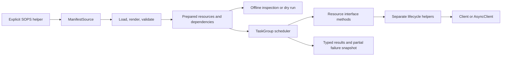

# Implementation Plan: Reusable SDK Applier

**Branch**: `feat/apply` | **Date**: 2026-10-09 | **Spec**: [spec.md](spec.md)

**Input**: Feature specification from `specs/001-sdk-applier/spec.md`.

The feature key is `001-sdk-applier`, resolved from `.specify/feature.json`; setup reports that key as `BRANCH`. The actual Git branch remains `feat/apply`. No branch change is required.

## Summary

Add reusable `Applier` and `AsyncApplier` workflows for the 12 resource kinds in the specification. Provide common resource methods through a field-free ResourceMethods mixin, with explicit model overrides for resource-specific client calls and special cases. Share helper functions in a separate package without introspection or inferred client method names. Non-empty live apply/delete calls receive a caller-supplied Client or AsyncClient; constructors accept source/options only, and Applier does not create, close, or retain clients. A shared TaskGroup scheduler enforces dependency order, bounded workers, reverse deletion, failure cleanup, and inspectable partial results. Retain a per-resource MutationJournal, explicitly passed through ResourceContext, so completed and unconfirmed writes survive raised exceptions or cancellation. Load and render YAML/JSON independently of execution; previews require no client. Provide explicit sync/async SOPS helpers returning secret-value mappings.

Sync workflows honor a supplied `Client` and block during its calls; only async workflows promise concurrent HTTP progress. Neither mode uses ThreadPool or offloads resource operations to threads. The existing one-operation clients and their payload contracts remain intact.

## Technical Context

**Language/Version**: Python >=3.13, matching `pyproject.toml`; validate on the existing Python 3.13/3.14 CI matrix.

**Primary Dependencies**: Existing httpx, Pydantic v2 through pydantic-settings, PyYAML, and standard `asyncio`, `graphlib`, `subprocess`, `json`, and `pathlib`. Add `jinja2>=3.1.6` and regenerate the tracked dependency lockfile. No rio, older SDK, Ansible, Graphviz, spinner, or SOPS Python package dependency.

**Storage**: In-memory prepared resources/results; read caller-selected files. No SDK-written decrypted files or persistent Applier state.

**Testing**: Existing pytest, pytest-asyncio, pytest-mock, coverage, and HTTPX controlled transports; deterministic event/response fixtures for scheduler and readiness cases; isolated subprocess fixtures for SOPS. No platform credentials required for automated tests.

**Target Platform**: Existing SDK environments on Python-supported host operating systems. SOPS execution additionally requires a caller-installed command and configured credentials; ordinary loading/preview does not. Async subprocess use follows the host event loop's subprocess support.

**Project Type**: Typed Python SDK with separate orchestration helpers.

**Performance Goals**: During async execution, two independent operations overlap at worker limit two; never exceed the configured number of active resources; unrelated async work progresses during HTTP, polling, and decryption waits. Sync execution has no HTTP-overlap guarantee. No speculative throughput or wall-clock SLA. Both existing HTTP pools cap connections at five independently of the default six resource workers.

**Constraints**: TaskGroup workers; default six workers and 50 readiness checks at six-second intervals; no platform access for preview; no context-setter side effects; no hidden login; borrowed clients stay open; all workers/processes settled before return; no rollback or arbitrary write retries; model serialization and omission semantics preserved; pinned Ruff 0.16.9 checks pass.

**Scale/Scope**: Finite caller-supplied collections, 12 kinds, one selected target scope per operation, versioned package identities, composite role-binding identities, external prerequisites, structured outcomes, and optional encrypted YAML/JSON secret-value files. Source parsing remains local synchronous preparation; async execution guarantees non-blocking remote waits rather than asynchronous disk parsing.

## Constitution Check

*Gate evaluated before research and re-evaluated after the Phase 1 design below.*

| Principle or constraint | Before research | After design and evidence |
| --- | --- | --- |
| I. Modern Python SDK | Pass: supported Python and typed public surface retained | Pass: paired typed methods, explicit typed progress/context contract, documented failures, and existing 3.13/3.14 test matrix |
| II. One-to-one clients | Pass: workflows planned outside client modules | Pass: ResourceMethods calls declared override hooks and named helper functions composing existing single-operation methods; no introspection or client orchestration methods |
| III. Validated request/response models | Pass: all covered client operations already modeled | Pass: SecretCreate, UserGroupCreate, BulkRoleBindingUpdate and resource models used with exact client contracts; no raw platform payload dictionaries |
| IV. Separate higher-level modules | Pass: separate apply package selected | Pass: scheduler, rendering, readiness, special lifecycle cases, and decryption outside client modules |
| V. Ruff compliance | Pass: required checks and limits retained | Pass by design: option/context objects constrain signatures, kind-specific handlers constrain complexity; implementation must run both pinned checks without blanket suppressions |
| Package/model/wire identity | Pass: additive methods planned | Pass: field-free mixin, ClassVar capability metadata, and typing-only Protocol introduce no serialized resource fields; runtime context progress excluded from dump/repr/JSON Schema; arbitrary type allowance applies only to new ResourceContext, not SDKModel; aliases remain; source-kind normalization is loader-only |
| Review/verification governance | Pass: API/model impact identified | Pass: operation matrix and request/response/regression validation are specified in contracts and quickstart |

No proposed constitution exceptions or amendments. The existing synchronous authentication methods on AsyncClient and lack of public client cleanup APIs are recorded integration limitations; this feature neither invokes authentication nor expands those contracts. Optional Network response fields remain optional; stricter manifest checks live in preflight. These findings do not establish exceptions for modified code.

## Project Structure

### Documentation (this feature)

```text
specs/001-sdk-applier/
├── spec.md
├── plan.md
├── research.md
├── data-model.md
├── quickstart.md
├── contracts/
│   ├── applier-api.md
│   ├── resource-interface.md
│   ├── resource-progress.md
│   └── sops-helper.md
├── tasks.md
└── checklists/
    ├── requirements.md
    └── api.md
```

The existing `tasks.md` is preserved, with affected descriptions reconciled to the clarified design. This follow-up plan does not generate a new task list or implement it. Reviewer-owned checklist markers remain unchanged.

### Source Code (repository root)

Proposed implementation paths:

```text
rapyuta_io_sdk_v2/
├── __init__.py                   # additive public exports
├── apply/
│   ├── __init__.py               # helper exports
│   ├── applier.py                # Applier and AsyncApplier facades with per-call clients
│   ├── source.py                 # ManifestSource and source type aliases
│   ├── errors.py                 # preflight, execution, readiness, SOPS errors
│   ├── secrets.py                # explicit sync/async SOPS helpers
│   ├── _loader.py                # parse, render, merge, source validation
│   ├── _graph.py                 # identities, aliases, preflight graph
│   ├── _scheduler.py             # shared TaskGroup scheduler and result recording
│   ├── _readiness.py             # shared evaluators with sync/async polling
│   ├── _lifecycle.py             # shared policies using explicitly supplied callables
│   └── _resources/
│       ├── standard.py          # shared typed scope and mutation utilities
│       ├── usergroup.py         # exact scoped UserGroup GUID lookup
│       ├── project.py           # GUID resolution and Docker cache workflow
│       ├── rolebinding.py       # exact binding lookup and bulk grant/revoke
│       └── staticroute.py       # logical/server name resolution
└── models/
    ├── applier.py                # typed identity/context/options/results
    ├── progress.py               # MutationAttempt and concrete MutationJournal
    ├── resource.py               # field-free ResourceMethods mixin and typed protocol
    └── existing resource files   # explicit hooks/special-case overrides; preserve fields

tests/
├── apply/
│   ├── test_loading.py
│   ├── test_graph.py
│   ├── test_progress.py
│   ├── test_resource_interface.py
│   ├── test_lifecycle.py
│   ├── test_scheduler.py
│   ├── test_cancellation.py
│   ├── test_readiness.py
│   ├── test_deletion.py
│   ├── test_rolebinding.py
│   ├── test_preview.py
│   ├── test_sops.py
│   └── test_client_ownership.py
└── test_model_contracts.py       # existing serialization/typed-client regressions

examples/applier/
├── offline_preview.py
├── sync_apply.py
├── async_apply.py
└── encrypted_secrets.py
```

**Structure Decision**: Use the existing repository package and test layout, adding a dedicated helper package. ResourceMethods implements common lifecycle policy, retention, default identity/dependencies, and unsupported-operation defaults. Each resource owns its ordinary paired create/update/delete endpoint implementations and declares typed capability metadata and explicit dependency hooks. Disk, Network, Project, and Deployment own readiness state interpretation. Shared helpers provide scope reconciliation, private copies, mutation recording, and polling; resource-specific multi-call workflows provide Project provisioning, StaticRoute canonical resolution, RoleBinding matching, and UserGroup GUID lookup. A typing-only Resource protocol supports static checking. Normal virtual-method calls and typed helpers replace introspection or runtime operation registries. Function-local imports at explicit helper call sites prevent import cycles. Only helper input values are mappings; platform requests/responses stay in existing validated model modules. Public result/options models live under `models`. There is no new service or storage layer.

## Phase 0: Research Outcome

[research.md](research.md) resolves execution modes, TaskGroup failure/cancellation semantics, model interfaces and identity, client ownership, template dependencies, SOPS command lifecycle, resource mappings, readiness, the explicit mutation journal, and validation timing. Follow-up research checked the proposed excluded runtime context field against the installed Pydantic version and its documentation. All decisions have rationale, alternatives, and repository or primary-documentation evidence. No unresolved planning clarification remains.

## Phase 1: Design

### Data flow and public surface



The exact public signatures and behavior are in [Applier API](contracts/applier-api.md), [Resource interface](contracts/resource-interface.md), [Mutation progress](contracts/resource-progress.md), and [SOPS helper](contracts/sops-helper.md). Fields, validation, and state transitions are in [data-model.md](data-model.md).

### Preparation and identity

Construction freezes input iterables into owned snapshots, deep-copies supplied resource models, merges values, renders, validates supplied modeled fields and identities, and uses a fixed kind-to-model mapping only for parsing manifests. Reject unsupported kinds, missing identity, ambiguous local aliases, duplicates and cycles during common local preparation. Files contain one JSON resource or multiple YAML documents; plain values contain one mapping. Preparing a valid resource does not select apply or delete, so unsupported deletion alone does not prevent preparing an Organization.

Each apply/delete call, including preview, then validates its requested capabilities, operation-specific request conversion and required payload fields before mutation. Apply selects/revalidates SecretCreate and UserGroupCreate while preserving creation-only values; inspection/delete do not require creation-only credentials on response instances. Retention skips unsupported deletion as documented. Live calls additionally validate client/authentication/scope before platform requests and rebind scope-aware identities; previews omit those live-context checks. Lifecycle methods are ordinary calls on the typed interface, with no operation discovery registry.

Use structured identity tuples for equality; string keys are display-only. Preserve exact names/versions, including delimiters. Match package references by version plus name or known GUID; match normal references by name or known GUID within effective scope. Leave absent references external. Resource dependency discovery includes explicitly referenced package secrets, deployment runtime prerequisites and service accounts/secret references, explicit deployment waits, and membership/binding references. Existing legacy string dependency APIs do not drive the graph.

### Execution and result handling

Build fresh managed edges per apply/delete. For delete, reverse edges and retain all input nodes, including retained nodes that finish with a retained outcome. Execute each ready cohort using no more than the configured number of TaskGroup workers. A resource finishes only after its required readiness checks, bounded per target in polling rounds; paginated lookup requests within a round do not consume additional rounds. The next cohort starts after all successful current work settles. On failure, set a stop flag, cancel siblings, record failed/cancelled/unstarted resources, and raise ApplierExecutionError with a complete immutable result. Preserve caller cancellation and publish `last_result` after settlement. An independently cancelled child must be detected and treated as incomplete execution: stop scheduling, settle peers, and raise an identified execution failure rather than hanging or marking it done. No rollback.

ResourceMethods provides paired common synchronous/asynchronous lifecycle methods and calls explicit resource override hooks. Ordinary resource methods name the client endpoint and wrap it with shared scope/copy/mutation utilities; they do not delegate a single write to a separate kind-specific function. Secret and UserGroup request conversion belongs to their models. Multi-call workflow helpers retain identity resolution, matching, and provisioning sequences. Disk, Network, Project, and Deployment expose `readiness_state()`; shared sync/async polling consumes a typing-only readiness interface and handles absent observations centrally. ClassVar capabilities identify supported behavior; common code calls declared methods or explicit typed callables, without getattr/hasattr/reflection or client method-name inference. Sync polling blocks; async polling awaits. A scheduler adapter invokes the corresponding resource `apply` or `delete_object` method. Do not call synchronous entry points from an async workflow or nest asyncio.run inside a resource method.

Allocate one fresh MutationJournal per resource operation and retain it in the scheduler outside the resource method. Supply the exact recorder through optional ResourceContext.progress, excluded from context serialization, repr and JSON Schema. Named write helpers synchronously record started immediately before invocation, completed immediately after a validated successful response, rejected only after a definitive no-effect response, and uncertain for cancellation or an unconfirmed effect. Outer policy must not duplicate helper entries; nested operations share one recorder. No journal stores clients, payloads, responses, exceptions or callbacks, and no ContextVar or introspection is needed.

After worker settlement, construct completed_actions from completed journal entries and write_uncertain from uncertain or unfinished entries, even if the resource never returned an outcome. Cancellation during readiness preserves prior confirmed steps without making them uncertain. Successful outcomes use the same snapshot; reconcile rather than append duplicates. Publish immutable results and release all runtime journals/contexts; keep the original CancelledError unchanged. Direct callers can supply and retain a fresh recorder through ResourceContext when they need progress after failure/cancellation; otherwise resource methods create a local one. The journal's exact signatures, transitions and exclusions are in [resource-progress.md](contracts/resource-progress.md).

### Scope, lookup, and lifecycle special cases

Receive the client in each apply/delete call and resolve scope from explicit options over that client's configuration defaults. Constructors only prepare source/options; no client is stored on the Applier. Build fresh scope, lookup caches, GUID resolution, and server routing names for each call, so sequential reuse with another client cannot inherit execution context. Identity uses project scope only for project-scoped kinds; Organization, Project, UserGroup, Role, RoleBinding, and ServiceAccount do not inherit the selected project into their identity. The exact scope matrix is in data-model.md. Use endpoint-appropriate routing/header options and copy payloads. Resource metadata identifying the object itself and role-binding domains are data, not permission to switch the active project. Reject conflicting routing metadata except the Project workflow's documented population of selected organization on its private payload. Do not persist selection or login.

Exact-name/GUID lookup walks continuation pages and rejects multiple matches. Organization requires an identified GUID; Project/UserGroup resolve GUIDs where endpoints require them. RoleBinding checks its exact grant, adds only `new_bindings` when absent, and revokes only `old_bindings` when present. A cache-enabled absent Project is created with caching disabled and then updated using the full original feature request. StaticRoute resolution separates a logical manifest name from the platform-suffixed routing name and does not append the suffix twice.

### Optional secret decryption

SOPS helpers are explicit utilities, independent of Applier constructors, preview, client configuration, and platform requests. Once returned and supplied to ManifestSource, decrypted mappings are ordinary input data with no special redaction or protection in Applier. Use an executable argument vector, request JSON stdout, validate a mapping, and return it for the caller's `secrets` sources. Async process ownership handles cancellation during spawn, running work, and cleanup. Source and category diagnostics omit command output and parser excerpts. Do not create plaintext files or change source files.

### Verification and completion criteria

The [quickstart guide](quickstart.md) defines commands and expected observations for offline loading, sync/async parity, dependency/version matching, worker bounds, retention and absence, all lifecycle mappings, partial failures, cancellation, SOPS failures, and model compatibility. Use controlled platform responses, event barriers, and a fake local executable; avoid timing-only concurrency assertions. Existing full tests and pinned Ruff gates remain required during implementation.

Deliver documentation and runnable examples without rio installed. Update README public usage and dependency lockfile only as implementation changes require. This follow-up changes specification/design wording and synchronizes affected existing task descriptions; it performs no SDK implementation, implementation test suites, CLI migration, deployment, or new task generation.

### Analysis finding resolution

| Finding | Clarified contract |
| --- | --- |
| U1: progress on raised failure/cancellation | Explicit per-resource MutationJournal survives outside the call; context reference is runtime-only; direct callers may retain their own recorder. |
| A1: concurrency scope | SC-005 and performance goals explicitly apply overlap to async execution; sync uses the same lifecycle settings without promising overlapping HTTP. |
| A2: validation timing | Constructors perform common local preparation; requested operation and apply-specific payload checks occur at apply/delete/preview preflight. |
| I1: earlier checklist notes | Built-in notes now describe FR-001–FR-019, SC-001–SC-008 and optional SOPS scope; checkbox states and reviewer ownership are preserved. |
