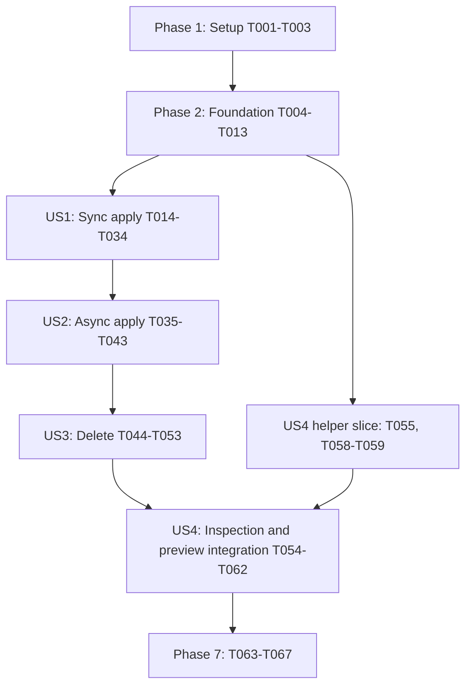

# Tasks: Reusable SDK Applier

**Input**: Design documents from `/home/ankit/Projects/Work/rapyuta-io-sdk-v2/specs/001-sdk-applier/`.
**Prerequisites**: [plan.md](plan.md), [spec.md](spec.md), [research.md](research.md), [data-model.md](data-model.md), [contracts/](contracts/), and [quickstart.md](quickstart.md).
**Tests**: Included because the specification explicitly requires resource conformance in FR-006, compatibility checks in FR-017, acceptance scenarios, and measurable outcomes. Controlled transports and subprocess fixtures require no platform or decryption credentials. Write the listed story tests before their implementation and establish the relevant failure; rerun them at each checkpoint. Existing regressions must remain green.
**Organization**: Tasks follow the four user stories in specification priority order. Common parsing and graph preparation are foundational because live apply requires them; inspection, previews, and explicit decryption belong to US4. Paired resource hooks are delivered with US1 so US2 can reuse them without repeating model edits. Deletion hooks become operational in US3.

## Format: `[ID] [P?] [Story] Description`

- Every task starts unchecked and has one sequential ID.
- `[P]` identifies work that can run alongside the listed tasks in its batch after shared prerequisites finish; it does not waive those dependencies.
- `[US1]` through `[US4]` map to the specification's user stories. Setup, foundation, and polish have no story label.
- All implementation paths are relative to `/home/ankit/Projects/Work/rapyuta-io-sdk-v2/`. Paths below name deliverables, including files to be created.
- Follow the contracts for exact signatures and endpoint arguments. Workflow logic stays outside `client.py` and `async_client.py`; no new platform operations are required.

## Phase 1: Setup (Shared Infrastructure)

**Purpose**: Prepare the existing package and controlled verification infrastructure.

- [X] T001 Add `jinja2>=3.1.6` to `pyproject.toml` and regenerate `uv.lock`; retain Python >=3.13, the 3.13/3.14 verification matrix, and pinned Ruff 0.16.9 without weakening configuration.
- [X] T002 Create the helper package skeleton in `rapyuta_io_sdk_v2/apply/__init__.py` and `rapyuta_io_sdk_v2/apply/_resources/__init__.py`, and establish the planned `tests/apply/conftest.py` and `examples/applier/` locations with repository license/style conventions; defer public imports until their modules exist.
- [X] T003 Build isolated fixtures in `tests/apply/conftest.py` for caller-configured Client/AsyncClient with controlled HTTPX responses, request accounting, typed resources for all 12 kinds, event barriers, and a configurable fake SOPS executable; use dummy credentials and avoid real platform/SOPS dependencies.

**Checkpoint**: Package layout and deterministic verification fixtures are available.

## Phase 2: Foundational (Blocking Prerequisites)

**Purpose**: Define shared typed contracts and locally prepare immutable resources and dependency data.

**Dependency**: Finish T001–T003 before this phase. All user stories depend on T004–T013.

- [X] T004 Define frozen/hashable ResourceScope, ResourceReference, ResourceIdentity, DependencyReference, and ResourceCapabilities in `rapyuta_io_sdk_v2/models/applier.py`; preserve the data-model constraints verbatim: scope identifiers are "optional non-empty string"; references "Require name or GUID. Preserve exact spelling of names, GUIDs and versions. Package references require non-empty version."; "Named resources require name. RoleBinding requires typed subject and domain kinds plus reference identifiers, rather than metadata.name."; "Structured tuples establish equality; display keys never get parsed for identity."; dependency `wait: bool=false`, "Wait applies to explicit deployment readiness references. Deduplicate identical edges; do not discard different versions."; capabilities use `create_or_update/create_or_exists/update_only/grant` and are "Immutable metadata, not serialized platform fields." Include normalized lower-case kinds and the documented per-kind scope matrix. Also define frozen MutationAttempt and concrete MutationJournal in `rapyuta_io_sdk_v2/models/progress.py`: sequence is a "positive non-boolean integer"; action is "created/updated/deleted/revoked"; state is "started/completed/rejected/uncertain". Implement the begin/complete/reject/mark_uncertain/snapshot signatures, one-pending-write transitions and detached immutable snapshots from `specs/001-sdk-applier/contracts/resource-progress.md`; store no client, payload, response or exception, and import no clients/apply/resource modules.
- [X] T005 Define ReadinessOptions, ApplierOptions, and ResourceContext in `rapyuta_io_sdk_v2/models/applier.py` with `checks=50`, `interval=6.0`, `workers=6`, and fresh nested defaults; retain "checks >=1; interval finite and >=0." and "Positive non-boolean integer workers."; "Count polling rounds per readiness target, not retries of writes. Paginated lookup within a round is part of that round. Check immediately; each target has at most checks-1 between-round sleeps."; context is a "Frozen typed argument to direct resource lifecycle methods. Clients are supplied separately, not stored or serialized in context."; client timeout/pool settings are not overridden. Add optional progress: MutationJournal | None = None as an exact runtime reference, using SkipJsonSchema over the entire optional field plus Field(exclude=True, repr=False) and arbitrary_types_allowed on ResourceContext only; existing SDKModel and payload configuration stay unchanged. Freeze/snapshot scope and readiness values; the recorder alone is intentionally mutable for this call.
- [X] T006 Define SourceLocation, OperationFailure, ResourceOutcome, ApplierResult, DependencyGraph, and InspectionResult in `rapyuta_io_sdk_v2/models/applier.py`; preserve "One result for every managed input resource, ordered by input rather than worker completion. Outcomes contain lifecycle data rather than raw resource payloads." and "Immutable snapshot. Successful includes exists/absent/retained and valid plans; failure or incomplete work makes live execution unsuccessful." Use `operation: apply/delete`, the nine documented outcome statuses, `cancelled/blocked/not_started` incomplete reasons, `create_or_update/create_or_exists/update/grant` apply plans and `delete/revoke` delete plans; carry completed actions and write uncertainty. Graphs retain external-reference metadata, and inspection follows "Explicit inspection can contain resolved secret values. SDK does not print or persist it automatically."
- [X] T007 [P] Define frozen ManifestSource and source/prepared type aliases in `rapyuta_io_sdk_v2/apply/source.py` after T004–T006; accept optional empty-default `files/resources/values/secrets/rio`, str/Path inputs and ordered iterable sources; preserve "Snapshot iterables on construction. Files and resource instances can be combined. Values are merged first, explicit secrets and rio become reserved namespaces. Supplied secret values, including decrypted mappings, are ordinary input data without secret-specific repr exclusion or redaction." Source diagnostics retain path/instance and document index without file contents.
- [X] T008 [P] Define ApplierValidationError, ApplierUsageError, UnsupportedResourceOperationError, MissingResourceContextError, ApplierExecutionError, ReadinessError, and SopsDecryptionError in `rapyuta_io_sdk_v2/apply/errors.py` after T004–T006; expose documented source/resource/stage/categories and immutable partial results, with "Never contains stdout/stderr or chained decoded-content/parser exceptions." for decryption errors only. General Applier errors use ordinary SDK diagnostics without secret-specific redaction; structured outcomes do not copy arbitrary response bodies.
- [X] T009 [P] Add foundational parsing contract tests in `tests/apply/test_loading.py` after T007–T008: files and instances, multi-document YAML, one JSON resource, empty input/documents, invalid source/kind/version, ordered nested merging, reserved contexts, strict undefined values, source-aware diagnostics, and zero client/SOPS access. Add `tests/apply/test_progress.py` for journal sequences/transitions, empty and detached immutable snapshots, programmer-error transitions, exact context recorder identity, and exclusion from model_dump/model_dump_json/repr and validation/serialization JSON Schema. These tests use the foundational model/recorder types without concrete resource methods.
- [X] T010 [P] Add foundational identity/graph contract tests in `tests/apply/test_graph.py` after T007–T008 using explicit typed identity/dependency records from fixtures, without requiring unfinished resource methods: two package versions and delimiter-containing names, composite RoleBinding identity, kind normalization, per-kind scope, known GUID aliases, ambiguity, duplicates, cycles/self-edges, and external references that never become managed mutation nodes. Concrete model dependency extraction is covered by US1/US4 tests.
- [X] T011 Implement preparation in `rapyuta_io_sdk_v2/apply/_loader.py`: safe YAML/JSON parsing, source attribution, a fixed kind-to-model map used only for parsing, recursive ordered values merge with list/scalar replacement, and explicit `rio/secrets`; use ImmutableSandboxedEnvironment, StrictUndefined, `autoescape=False`, and no filesystem loader or CLI filters. Preserve "Plain YAML/JSON value sources must contain exactly one string-keyed mapping" and "Empty value mappings are valid." Snapshot/deep-copy caller resources and unset state, retain creation-only fields, allow response-only Secret/UserGroup for inspection/delete, and defer operation-specific create validation to apply preflight; do not tighten response schemas globally.
- [X] T012 Implement canonical preparation graph handling in `rapyuta_io_sdk_v2/apply/_graph.py` over supplied typed identity/dependency records: unresolved offline identities, managed-only nodes, dependency deduplication, known local name/GUID aliases, scope-aware matching, duplicate/cycle validation, and external metadata. Follow "Created without clients or network. Graph state is recreated per operation. Inspection returns independent copies, not internal mutable data." Keep this core independently usable before concrete resource methods exist; T031 integrates those methods by passing their declared identity/dependency results, without a discovery registry. Preserve every declared relationship/version and legacy `list_dependencies` contracts.
- [X] T013 Run `uv run --python 3.13 pytest tests/apply/test_loading.py tests/apply/test_graph.py tests/apply/test_progress.py` and validate the new source/options/result models against `specs/001-sdk-applier/data-model.md`, extending assertions in those test files for frozen values, exact constraints, source-aware errors, and unchanged caller input; finish the foundation before story implementation. Include `tests/apply/test_progress.py` in this checkpoint and validate the context runtime-field exclusions without changing existing model configuration.

**Checkpoint**: Files and modeled resources can be prepared and locally validated without clients or platform access; foundational tests pass.

## Phase 3: User Story 1 — Apply from a synchronous application (Priority: P1, MVP)

**Goal**: Provide standalone synchronous apply for every covered kind, preserving modeled requests, dependency readiness, client ownership, and inspectable partial outcomes.

**Independent Test**: Use a supplied Client and controlled responses to apply Package→Deployment and all 12 resource policies; assert version-aware dependency completion, create/update/exists distinctions, exact payloads, and unchanged/open caller client and input resources. Sync HTTP overlap is not required.

### Tests for User Story 1

- [X] T014 [P] [US1] Add paired apply-side resource interface conformance tests in `tests/apply/test_resource_interface.py` for all 12 kinds, explicit apply-capability agreement, empty/direct dependencies including every modeled branch, immutable inputs, modeled request/response types, unsupported create/update operations, and common mixin versus special overrides without introspection; cover direct sync methods and awaitable resource counterparts independently of a collection facade, including optional source attribution on direct outcomes. Supported delete-hook conformance is added in US3. Cover direct paired lifecycle calls with an explicitly supplied fresh journal: read earlier completed steps after failure or the original cancellation; no partial-result cancellation wrapper, response payload or client enters the journal.
- [X] T015 [P] [US1] Add synchronous collection/lifecycle tests in `tests/apply/test_lifecycle.py` covering absent/existing resources, creation-conflict and creation-denied update fallback, denied immutable-resource creation, Organization update-only, credential-bearing SecretCreate, UserGroup membership preservation, Project cache bootstrap/partial writes, exact RoleBinding grant matching, and StaticRoute logical/canonical names. Assert journal-derived completed_actions for Project create success/update failure and create/update success/readiness failure, with no duplicate actions or lost prior writes.
- [X] T016 [P] [US1] Add paired readiness tests in `tests/apply/test_readiness.py` covering all documented ready/terminal states, delayed/missing resources or status, every explicit deployment wait target, per-target budgets and immediate first round, paginated round accounting, repeated continuation tokens, exhaustion, and no retries of writes.
- [X] T017 [P] [US1] Add sync facade ownership/preflight tests in `tests/apply/test_client_ownership.py` for client supplied to apply rather than construction, exact instance use, missing/wrong-mode clients, no authentication/context setters/client construction/closure, private scope population, pinned-scope conflicts, reuse across two client scopes, no retained client/cache references, empty results, and active-loop rejection before coroutine creation or platform work. Assert common construction succeeds for a valid Organization and for response-only Secret/UserGroup instances before requested-operation checks; apply conversion/capability errors remain preflight, and journals/client-derived state are fresh per call.

### Implementation for User Story 1

- [X] T018 [US1] Implement paired common apply policy in `rapyuta_io_sdk_v2/apply/_lifecycle.py` and explicitly named create/update/scoped lookup helpers in `rapyuta_io_sdk_v2/apply/_resources/standard.py`; compose existing typed client methods through explicit callables, preserve unset/null fields on private copies, catch only the documented conflict/permission fallback, and record successful mutations before later steps fail. Do not use inferred method names, class-to-operation registries, runtime reflection, thread executors, or hidden write retries. Instrument every actual write in its named helper through ResourceContext.progress: begin immediately before invocation, complete immediately after validated success, reject only a documented definitive no-effect error, otherwise mark uncertain and re-raise the original error/cancellation. Bookkeeping does no await/callback/logging/platform work. Outer policies create a local journal when none was supplied, propagate one exact reference to nested helpers, and never duplicate completed actions.
- [X] T019 [US1] Implement shared status evaluators plus blocking/awaitable polling in `rapyuta_io_sdk_v2/apply/_readiness.py`: Disk Available/Released versus Failed; Network Succeeded versus Stopped/FailedToStart/FailedToUpdate/Error/DEP_E153; Project Success versus Error; waited Deployment Running versus Error/Stopped or failed/stopped phase. Use exact scoped paginated reads, independent target budgets, immediate observation and at most checks-1 sleeps, missing data pending until exhaustion, repeated-token rejection, and native async waits. Readiness/read helpers never create write attempts; cancellation during polling leaves earlier confirmed mutations completed and certain.
- [X] T020 [US1] Implement field-free ResourceMethods and a typing-only Resource protocol in `rapyuta_io_sdk_v2/models/resource.py`: default named identity, empty dependencies, declared ClassVar capabilities, known metadata retention access, paired unsupported create/update/delete-hook defaults, and common paired apply policy. Define `_delete_object/_delete_object_async` hooks with the contracted None result; US3 will complete deletion outcome handling. Normal override dispatch is allowed; `getattr/hasattr/inspect/dir`, dynamic method inference and runtime protocol checks are not. Use explicit local helper imports where necessary to avoid client/model import cycles.
- [X] T021 [P] [US1] Implement paired Project apply workflows in `rapyuta_io_sdk_v2/apply/_resources/project.py` after T018–T020: exact paginated name/GUID resolution within organization, private organization/GUID population, normal create/update fallback, cache-enabled existing update, and absent cache-enabled base create with caching disabled followed by full feature update. Handle create races by resolving and updating, await provisioning, and retain each successful write in partial results. Use one shared per-call journal through base creation, full update and readiness; capture confirmed earlier steps before later failures without wrapping cancellation.
- [X] T022 [P] [US1] Implement paired exact RoleBinding lookup/grant helpers in `rapyuta_io_sdk_v2/apply/_resources/rolebinding.py` after T018–T020: typed list filters, pagination/ambiguity handling, all supplied role/subject/domain selectors, known GUID verification, and mixed name/GUID reconciliation without whole-reference equality. For GUID-only roles omit role_names filtering, match GUIDs or resolve response-only names via get_role/list_roles. Present grants yield exists; absent grants use BulkRoleBindingUpdate(new_bindings=[binding], old_bindings=[]) and yield created.
- [X] T023 [P] [US1] Implement paired StaticRoute routing/apply helpers in `rapyuta_io_sdk_v2/apply/_resources/staticroute.py` after T018–T020: separate logical identity from canonical server name, resolve organization short GUID only from explicit scope or execution get_organization, exact get_staticroute(name)/list_staticroutes(names=[...]), no double suffix, logical-name creation and canonical-name update; never resolve live names during local preparation.
- [X] T024 [P] [US1] Add ResourceMethods, typed capabilities, paired supported create/update methods, explicit special apply overrides, and membership/cache-secret/external-device dependencies in `rapyuta_io_sdk_v2/models/organization.py` and `rapyuta_io_sdk_v2/models/project.py` after T021–T023; Organization is update-only by GUID, Project uses selected organization and target identity without selected-project contamination; preserve existing fields and serialization.
- [X] T025 [P] [US1] Add the mixin, versioned identity and explicit paired create-only apply hooks/dependencies in `rapyuta_io_sdk_v2/models/package.py` and `rapyuta_io_sdk_v2/models/deployment.py` after T021–T023; keep packages distinct by version, include pull secrets and all deployment package/volume/static-route/network/device/service-account/secret-key/explicit wait references, and do not invoke the existing Deployment update API.
- [X] T026 [P] [US1] Add the mixin, explicit paired create-only apply hooks, readiness capabilities, and modeled device-runtime dependencies in `rapyuta_io_sdk_v2/models/disk.py` and `rapyuta_io_sdk_v2/models/network.py` after T021–T023; absent response-only fields stay optional, executable manifest requirements are checked separately, and existing resources yield exists without updates.
- [X] T027 [P] [US1] Add the mixin and paired mutable apply hooks/dependencies in `rapyuta_io_sdk_v2/models/secret.py` and `rapyuta_io_sdk_v2/models/usergroup.py` after T021–T023; use SecretCreate for both create/update returning Secret, retain device references, use UserGroupCreate on create and a validated GUID-bearing UserGroup on update, preserve explicit memberships/roles, and keep response variants usable for later inspect/delete.
- [X] T028 [P] [US1] Add the mixin, typed capabilities, paired create/update hooks, and explicitly modeled dependencies in `rapyuta_io_sdk_v2/models/role.py` and `rapyuta_io_sdk_v2/models/serviceaccount.py` after T021–T023; scope identities to organization, preserve Role's empty dependencies where appropriate, and retain service-account role/domain references.
- [X] T029 [P] [US1] Add the mixin, composite binding identity/role-subject-domain dependencies and paired grant override in `rapyuta_io_sdk_v2/models/rolebinding.py`, and paired canonical-routing apply overrides in `rapyuta_io_sdk_v2/models/staticroute.py`, after T021–T023; do not synthesize RoleBinding metadata.name or serialize any capabilities/client/cache state.
- [X] T030 [US1] Implement the common TaskGroup apply scheduler and ordered result recorder in `rapyuta_io_sdk_v2/apply/_scheduler.py`: fresh TopologicalSorter, managed-only edges, ready-cohort barriers, at most workers queue-draining tasks including readiness, sync resource calls through an explicit adapter, and done only after successful completion. Set stop before propagating worker failure, settle peers, report failed/cancelled/blocked/unstarted outcomes and completed/uncertain writes, aggregate execution errors, and publish immutable input-order snapshots without rollback or threads. Retain fresh journals for managed resource operations outside each lifecycle call, pass them explicitly in worker ResourceContext, and read them after settlement even when no ResourceOutcome returned. Derive completed_actions from completed attempts and write_uncertain from uncertain/still-started attempts; reconcile successful outcomes without appending duplicates, copy only immutable values into results, and release journals/contexts after settlement.
- [X] T031 [US1] Implement the synchronous Applier constructor and live apply path in `rapyuta_io_sdk_v2/apply/applier.py`: source/options-only local preparation, ordinary calls to each model's declared identity/dependency methods feeding the foundational graph, call-time Client, operation-specific request/capability validation including Secret/UserGroup create variants, explicit scope over client defaults, endpoint-specific scope arguments, fresh per-call aliases/GUID/routing state and private payloads. Reject missing context, wrong mode, conflicting routing, simultaneous facade calls, and active event loop before work; use asyncio.run for the shared scheduler without nesting resource runners, release operation-local references, leave clients open, and update last_result only after settlement.
- [X] T032 [US1] Add implemented sync facade, source, result/options/context and helper-error exports in `rapyuta_io_sdk_v2/__init__.py`, `rapyuta_io_sdk_v2/apply/__init__.py`, and `rapyuta_io_sdk_v2/models/__init__.py`; preserve existing exports and import-cycle behavior, without exporting unfinished async/SOPS entry points. Export MutationAttempt and MutationJournal from `rapyuta_io_sdk_v2/models/__init__.py` for the explicit ResourceContext progress contract.
- [X] T033 [US1] Add standalone synchronous apply/result/error handling in `examples/applier/sync_apply.py` using explicit caller configuration, client passed to apply, source paths and worker/readiness options; demonstrate safe caller cleanup without pretending the SDK has a public close API, and avoid rio imports, implicit login, or automatic platform access on import.
- [X] T034 [US1] Run `uv run --python 3.13 pytest tests/apply/test_resource_interface.py tests/apply/test_lifecycle.py tests/apply/test_readiness.py tests/apply/test_client_ownership.py tests/test_model_contracts.py`; resolve US1 failures in the named source/test files, establish all 12 modeled policies and Package→Deployment ordering, and verify standalone imports for `examples/applier/sync_apply.py` without invoking a real platform.

**Checkpoint**: US1 is independently demonstrable as the sync apply MVP. Paired resource methods are ready for the async facade; collection delete, inspection/preview, and SOPS remain later increments.

## Phase 4: User Story 2 — Apply from an asynchronous application (Priority: P1)

**Goal**: Expose native async collection execution with lifecycle parity, bounded overlap, robust failure/cancellation, and safe sequential reuse.

**Dependency**: US1's shared policies, paired resource hooks, scheduler, and facade preparation must be complete.

**Independent Test**: With three independent resources and workers=2, two awaitable operations overlap while a third waits and unrelated work progresses. Dependents start only after readiness; failures and repeated cancellation leave no post-return requests, and completed/uncertain effects remain inspectable.

### Tests for User Story 2

- [X] T035 [P] [US2] Add deterministic scheduler tests in `tests/apply/test_scheduler.py` using event barriers for workers=1/2, unrelated application progress, cohort barriers including readiness, version-aware dependency release, no external mutation, fresh sorter state, and complete input-order results.
- [X] T036 [P] [US2] Add failure/cancellation tests in `tests/apply/test_cancellation.py` for simultaneous failures, queued versus blocked work, cancellation during reads/writes/readiness, successful earlier mutation steps, uncertain interrupted writes, independently cancelled children, repeated caller cancellation, settled last_result and zero requests after return; prove no sorter hang or dependent release on incomplete work. Cover cancellation after a successful Project create but during update, cancellation during later readiness without false uncertainty, response-validation failure with an unconfirmed effect, rejected-create/update fallback, immutable isolated journals, and original cancellation propagation without exception mutation.
- [X] T037 [US2] Extend `tests/apply/test_lifecycle.py` with equivalent modeled sync/async apply cases for every kind, exact argument/payload parity, matching failure categories and special workflows; only independent completion order may differ.

### Implementation for User Story 2

- [X] T038 [US2] Complete the native async resource adapter and cancellation coordination in `rapyuta_io_sdk_v2/apply/_scheduler.py`: await paired resource methods, stop peer scheduling on independent child cancellation rather than treating it as success, distinguish caller cancellation and propagate its original CancelledError after settlement, resist repeated interruption during cleanup, and publish one complete snapshot before returning or raising. Journal snapshots are independent of caught exceptions; finalize result values from retained recorders after cleanup, including unfinished-attempt uncertainty, without changing the original CancelledError or carrying mutable journal references in last_result.
- [X] T039 [US2] Implement AsyncApplier live apply and shared operation ownership in `rapyuta_io_sdk_v2/apply/applier.py`: source/options-only local constructor, call-time exact AsyncClient, native awaitable operations, per-call scope/cache/routing rebinding, empty successful collections, rejection of concurrent calls on one facade, no clients retained between calls, and settled last_result; never call sync transport/authentication or replace/close the client's transports.
- [X] T040 [US2] Export AsyncApplier through `rapyuta_io_sdk_v2/__init__.py` and `rapyuta_io_sdk_v2/apply/__init__.py`, preserving both facade signatures and common typed results/options from the public contract.
- [X] T041 [US2] Extend `tests/apply/test_client_ownership.py` for AsyncClient identity/open transports on success/failure/cancellation, loop ownership expectations, wrong/missing client failures before platform access, no stored client references, sequential reuse across scopes, source/configuration preservation, and concurrent-call rejection without disturbing the active operation.
- [X] T042 [US2] Add `examples/applier/async_apply.py` demonstrating caller-configured AsyncClient passed to apply, awaited results/partial failures, worker/readiness settings and caller-owned lifecycle; show native async use without implicit login, sync client substitution, or real requests on import.
- [X] T043 [US2] Run `uv run --python 3.13 pytest tests/apply/test_progress.py tests/apply/test_scheduler.py tests/apply/test_cancellation.py tests/apply/test_lifecycle.py tests/apply/test_client_ownership.py tests/apply/test_readiness.py`; resolve US2 failures in those files and `rapyuta_io_sdk_v2/apply/applier.py`/`rapyuta_io_sdk_v2/apply/_scheduler.py`, proving bounded overlap, resource parity, cancellation propagation and zero post-return work.

**Checkpoint**: Sync and async apply support all covered kinds with equivalent lifecycle outcomes; async waits allow unrelated work to progress.

## Phase 5: User Story 3 — Delete managed resources safely (Priority: P2)

**Goal**: Support both delete entry points with reverse dependency order, explicit retention/absence outcomes, exact grant revocation, and repeatable delete→apply composition.

**Dependency**: US1 and US2 supply both facades and the shared scheduler; these deletion operations reuse their ownership and failure guarantees.

**Independent Test**: Delete a modeled Deployment→Package chain with a retained and an absent resource in both modes; assert reverse order, no retained/unmanaged deletion, exact RoleBinding revocation, no prerequisite deletion after dependent failure, and fresh state for a following apply.

### Tests for User Story 3

- [X] T044 [P] [US3] Add paired deletion tests in `tests/apply/test_deletion.py` for every deletable kind, reverse edges, retention label semantics without propagated retention, Organization unsupported unless retained, non-fatal absence, permanent dependent failure, delete cancellation/partial results, and repeated delete→apply on one facade; extend `tests/apply/test_resource_interface.py` with paired delete-hook/capability conformance for all 12 kinds and response-only request variants. Assert successful delete/revoke steps survive a different worker failure, no entries for lookup-confirmed absence/retention, and definitive rejected deletion contributes no completed mutation.
- [X] T045 [P] [US3] Add paired exact binding revocation tests in `tests/apply/test_rolebinding.py` for absent grants, paginated ambiguous matches, all supplied selectors despite extra returned identifiers, GUID-only roles and name/GUID reconciliation, GUID/tuple mismatch rejection, and BulkRoleBindingUpdate(old_bindings=[resolved_binding], new_bindings=[]) with no re-grant.

### Implementation for User Story 3

- [X] T046 [US3] Complete paired retention/absence/delete outcome policy in `rapyuta_io_sdk_v2/models/resource.py` and `rapyuta_io_sdk_v2/apply/_lifecycle.py`: skip exactly metadata.labels['rapyuta.io/deletionPolicy'] == 'retain' before unsupported-operation failure, call declared `_delete_object/_delete_object_async` hooks, report absent/deleted/retained, and retain successful deletion steps/uncertain writes without compensating mutations. Use the same explicit journal for low-level deletion and outer outcome policy; record each write once and keep lookup-based absence/retention free of mutation entries.
- [X] T047 [US3] Add explicit named paired deletion helpers for Package version, Deployment, Disk, Network, Secret, Role, ServiceAccount, and GUID-resolved UserGroup in `rapyuta_io_sdk_v2/apply/_resources/standard.py`; use actual endpoint-specific scope options, exact name/version/GUID resolution and only documented absence handling, preserving all other lookup/permission errors.
- [X] T048 [US3] Add paired Project GUID deletion, StaticRoute canonical-name deletion, and exact RoleBinding revoke helpers in `rapyuta_io_sdk_v2/apply/_resources/project.py`, `rapyuta_io_sdk_v2/apply/_resources/staticroute.py`, and `rapyuta_io_sdk_v2/apply/_resources/rolebinding.py`; verify the selected binding tuple before sending old_bindings only, preserve logical source identity, and record revoked as the completed mutation step. Use the caller/scheduler journal for exact revocation so the final deleted outcome contains one revoked step, surviving later collection failure.
- [X] T049 [P] [US3] Wire declared paired delete hooks in `rapyuta_io_sdk_v2/models/project.py`, `rapyuta_io_sdk_v2/models/usergroup.py`, `rapyuta_io_sdk_v2/models/role.py`, and `rapyuta_io_sdk_v2/models/serviceaccount.py` after T046–T048; retain Organization's explicit unsupported defaults in `rapyuta_io_sdk_v2/models/organization.py` and ensure capabilities/retention behavior agree.
- [X] T050 [P] [US3] Wire declared paired delete hooks in `rapyuta_io_sdk_v2/models/package.py`, `rapyuta_io_sdk_v2/models/deployment.py`, `rapyuta_io_sdk_v2/models/disk.py`, `rapyuta_io_sdk_v2/models/network.py`, and `rapyuta_io_sdk_v2/models/secret.py` after T046–T048; preserve exact package version and credential-independent response-model deletion.
- [X] T051 [P] [US3] Wire special paired delete hooks/outcome handling in `rapyuta_io_sdk_v2/models/staticroute.py` and `rapyuta_io_sdk_v2/models/rolebinding.py` after T046–T048; use canonical routing or exact revocation with no resource-name assumption, approximate match, or create/update-on-delete fallback.
- [X] T052 [US3] Add reverse managed-edge scheduling in `rapyuta_io_sdk_v2/apply/_scheduler.py` and both call-time-client delete entry points in `rapyuta_io_sdk_v2/apply/applier.py`; preserve all input nodes including retained outcomes, reject unsupported non-retained operations before writes, avoid apply-only credential checks, rebuild per-call state, and block later prerequisite deletion after a dependent fails.
- [X] T053 [US3] Run `uv run --python 3.13 pytest tests/apply/test_deletion.py tests/apply/test_rolebinding.py tests/apply/test_resource_interface.py tests/apply/test_lifecycle.py tests/apply/test_scheduler.py tests/apply/test_cancellation.py tests/apply/test_client_ownership.py`; resolve failures in those test files and `rapyuta_io_sdk_v2/apply/_lifecycle.py`, `rapyuta_io_sdk_v2/apply/_scheduler.py`, `rapyuta_io_sdk_v2/apply/applier.py` or the named deletion helpers, including both modes' partial failures, retention, absence, reverse ordering and delete→apply reuse.

**Checkpoint**: Both facades expose complete live apply/delete workflows with immutable outcomes and caller-owned clients.

## Phase 6: User Story 4 — Validate and preview manifests before execution (Priority: P2)

**Goal**: Expose independent inspection copies and truthful client-free previews, plus explicit sync/async secret-value decryption helpers.

**Dependency**: Foundation provides preparation; US1/US2 provide the facades and policy metadata. Complete US3 before final preview integration so both live/preview delete contracts agree. SOPS work can begin after the foundation without waiting for deletion.

**Independent Test**: Inspect and preview both operations from multi-document YAML/JSON and SDK instances with merged values/secrets and no client; assert intended/retained outcomes, independent copies and zero platform/SOPS access. Explicit fake-command decryption returns usable mappings with unchanged sources, safe failures, native async progress and settled child cancellation.

### Tests for User Story 4

- [X] T054 [P] [US4] Add inspection/preview tests in `tests/apply/test_preview.py` for both facades and operations, no client/auth/platform/SOPS access, input-order immutable outcomes, unresolved live routing and existence, independent inspection copies, planned policies/retention, empty input, and unsupported operation or invalid apply payload rejection before any request. Assert preparing/inspecting Organization is valid, non-retained delete preview rejects only at operation preflight, and response-only Secret/UserGroup inspection/delete do not inherit apply-only creation requirements.
- [X] T055 [P] [US4] Add paired helper contract tests in `tests/apply/test_sops.py` using the fake executable: YAML/YML/JSON and empty mappings, literal spaces/metacharacters/leading '-' paths, missing/unreadable/unsupported sources, unavailable command, failed decryption/credentials, malformed/non-mapping output, source-byte preservation, no plaintext files, and safe messages/repr/logs/traceback chains with secret-looking output. Cover async progress, spawn/running/drain cancellation, ignored termination, repeated cancellation and child reaping before return; cover sync interruption settlement.
- [X] T056 [US4] Extend `tests/apply/test_loading.py` and `tests/apply/test_graph.py` with collection-level instance/file equivalence, two nested values sources, list/scalar replacement, reserved `rio/secrets`, response-only Secret/UserGroup inspection/delete versus apply validation, duplicate/cycle source attribution, repeated previews and complete branch-preserving dependency extraction without mutating source state.

### Implementation for User Story 4

- [X] T057 [US4] Implement local synchronous inspect on both facades and apply/delete `dry_run=True` paths in `rapyuta_io_sdk_v2/apply/applier.py` with operation planning from `rapyuta_io_sdk_v2/apply/_graph.py`: validate capabilities and intended ordering, return independent copies and external graph metadata, omit live client/auth/routing/existence checks, expose planned policies or retained outcomes, and make zero platform/decryption requests. Map update_only policy to the data model's planned action `update`; preserve the sync active-loop guard and settled last_result semantics. Keep constructor kind/model/identity/graph validation separate from per-preview lifecycle and creation-payload preflight, including retained unsupported deletion; no live journal attempts arise during planning.
- [X] T058 [US4] Define SopsOptions in `rapyuta_io_sdk_v2/models/applier.py` with `executable='sops'`, `termination_grace=1.0`, and "Non-empty executable; finite positive grace. Only executable location and cleanup grace configurable, not arbitrary command arguments." Implement sync decrypt_secret_file in `rapyuta_io_sdk_v2/apply/secrets.py`: absolute readable regular YAML/YML/JSON file, literal argument vector for `sops decrypt --input-type yaml/json --output-type json`, captured pipes, successful exit before JSON decoding, and a single string-keyed JsonValue mapping (empty valid; null/array/scalar invalid). Preserve encrypted contents, settle the direct child on interruption, return no partial values, and replace secret-bearing parser/process chains with source/category/exit-code/generic guidance errors; no shell, plaintext files or implicit invocation.
- [X] T059 [US4] Implement async_decrypt_secret_file in `rapyuta_io_sdk_v2/apply/secrets.py` using native create_subprocess_exec/communicate and the same validation/error contract; shield process-spawn ownership, terminate then wait the configured grace, kill if required, drain/reap before propagating original cancellation, and keep cleanup effective through repeated cancellation and already-exited races without leaking output or orphaning children.
- [X] T060 [US4] Export both decryption helpers through `rapyuta_io_sdk_v2/__init__.py` and `rapyuta_io_sdk_v2/apply/__init__.py`, and SopsOptions/inspection/identity models through `rapyuta_io_sdk_v2/models/__init__.py`; ensure plain loading/preview imports work without SOPS installed and no entry point invokes decryption automatically.
- [X] T061 [US4] Add `examples/applier/offline_preview.py` for inspection and both previews with no client, and `examples/applier/encrypted_secrets.py` for explicit sync/async decryption composed into ManifestSource.secrets; expose result categories without printing resolved secrets and require caller-specified paths/credentials only for explicit integration use.
- [X] T062 [US4] Run `uv run --python 3.13 pytest tests/apply/test_loading.py tests/apply/test_graph.py tests/apply/test_preview.py tests/apply/test_sops.py tests/apply/test_client_ownership.py` and `uv run python examples/applier/offline_preview.py`; resolve US4 failures in those files and `rapyuta_io_sdk_v2/apply/applier.py`, `rapyuta_io_sdk_v2/apply/secrets.py` or the loading/graph helpers, proving zero implicit platform/decryption access, unchanged sources, confidential SOPS-helper diagnostics and settled subprocess cancellation without real credentials.

**Checkpoint**: All four stories are demonstrable, including offline planning and optional explicit decryption in both modes.

## Phase 7: Polish and Cross-Cutting Concerns

**Purpose**: Finish public documentation, compatibility verification and repository-required checks.

- [X] T063 [P] Extend `tests/test_model_contracts.py` after all stories with schema/field/alias/exclude_unset comparisons for all participating resource models and creation variants, explicit-null preservation, existing legacy dependency API compatibility, exact typed requests/validated responses, public import coverage and no mixin/ClassVar/client/cache leakage into serialized payloads; rerun the relevant existing sync/async client tests. Cover MutationJournal exclusion from context dumps/repr/both JSON Schema modes and exact reference preservation; no global arbitrary-type allowance or progress field is added to existing payload schemas.
- [X] T064 [P] Update `README.md`, `examples/applier/sync_apply.py`, and `examples/applier/async_apply.py` after all stories to document apply/delete/preview, paired direct resource methods, all supported/unsupported kinds, worker/readiness settings, call-time client ownership, safe partial-result/cancellation handling, explicit secret-helper use and scope-aware reuse; examples remain standalone and never authenticate or mutate a platform on import. Document direct-call partial progress using a fresh MutationJournal supplied through ResourceContext, original cancellation propagation, per-resource ownership, and uncertain versus rejected writes.
- [X] T065 Validate documented offline examples, additive package exports/typed markers, and model/client contracts against `specs/001-sdk-applier/quickstart.md`; update that guide's planned-deliverable wording and record actual validation commands/results only after implementation, keeping a real platform/SOPS integration run optional and caller-configured.
- [X] T066 Run the required full matrix from `specs/001-sdk-applier/quickstart.md`: `uv run --python 3.13 pytest tests/ --cov` and `uv run --python 3.14 pytest tests/ --cov`; resolve actual failures in the affected source/test files, preserving existing one-operation clients and all new acceptance cases.
- [X] T067 Run `uvx ruff==0.16.9 check .`, `uvx ruff==0.16.9 format --check .`, and `uv build` using `pyproject.toml`; fix reported issues without weakening rules or blanket suppressions, inspect distribution inclusion of the new typed modules, and record final checks in `specs/001-sdk-applier/quickstart.md`. No commit, publish, deploy, or CLI migration is required by this task list.

## Dependencies and Execution Order

### Phase dependencies

- **Setup**: Sequential T001→T002→T003. No new project, transport, authentication, or CI architecture is needed.
- **Foundation**: T004→T005→T006; T007/T008 may run together afterwards. T009/T010 may run together after T007/T008. T011/T012 then establish preparation and graph integration; T013 validates the phase. These files underpin every story.
- **US1**: T014–T017 are independent test files. T018→T019→T020 establishes shared lifecycle/readiness/mixin contracts. T021–T023 can run together; T024–T029 can run together only after all three helpers finish. T030–T034 then integrate and verify. Paired resource operations here make US2 a facade/scheduler increment.
- **US2**: T035/T036 can run together after US1. T037–T043 extend shared files in order. T038 cancellation changes must precede facade/ownership validation. US2 is independently assessed using async apply, even though it reuses US1's shared implementation.
- **US3**: T044/T045 can run together after US2. T046–T048 establish shared deletion helpers; T049–T051 can then run together before T052/T053. No reverse scheduler or facade edits should overlap with US2 edits.
- **US4**: T054/T055 use different test files and can run together after their prerequisites. The SOPS slice T055→T058→T059 is independent of live orchestration and may begin after foundation; keep any simultaneous edits to `models/applier.py` serialized with other phases. Run final preview integration after US3 so reverse-order capabilities/retention have one contract. T056–T062 otherwise proceed in listed order. Plain-value callers do not depend on using SOPS.
- **Polish**: T063/T064 may run together after all stories. T065→T066→T067 supplies final documentation, compatibility, full-test, lint/format and packaging evidence.
- Same-file edits must stay sequential, including `models/applier.py`, `_scheduler.py`, `applier.py`, package export files and any existing tests extended by a later story. Parallel markers are opportunities within explicit batches, not blanket permission to start dependent tasks.

### Parallel execution examples per story

| Story | Shared prerequisites | Safe parallel batch | Files kept separate |
| --- | --- | --- | --- |
| US1 | T013 | T014, T015, T016, T017 | Resource-interface, lifecycle, readiness, ownership test files |
| US1 | T020 | T021, T022, T023 | Project, RoleBinding, StaticRoute helper modules |
| US1 | T021–T023 | T024–T029 | Six disjoint pairs of existing resource model files |
| US2 | T034 | T035, T036 | Scheduler and cancellation test files |
| US3 | T043 | T044, T045 | Deletion and exact RoleBinding test files |
| US3 | T046–T048 | T049, T050, T051 | Organization-level, project-level, and special delete-hook model groups |
| US4 | T013 for helper tests; T053 for final preview tests | T054, T055 | Preview and SOPS contract test files |

These examples describe task scheduling; they do not require spawning agents. Independent test authoring may proceed once prerequisite public types/fixtures exist, before new implementation passes those tests.

## Requirements and Acceptance Traceability

| Requirements / outcomes | Delivering tasks |
| --- | --- |
| FR-001, SC-001: standalone reusable coverage | T001–T003, T014–T034, T039–T043, T049–T053, T057–T064 |
| FR-002: call-time clients, scope and ownership | T004–T005, T017, T018, T021–T031, T039, T041, T052 |
| FR-003–FR-004: files/instances/rendering | T007, T009, T011, T013, T056, T058–T062 |
| FR-005–FR-008: supported resource interface, identity and apply policy | T004, T008, T010, T012, T014–T015, T018–T029, T031, T037 |
| FR-009, SC-003: managed dependencies, reverse order and external references | T010, T012, T025, T030, T035, T044, T052–T053 |
| FR-010, SC-005: worker bounds and async progress | T005, T030, T035–T039, T043 |
| FR-011: finite readiness and terminal states | T005, T016, T019, T021, T026, T034, T035, T043 |
| FR-012: deletion/retention/revocation | T044–T053 |
| FR-013, SC-004: inspection and truthful zero-request preview | T006, T009–T013, T017, T044, T054, T056–T057, T061–T062 |
| FR-014–FR-015, SC-006: partial results, failure and cancellation settlement | T004–T006, T008–T009, T014–T015, T018, T021, T030–T031, T036, T038–T043, T044–T053, T055, T059 |
| FR-016, SC-002: sync/async parity | T014, T016–T029, T034, T037–T043, T044–T053, T054–T062 |
| FR-017: immutable inputs, existing contracts and repeated use | T007, T011–T012, T014, T017, T031, T035, T039, T041, T044, T052, T056, T063 |
| FR-018, SC-007: public documentation and standalone examples | T032–T033, T040, T042, T060–T065 |
| FR-019, SC-008: explicit SOPS utility and confidential output | T008, T055, T058–T062, T064 |
| Explicit TaskGroup / no ThreadPool constraint | T018–T020, T030, T035–T039 |
| Explicit common mixin / no introspection constraint | T014, T018, T020, T024–T029, T049–T051, T063 |
| Constitution: typing, one-operation clients, models, separate workflows, Ruff | T001, T004–T008, T018–T032, T038–T040, T046–T052, T058–T060, T063–T067 |

## Implementation Strategy

### MVP first

Complete setup, foundation and US1 (T001–T034), then validate standalone synchronous apply over the full resource coverage matrix. This is an internal sync apply milestone; the requested feature is complete only when async execution, deletion, preview/inspection and explicit decryption also pass their checkpoints and final gates.

### Incremental delivery

1. Prepare the typed source/result/interface contracts and local loader/graph once.
2. Deliver US1's paired resource implementations and sync apply facade.
3. Add US2's native async facade and deterministic failure/cancellation guarantees.
4. Add US3's paired reverse-order deletion and exact grant revocation.
5. Add US4's offline inspection/previews and optional explicit sync/async SOPS helpers; the subprocess slice can progress independently after foundation.
6. Finish docs, compatibility, the full Python matrix, pinned lint/format and local packaging checks.

Each checkpoint verifies its story without platform credentials. A separately configured real platform or SOPS integration may corroborate backend routing/provisioning behavior but is not a prerequisite for the controlled acceptance suite. There is no automated rollback, hidden authentication, unrelated resource expansion or CLI migration.

## Notes

- This file generates work; it does not implement it or claim tests have run. All 67 tasks are initially unchecked.
- Custom requirements-quality checklists are reviewer-owned. Task generation does not evaluate or modify `checklists/api.md` or the built-in `checklists/requirements.md` markers; implementation must respect the applicable checklist gate.
- The initial 67 tasks were retained; T068-T069 record the first convergence pass, and T070-T075 record the first implementation review follow-up, and T076-T080 record the routing, dependency, and inspection corrections.
- Quoted field constraints come from [data-model.md](data-model.md); contract-specific payloads and operation signatures come from [contracts/resource-interface.md](contracts/resource-interface.md), [contracts/applier-api.md](contracts/applier-api.md), [contracts/resource-progress.md](contracts/resource-progress.md), and [contracts/sops-helper.md](contracts/sops-helper.md).
- Run checks appropriate to each increment. After required checks pass, repeat or broaden them only for a new change, failure, or unresolved concern.
- Existing SDK authentication and lack of public transport cleanup remain caller integration constraints. Applier neither invokes authentication nor changes client ownership.
- No extension hook configuration was present when this task list was generated.

## Phase 8: Convergence

- [X] T068 Reject RoleBinding identities with missing subject or domain kinds instead of synthesizing `user` or `project`; enforce this during local preparation and direct identity construction without changing existing model serialization, and add source-aware coverage for file and instance inputs per FR-007, US1/AC6, and T004 (contradicts).
- [X] T069 Cancel remaining TaskGroup siblings when a resource operation fails, then settle all workers before publishing `last_result` or raising while preserving per-resource journals and incomplete outcomes; add a barrier-based regression proving a blocked sibling is cancelled and no further platform work follows, without changing caller-cancellation propagation, per plan: execution and result handling, FR-015, SC-006, T030, and T038 (partial).
- [X] T070 Preserve alternative name-or-GUID matching for deployment prerequisites and Package pull-secret dependencies when a managed resource has distinct name and GUID aliases; cover both aliases in graph tests (contradicts).
- [X] T071 Resolve a scoped UserGroup GUID into a private payload before sync or async update after create conflict; verify repeated application updates memberships and roles (partial).
- [X] T072 Reject conflicting metadata and context scopes in direct standard resource calls before transport, and verify request routing agrees with the returned identity (contradicts).
- [X] T073 Classify `MethodNotAllowedError` as a rejected write in sync and async mutation journals while preserving uncertainty for unconfirmed failures (contradicts).
- [X] T074 Require an Organization target GUID during apply preflight and dry-run preview before scheduling writes (partial).
- [X] T075 Report example failures from result outcomes, pairing each resource identity with its failure, and test sync/async exit status (contradicts).

## Phase 9: Review corrections

- [X] T076 Add failing regressions for cross-scope Organization→Role and Project→Secret dependencies, direct RoleBinding scope reconciliation, paired direct standard write routing, and concrete inspection serialization in `tests/apply/`.
- [X] T077 Preserve effective routing scope while resolving canonical graph dependencies in `apply/_graph.py` and `apply/applier.py`.
- [X] T078 Reconcile scope before paired direct RoleBinding grants and standard create/update hooks in `apply/_resources/rolebinding.py` and `apply/_resources/standard.py`.
- [X] T079 Preserve concrete manifest fields in `models/applier.py` inspection serialization.
- [X] T080 Run focused regressions, the Python 3.13/3.14 full test matrix, pinned Ruff checks, offline example, and distribution build; record review validation in `quickstart.md` (Python 3.13 coverage instrumentation stalls in an existing SOPS test; full tests pass without instrumentation).

## Phase 10: Instance, dependency, routing, and operation-guard corrections

- [X] T081 Add failing regressions in `tests/apply/` for normalized Package instance commands, Organization target-GUID prerequisites without a client organization default, paired direct StaticRoute metadata routing and conflict preflight, and overlapping previews on both facades.
- [X] T082 Preserve normalized SDK instance data and unset fields during preparation in `apply/_loader.py` without rerunning model transformations.
- [X] T083 Route Organization dependencies using its target GUID in `apply/_graph.py`, matching scheduler context selection.
- [X] T084 Reconcile StaticRoute metadata scope before client defaults and validate context conflicts before reads in `apply/_resources/staticroute.py`.
- [X] T085 Guard previews with the active-operation lock and release it after success or failure in `apply/applier.py`.
- [X] T086 Run focused regressions, the Python 3.13/3.14 test matrix, and both pinned Ruff checks; record validation in `quickstart.md` (all tests pass on Python 3.13 in separate SOPS/non-SOPS runs; combined runs stall intermittently in existing async SOPS tests).

## Phase 11: Scheduler type corrections

- [X] T087 Reproduce the reported scheduler lifecycle attribute errors with `ty check apply/_scheduler.py` and identify related scheduler diagnostics.
- [X] T088 Type scheduler dispatch and preflight through the existing typing-only Resource protocol, and preserve MutationAction literals in journal snapshots in `apply/_scheduler.py`.
- [X] T089 Verify the scheduler with ty on Python 3.13/3.14, run existing scheduler/lifecycle/deletion regressions and both Ruff checks, and record validation in `quickstart.md`.

## Phase 12: Resource-owned operations and readiness

- [X] T090 Add direct model readiness tests for Disk, Network, Project, and Deployment states, including missing status and ready/terminal flags, in `tests/apply/test_readiness.py`; reuse existing paired request, journal, deletion, and serialization regressions.
- [X] T091 Move ordinary paired create/update/delete endpoint implementations from `apply/_resources/standard.py` into their resource methods, retaining shared scope and mutation helpers; also move simple Project/StaticRoute creation into their models, move UserGroup GUID lookup into a dedicated workflow helper, and update tests to call the resource interface.
- [X] T092 Move resource state interpretation into model readiness methods and make shared polling consume that typed interface in `apply/_readiness.py`.
- [X] T093 Reconcile the implementation plan, resource interface contract, and research with resource-owned simple operations and shared workflow helpers.
- [X] T094 Run affected lifecycle/readiness/model regressions, the Python 3.13/3.14 test matrix, both Ruff checks, and scheduler/readiness typing checks; record results in `quickstart.md` (Python 3.13 uses separate SOPS/non-SOPS runs; four pre-existing Network.list_dependencies typing diagnostics remain).
