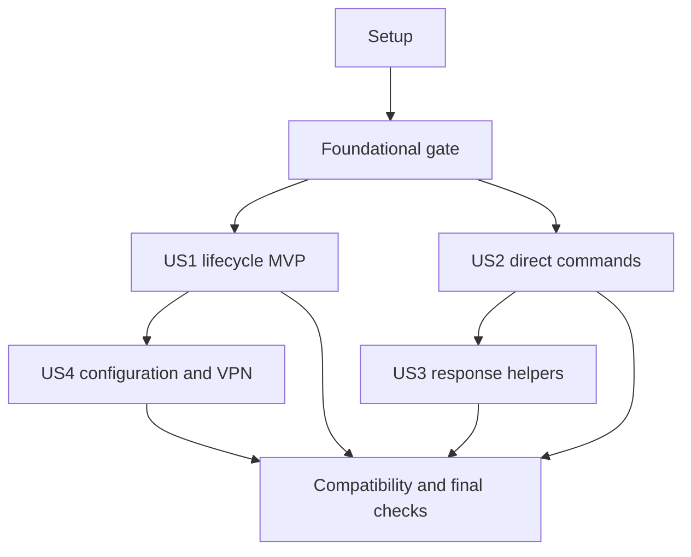

# Tasks: Device Management and Command Responses

**Input**: [spec.md](spec.md), [plan.md](plan.md), [research.md](research.md), [data-model.md](data-model.md), [contracts/sdk.md](contracts/sdk.md), and [quickstart.md](quickstart.md) in `specs/002-device-management/`.

**Prerequisites**: All design documents above; `.specify/memory/constitution.md` version 1.0.0; Python 3.13+; existing HTTPX/Pydantic SDK layout.

**Tests**: Required by spec FR-015, acceptance scenarios, success criteria, and the constitution. Add behavioral contract tests before the corresponding implementation; once model imports are available, confirm they fail for missing behavior, then implement and make them pass. Missing reference dependencies or skipped required compatibility cases do not count as acceptance.

**Organization**: Four independently verifiable story increments. User Story 3 requires User Story 2; User Story 4 reuses Device/read models from User Story 1. Complete shared foundations before any story. Task descriptions deliberately preserve the design's model constraints and exact operation contracts.

## Format: `[ID] [P?] [Story] Description`

- Every executable task starts with an unchecked checkbox and a sequential T-number.
- `[P]` identifies different-file work that can proceed together after its stated prerequisites are complete. It does not authorize simultaneous edits to a shared file.
- `[US1]`–`[US4]` map to the corresponding story in spec.md. Setup, foundational, and final tasks have no story label.
- File paths are repository-relative. Resolve them under the working repository; source evidence paths and pinned revisions are listed in research.md.

## Path Conventions

Extend `rapyuta_io_sdk_v2/`, `tests/`, and `examples/devices/`; do not create a new application, manager service, or transport stack. Documentation stays in `specs/002-device-management/` and `README.md`. Reuse `Configuration.core_api_host` and current header/error conventions. Existing client authentication and resource methods are outside this feature's implementation scope.

## Phase 1: Setup (Shared Infrastructure)

**Purpose**: Prepare reproducible tooling and isolated source-derived fixtures without adding runtime dependencies or changing the package identity.

- [X] T001 Verify Python 3.13+, install the existing dev/reference groups using `uv sync --group dev --group reference`, and retain the SDK v1 revision `739a6fe44600ff0964fa56b04878ddb21e76b5be` and Ruff 0.16.9 declared in `pyproject.toml`; record available tooling and baseline limitations in `specs/002-device-management/quickstart.md` without claiming unrun checks passed.
- [X] T002 [P] Create `tests/data/device_data.py` with fake identities/tokens and immutable golden fixtures for all 20 operation requests/responses, pending/partial command batches, service refusals, slash-sensitive routes, and VPN Daemon payloads; record source checkout revision and exact originating source/test location from `specs/002-device-management/research.md` for every fixture family.
- [X] T003 [P] Extend `tests/reference/conftest.py` with scoped Device replay fixtures that reject unmocked network requests and require actual pinned SDK tooling and executed, non-skipped cases; preserve the existing Parameter compatibility gate and use only fake credentials.

**Checkpoint**: Dependencies and fixture provenance are available. T002 and T003 can run together after T001; neither depends on the other's unfinished edits.

## Phase 2: Foundational (Blocking Prerequisites)

**Purpose**: Establish shared envelope parsing, safe routing, and existing-error compatibility used by every story. Finish T004–T009 before story implementation.

- [X] T004 Add foundational contract tests in `tests/test_device_api.py` and extend error-message regressions in `tests/sync_tests/test_utils.py` for dynamic core host resolution, missing host, scalar path safety, strict positive record IDs, named empty acknowledgments, omitted versus explicit values, invalid JSON/envelopes, and nested versus top-level error extraction; use the T002 fixtures.
- [X] T005 Extend error extraction in `rapyuta_io_sdk_v2/utils.py` to preserve nested `response.error` while retaining existing top-level error behavior and HTTP-status-to-SDK-exception mappings; make T004's shared error regressions pass, including unmapped HTTP429 as terminal with no retry.
- [X] T006 Add shared named success/envelope bases and `DeviceEmptyData`/`DeviceMutationResponse` in `rapyuta_io_sdk_v2/models/device.py`; enforce "Success outer status is literal success" and "Validate response shape before returning; do not accept false success statuses or error payloads as empty successful data"; retain actual nested `response.data` and reject nonempty data for an empty acknowledgment.
- [X] T007 Add `DeviceContractError` as an `UnknownError` subtype in `rapyuta_io_sdk_v2/exceptions.py` for invalid platform payload/variant contracts, preserving its underlying cause without dumping token, environment, or raw request payloads into error messages.
- [X] T008 Implement pure routing, scalar validation, copied model revalidation/serialization, and typed response parsing in `rapyuta_io_sdk_v2/_device_api.py`; resolve `/api/device-manager/v0` from `core_api_host` per call, reject blank/control/traversal or slash-containing routing IDs, encode allowed segments, accept only strict positive integer record IDs, preserve aliases/explicit values with operation-sensitive omission, and delegate ordinary HTTP errors to the shared handler without performing I/O.
- [X] T009 Run T004's checks using `tests/test_device_api.py` and `tests/sync_tests/test_utils.py`, verify configured/local/missing core hosts do not change existing v2 or Parameter routing, and document the foundational gate result in `specs/002-device-management/quickstart.md`; mark this gate complete only after its required behavioral checks pass. If tooling prevents execution, record the concrete blocker and leave T009 unchecked; evidence gathering and draft documentation/test cases may continue, but story implementation and dependent task completion remain blocked until verification passes.

**Checkpoint**: Named base contracts and errors are available, and no workflow or additional request is embedded in the foundational utilities.

## Phase 3: User Story 1 — Manage devices throughout their lifecycle (Priority: P1, MVP)

**Goal**: Discover/select, register, obtain onboarding authorization, inspect, update, and delete devices using either client mode with existing SDK conventions.

**Independent Test**: Seven single-operation lifecycle/selection methods work in both modes against source-derived fixtures, including empty collections, actual token registration envelopes, summary/detail differences, valid changes, missing/unauthorized devices, and deployment-related deletion refusal; every method makes exactly one request.

### Tests for User Story 1

- [X] T010 [P] [US1] Add lifecycle/selection model tests in `tests/test_device_models.py` for complete and partial reads, timestamps/aliases, historical versions, extension preservation, registration/runtime/name/description constraints, token repr, externally permitted update states, exact selection grammar, and omitted versus explicitly empty/null data using T002's fixtures; include historically ignored registration fields and empty/null description updates without inventing persistence in response models.
- [X] T011 [P] [US1] Add synchronous seven-operation contract tests in `tests/sync_tests/test_device.py` for `list_devices`, `select_devices`, `get_device`, `create_device`, `get_device_onboarding`, `update_device`, and `delete_device`; assert the exact contracts/sdk.md verbs/routes/query/body/envelopes, context overrides, error categories, zero redirects/hidden reads, and one HTTP request per call.
- [X] T012 [P] [US1] Add matching awaitable seven-operation contracts in `tests/async_tests/test_device_async.py`, including absence of synchronous I/O, identical response models/defaults, missing/unauthorized/offline failures, and preserved caller client/configuration state.

### Implementation for User Story 1

- [X] T013 [US1] Add Device/read models and reusable label/config read records in `rapyuta_io_sdk_v2/models/device.py`: enforce "UUID is required remote identity; timestamps parse as datetime when supplied; detail collections are optional, preserving absence versus empty"; implement `python_version` alias `device_version`, legacy `DeviceDeployment` required IDs/phase and optional error_code/created_at, named JsonValue daemon reports and typed extensions; read states are "NEW, REGISTERED, REJECTED, ONLINE, OFFLINE, DELETED, INITIALIZING, ERROR, FAILED"; label read fields are "id: positive int, key: str, value: str" with pattern `^[0-9a-zA-Z][a-zA-Z0-9_-]{0,49}$`; config read fields are "id: positive int, key: str, value: str, optional type: str/null" and must preserve empty stored values.
- [X] T014 [US1] Add registration/update/list-query models and shared `DeviceLabelsCreate` in `rapyuta_io_sdk_v2/models/device.py` with exact name pattern `^(?=.{3,256}$)[a-zA-Z]+[ \w-]*[^\W_-]$`, "length 3–256", and "Description has maximum length 256"; `DeviceCreate` has optional description, empty default labels, and "python_version: Literal['3'] default '3'"; `DeviceLabelsCreate` is a named string map permitting an empty registration default and validates keys/values against `^[0-9a-zA-Z][a-zA-Z0-9_-]{0,49}$`; registration config is a named strict-string/bool map with "Runtime keys runtime_docker/runtime_preinstalled accept strict bool or exact legacy strings 'True'/'False'; at least one true. Other values are strings; configuration-key validation applies", using `^[a-zA-Z_][a-zA-Z0-9_]{0,255}$`; update obeys "Require at least one explicitly set update field; reject explicitly null name" and preserves description empty/null as a documented server no-op; update states are "REGISTERED, REJECTED, DELETED, INITIALIZING, ONLINE, OFFLINE, FAILED"; list query is "Optional `name: str`" with exact filtering only.
- [X] T015 [US1] Add selection records and recursive expression models in `rapyuta_io_sdk_v2/models/device.py`: `DeviceSelectionRecord` requires uuid/name/status and a positive numeric id distinct from UUID; top-level operator is "operator: Literal['$and','$or']" with optional labels/specs; labels permit logical empty arrays and leaf $eq/$ne with "args exactly `(field_name: str, value: str)`"; specs require nonempty logical arrays and leaf $eq/$ne/$in with "args exactly `(field_name: str, value: JsonScalar)`"; preserve string-substring $in and backend empty-selection/online-spec semantics without local extra reads.
- [X] T016 [US1] Add named lifecycle response/token envelopes to `rapyuta_io_sdk_v2/models/device.py` and lifecycle request preparation to `rapyuta_io_sdk_v2/_device_api.py`; token fields obey "Token string and sibling fields are required and nonempty" and data uses "`repr=False`"; preserve response.device_id/script_command siblings, registration `download_type=script`, update's copied scalar device_id injection, summary-only update output, and empty deletion acknowledgment; never substitute a synthetic Device/bool or install/run onboarding credentials.
- [X] T017 [P] [US1] Implement the seven US1 methods in `rapyuta_io_sdk_v2/client.py` with contracts/sdk.md names/signatures and named return models, typed `body`/query inputs and HeaderOptions overrides; keep one HTTP operation per method, safe canonical paths and disabled redirects, existing supplied transport/header/error behavior, and no automatic device expansion or readiness checks.
- [X] T018 [P] [US1] Implement the same seven US1 methods in `rapyuta_io_sdk_v2/async_client.py` with identical public arguments/defaults/response models and only awaitable I/O; preserve existing unrelated synchronous authentication behavior without copying it into the new operations.
- [X] T019 [US1] Export US1 and shared payload classes in `rapyuta_io_sdk_v2/models/__init__.py` and `rapyuta_io_sdk_v2/__init__.py` using current conventions; verify aliases, generic/named envelope annotations, and every new structured request reject raw dictionaries before HTTP without relaxing existing model-contract tests.
- [X] T020 [P] [US1] Create `examples/devices/manage.py` with explicitly selected discovery/selection, registration, onboarding authorization, inspection, update, and deletion examples; accept configured environment/context, print fake-fixture or permitted device identities without a real token, show token-response versus Device distinction, and release only caller-owned resources at the example boundary.
- [X] T021 [P] [US1] Create equivalent awaitable lifecycle examples in `examples/devices/manage_async.py`, preserving the same actions/models and the existing async resource-release convention; do not run installers or synchronous network requests.
- [X] T022 [US1] Execute the US1 model/sync/async tests in `tests/test_device_models.py`, `tests/sync_tests/test_device.py`, and `tests/async_tests/test_device_async.py`; verify all seven methods match names/arguments/defaults/results/errors and SC-001's exact transmitted request values and returned identities, distinguish SDK serialization fidelity from server persistence/no-op behavior, and record the lifecycle checkpoint in `specs/002-device-management/quickstart.md` with actual results.

**Checkpoint**: US1 alone, after foundations, is a useful SDK increment. No command helper or US4 management operation is required to validate it.

## Phase 4: User Story 2 — Submit commands and retrieve their results explicitly (Priority: P1)

**Goal**: Supply exact command/target/context options, inspect immediate/deferred/background responses, and retrieve one job snapshot without client-owned polling.

**Independent Test**: Both command methods perform one request in each client mode; operational defaults reach the server, mode precedence matches the backend, lookup query multiplicity is correct, and only the exact retrieval HTTP400 pending envelope is returned as pending.

### Tests for User Story 2

- [X] T023 [P] [US2] Add command model/serialization tests in `tests/test_device_command_models.py` for strict explicit targets, blank command/environment/timeout validation, mode-aware named output/job variants, opaque job IDs/minions, Unicode/multiline/empty strings, operational default emission, and optional null/unset field omission.
- [X] T024 [P] [US2] Extend `tests/sync_tests/test_device.py` with `execute_device_command`/`get_device_command_result` contracts, repeated device_id keys, exact pending versus offline/invalid-ID/unknown-message/malformed errors, `bg=True, run_async=True` launch precedence, one-request behavior, request_timeout caps, and default transport/header state preservation.
- [X] T025 [P] [US2] Extend `tests/async_tests/test_device_async.py` with matching awaited command lookup/submission contracts and the same variant, error, query, and per-call timeout cases; verify no fallback to the auxiliary synchronous client.

### Implementation for User Story 2

- [X] T026 [US2] Add command API payloads/envelopes in `rapyuta_io_sdk_v2/models/device_command.py`: request targets obey "Nonempty unique identifiers, nonblank command, valid environment names"; optional shell/runas/cwd preserve supplied strings, environment is a string map default empty, bg/run_async are strict booleans default false, and timeout is "positive finite number default 300"; query targets are "Nonempty unique targets serialized as repeated singular device_id query keys"; output is "Named root `dict[str, StrictStr]`" and "Empty map allowed; empty output string differs from missing key"; job fields are jid and minions with "Nonblank opaque JID"; add named submission/result variants and exact pending error literal with named empty data.
- [X] T027 [US2] Add `DeviceCommandCallOptions` with optional positive finite request_timeout in `rapyuta_io_sdk_v2/_client_options.py` and timeout preparation in `rapyuta_io_sdk_v2/_device_api.py`; remove that option before header generation, cap each configured connect/read/write/pool component and replace unlimited components with the cap, while omission leaves defaults untouched and no call mutates client timeout settings.
- [X] T028 [US2] Implement command-specific serialization/query/response preparation in `rapyuta_io_sdk_v2/_device_api.py`; explicitly emit timeout=300, bg=false, run_async=false and env={} defaults, omit optional null shell/runas/cwd, preserve exact text, safely encode opaque JIDs, repeat device_id keys with no redundant jid query, parse bg launch before run_async job mode, and recognize only HTTP400 lookup with exact status/error/empty-data pending shape before ordinary HTTP handling.
- [X] T029 [P] [US2] Implement `execute_device_command` and `get_device_command_result` in `rapyuta_io_sdk_v2/client.py` using the US2 models/options and contracts/sdk.md signatures; return immediate/launch output or job acknowledgment on submission and one result/pending model on lookup, without polling, retries, local shell wrapping, or a replacement transport.
- [X] T030 [P] [US2] Implement identical command methods in `rapyuta_io_sdk_v2/async_client.py` with the same signatures/options/named response models and awaited supplied transport only; keep detached/deferred execution flags distinct from async Python invocation.
- [X] T031 [US2] Export the US2 command classes in `rapyuta_io_sdk_v2/models/__init__.py` and `rapyuta_io_sdk_v2/__init__.py`, and verify command options type-hint discovery in `tests/test_model_contracts.py` remains compatible with typed kwargs and union response annotations.
- [X] T032 [US2] Add standalone direct submission and single-lookup demonstrations to `examples/devices/command.py` and `examples/devices/command_async.py`, showing named job/output/pending variants, explicit targets and context, exact command text, and background acknowledgments without claiming process completion; keep examples suitable for later helper expansion.
- [X] T033 [US2] Run the command model and both direct-client operation suites in `tests/test_device_command_models.py`, `tests/sync_tests/test_device.py`, and `tests/async_tests/test_device_async.py`, confirm exact pending recognition/default emission/mode precedence and no hidden lookup on submission, and record the US2 checkpoint in `specs/002-device-management/quickstart.md`.

**Checkpoint**: Direct command operations work without helper implementation. The backend's unknown/incomplete job ambiguity is documented rather than replaced by an invented not-found distinction.

## Phase 5: User Story 3 — Execute a command and receive all requested responses (Priority: P1)

**Goal**: Submit once and collect all explicit target responses through sync/async helpers with inspectable partial failures, bounded polling, and preserved cancellation.

**Independent Test**: Immediate results require no extra lookup; a deferred three-device fixture arrives in batches with one empty output and one submission; timeouts, malformed/terminal failures, and cancellation retain correct immutable job/target/response context without restarting remote execution or closing supplied clients.

### Tests for User Story 3

- [X] T034 [P] [US3] Add synchronous helper behavioral tests in `tests/helpers/test_device_command.py` for immediate/deferred collection, three staggered targets, empty output, unknown/incomplete jobs, missing minions/JID, unexpected/conflicting/duplicate responses, preflight/background rejection, copied helper defaults, partial failures, and monotonic polling budget including valid late sync results that must time out.
- [X] T035 [P] [US3] Add matching async helper tests in `tests/helpers/test_device_command_async.py` including cancellation during submission/retrieval/sleep, internal deadline versus external cancellation, unknown acceptance without JID, zero subsequent requests after cancellation, caller ownership, and a real 50 ms heartbeat with no gap above 250 ms under controlled conditions.

### Implementation for User Story 3

- [X] T036 [US3] Add immutable helper options/results/failure models in `rapyuta_io_sdk_v2/models/device_command.py`: options are "wait_timeout: positive finite float=300, poll_interval: positive finite float=10"; device results are "device_guid: str, output: str" and frozen; outcome fields are requested_devices tuple, nullable jid, responses tuple, and missing_devices tuple with "Frozen ordered snapshot. Full success has no missing devices; partial snapshots may have none if responses arrived late"; `DeviceCommandFailure` has "Required stage: DeviceCommandFailureStage, required message: nonempty str, jid: str/null default None, required requested_devices: tuple[str,...], required missing_devices: tuple[str,...]" with "Frozen context, no raw credentials, command environment, or exception objects in JSON"; stage enum values are validation/submission/retrieval/contract/incomplete_result/timeout/cancellation, and empty identity tuples are permitted only when validation has no valid targets available.
- [X] T037 [US3] Add `DeviceCommandError`, `DeviceCommandTimeout(DeviceCommandError, TimeoutError)`, and `DeviceCommandCancelled(asyncio.CancelledError)` in `rapyuta_io_sdk_v2/exceptions.py` with typed failure/partial_result snapshots and chained underlying causes when available; enforce exact equality between failure and partial_result jid/requested_devices/missing_devices fields, preserve cancellation inheritance and unknown remote acceptance when submission is interrupted, and expose completed outputs only through partial_result.responses rather than serializing exception objects into payload models.
- [X] T038 [US3] Implement pure copied-command preparation, monotonic deadline/progress bookkeeping, and ordered immutable snapshot creation in `rapyuta_io_sdk_v2/helpers/_device_command.py`; fill helper-only omitted shell/user as /bin/bash and root, preserve caller flags/options/text, reject bg before HTTP, verify acknowledged minions exactly match unique requested targets, count key presence including empty strings, preserve identical repeats and fail conflicting/unexpected outputs, and calculate remaining-target queries/capped sleeps without making requests.
- [X] T039 [P] [US3] Implement `execute_device_command` in `rapyuta_io_sdk_v2/helpers/device.py` with contracts/sdk.md signature, only public client method composition, exactly one submission, immediate completion/incomplete failure and deferred polling; account for elapsed submission/retrieval/sleep, cap started request timeouts to remaining budget, start no request/sleep after expiry, retain valid late results in partial context then raise timeout, preserve terminal/malformed causes, and leave supplied clients/defaults open and unchanged.
- [X] T040 [P] [US3] Implement `execute_device_command_async` in `rapyuta_io_sdk_v2/helpers/async_device.py` with identical options/results/public operation composition and awaited network/sleep; enforce `asyncio.timeout_at`, distinguish own expiry from external cancellation, raise typed timeout/cancellation snapshots, and perform no shielding, worker thread, sync I/O, resubmission, remote cancellation, or post-cancellation cleanup requests.
- [X] T041 [US3] Export both helpers through `rapyuta_io_sdk_v2/helpers/__init__.py` and helper model classes plus `DeviceCommandFailureStage` through `rapyuta_io_sdk_v2/models/__init__.py` and `rapyuta_io_sdk_v2/__init__.py`; verify the helper import name and same-named single-operation client method remain distinct and correctly annotated.
- [X] T042 [P] [US3] Expand `examples/devices/command.py` with helper-default execution, explicit repeated --device targets, --command, immediate/deferred mode, --wait-timeout/--poll-interval, optional direct-operation demonstrations, and stage/job/missing-device/empty-output reporting; state that local timeout does not stop remote execution and never retry failed submissions automatically.
- [X] T043 [P] [US3] Expand `examples/devices/command_async.py` with the same helper flags/results plus --cancel-after, a typed DeviceCommandCancelled handler that inspects and re-raises cancellation, and caller-owned async resource cleanup; preserve known partial responses/JID without implying remote cancellation.
- [X] T044 [US3] Complete ownership/immutability/failure-context checks in `tests/helpers/test_device_command.py` and `tests/helpers/test_device_command_async.py`: preserve input fields, client identity/context/default timeout, open supplied transports and original target order; assert frozen tuple snapshots cannot lose earlier output, every failure/cancellation exposes the documented named fields and exact identity equality with partial_result, available underlying causes are chained without fabricating causes for clock expiry, validation with no known targets uses empty tuples, and shorter transport timeouts remain terminal rather than pending retries.
- [X] T045 [US3] Execute the helper/model suites in `tests/helpers/test_device_command.py`, `tests/helpers/test_device_command_async.py`, and `tests/test_device_command_models.py`; verify SC-003–005 including zero duplicate submissions, no new work after deadline, timeout-cap bounds, permitted sync overrun without late success, async deadline tolerance of one second, and heartbeat/cancellation behavior; record actual evidence in `specs/002-device-management/quickstart.md`.

**Checkpoint**: The requested execute-and-response workflow works in both modes, independently of VPN, metadata mutations, migration, and Parameter application.

## Phase 6: User Story 4 — Configure and operate existing devices (Priority: P2)

**Goal**: Manage labels/config variables, enable/disable VPN on one explicit device, apply Parameter trees, and migrate devices, preserving reported outcomes and existing client conventions.

**Independent Test**: Eleven management operations pass in both client modes; returned record identities are used directly, VPN only accepts VPN-specific state/config, Parameter failures/omissions remain visible, migration retains source context, and no deprecated/internal general interfaces appear.

### Tests for User Story 4

- [X] T046 [P] [US4] Extend `tests/test_device_models.py` with management-body/result cases: label-map creation and key/value update constraints, positive record IDs, nonempty configuration write values versus empty read values, restricted VPN strict booleans/route defaults and aliases, actual DeviceDaemon/SSH/pull-secret fields, Parameter target/tree semantics, and explicit destination project.
- [X] T047 [P] [US4] Extend `tests/sync_tests/test_device.py` with all eleven US4 wire/error contracts: four label, four config-variable, VPN, Parameter application, and migration methods; assert canonical slash spelling, actual empty versus record outputs, reserved/online restrictions, route defaults/true/false VPN payloads, per-device failure/unknown-ID omission, source authorization, and no discovery/precheck/extra request.
- [X] T048 [P] [US4] Extend `tests/async_tests/test_device_async.py` with identical awaited eleven-operation contracts, headers/defaults/model/error parity, explicit scope restrictions, and no mutation of selected project or unrelated daemon settings.

### Implementation for User Story 4

- [X] T049 [US4] Add label/config-write/migration models and concrete response envelopes in `rapyuta_io_sdk_v2/models/device.py`: label key/value pattern is "`^[0-9a-zA-Z][a-zA-Z0-9_-]{0,49}$`"; reuse US1's `DeviceLabelsCreate` flat map and allow its empty registration default, while standalone label creation requires at least one pair at the operation boundary; label updates require "At least one explicitly supplied, nonnull field"; config key pattern is "`^[a-zA-Z_][a-zA-Z0-9_]{0,255}$`", create/update values are nonempty strings and update never renames a key; read values may be empty and type is optional; migration obeys "Explicit nonempty destination project; source project remains the call's context"; preserve empty mutation acknowledgments and actual created/updated records.
- [X] T050 [US4] Add VPN/Parameter request and response models in `rapyuta_io_sdk_v2/models/device.py`: VPN has "Required strict `vpn: bool`; optional `config: DeviceVPNConfiguration`", nested required VPN-only configuration, "advertise_routes: strict bool default false", and "reject unrelated keys and advertisement true when disabling"; Parameter input has "Nonempty unique device identifiers. Omitted/empty tree names mean all trees per service; no invented per-node workflow" and outcomes have device_id, strict success bool and optional error, preserving absent unknown IDs rather than synthesizing results.
- [X] T051 [US4] Add `SSHCertConfig` and optional `DaemonSpec.ssh_cert_config` alias sshcert_config in `rapyuta_io_sdk_v2/models/daemons.py` with "enable: strict bool"; add existing `AuthConfig.auth` as "auth: optional str, repr=False"; preserve existing fields/defaults and parse actual returned kind DeviceDaemon without creating a public daemon mutation method.
- [X] T052 [US4] Complete management serialization/result parsing in `rapyuta_io_sdk_v2/_device_api.py` for flat label maps, copied key/value/config/migration payloads, VPN-only state/config with explicit false preserved, and wrapped actual Daemon responses; retain exact backend Parameter outcome arrays and service errors, use returned record IDs without lookup, and never configure project subnets or post-migration VPN implicitly.
- [X] T053 [P] [US4] Implement the eleven US4 methods in `rapyuta_io_sdk_v2/client.py`: list/create/update/delete device labels, list/create/update/delete device config variables, set_device_vpn, apply_device_parameters, and migrate_device; follow contracts/sdk.md exact signatures/verbs/routes/named results, one request each, HeaderOptions conventions and unchanged source-project context.
- [X] T054 [P] [US4] Implement identical eleven-method coverage in `rapyuta_io_sdk_v2/async_client.py` with matching arguments/defaults/results and awaited existing transport only; prohibit general patch_daemons/toggle_features, topic APIs, agent upgrade, fleet-wide VPN defaults, and hidden readiness waits.
- [X] T055 [US4] Export US4 payload/response classes and the necessary typed daemon response additions through `rapyuta_io_sdk_v2/models/__init__.py` and `rapyuta_io_sdk_v2/__init__.py` following current conventions; confirm fields use snake_case and aliases without exposing new unrelated mutating interfaces.
- [X] T056 [P] [US4] Extend `examples/devices/manage.py` with explicit label/config CRUD, VPN enable/disable/default/advertised routes, Parameter tree selection, and migration actions; use returned record IDs, report per-target failures/omissions, and distinguish accepted VPN changes from connectivity readiness without implicit fleet selection.
- [X] T057 [P] [US4] Extend `examples/devices/manage_async.py` with matching awaited management actions and models, source/destination context behavior, actual VPN response fields, and the same explicit-target/default/error documentation.
- [X] T058 [US4] Execute all management contracts in `tests/test_device_models.py`, `tests/sync_tests/test_device.py`, and `tests/async_tests/test_device_async.py`; verify all 20 total operations now exist in both modes, US4's full acceptance scenarios, zero added public topic/upgrade/generic-daemon APIs, and additive Daemon field behavior; record the checkpoint in `specs/002-device-management/quickstart.md`.

**Checkpoint**: All four user stories have independently passing behavioral evidence. Deprecated/internal functionality remains excluded.

## Phase 7: Polish & Cross-Cutting Concerns

**Purpose**: Complete required interoperability, example usability, documentation, regression, and quality gates after all story increments.

- [X] T059 [P] Implement and execute `tests/reference/test_device_compatibility.py` using actual pinned v1 public method/model serialization under the scoped replay guard; cover reference-supported lifecycle/metadata/VPN/command operations, and source-backed goldens for all 20 contracts including migration and canonical slash corrections; report intentionally corrected orchestration/mode/default semantics explicitly, reject any unmocked network use or missing/skipped required cases, and never substitute live credentials for this gate.
- [X] T060 [P] Extend `tests/test_model_contracts.py` and related model/error regression cases for all 20 paired method names/signatures/defaults/annotations/results/shared failure categories, structured raw-dict rejection before HTTP, explicit aliases/field omission, discovery/root exports, default command emission, and absence of public deprecated/internal mutations; keep existing Parameter/resource assertions and mapped HTTP error behavior intact.
- [X] T061 [P] Update `README.md` with the new operation table, typed envelope/token/record distinctions, public command helpers, explicit device targeting, VPN-only scope, helper default/timeout/cancellation behavior, and links to all four examples; reconcile narrative/examples in `specs/002-device-management/quickstart.md` with final public names without broadening scope or presenting sync network timeouts as a strict wall-clock bound.
- [X] T062 [P] Add `tests/test_device_examples.py` to run the documented examples/snippets against T002's isolated fixtures, exercising lifecycle/registration, direct command operations, single/multi-device immediate/deferred helpers, empty output, partial timeout, VPN modes, and asynchronous cancellation; prove SC-006 without consulting v1 internals or printing real credential material, and ensure all advertised example flags exist.
- [X] T063 Run the targeted new API/model/helper/reference/example suites, `uv run pytest`, `uvx ruff==0.16.9 check .`, and `uvx ruff==0.16.9 format --check .` from the repository root; include existing daemon-read/file-upload/ConfigTree/Parameter regressions, fix feature-related failures without weakening `pyproject.toml` rules or skip gates, and record actual commands/results/tooling limitations in `specs/002-device-management/quickstart.md`.
- [X] T064 Reconcile completed behavior against every FR-001–015 and SC-001–006, all 20 contracts, and constitution principles in `specs/002-device-management/plan.md`, `specs/002-device-management/data-model.md`, `specs/002-device-management/contracts/sdk.md`, and `specs/002-device-management/quickstart.md`; document any remaining required work explicitly in `specs/002-device-management/tasks.md`, mark only actually completed implementation tasks, and leave reviewer-owned quality checklist markers unchanged.

**Checkpoint**: Feature acceptance includes executed isolated reference checks and the configured quality gates. Live validation is optional supplemental evidence and cannot replace required checks.

## Dependencies & Execution Order

### Phase Dependencies

- Setup T001 precedes the independent fixture/guard tasks T002–T003.
- Foundational T004–T009 depends on setup completion and blocks story implementation and dependent task completion; execute its shared-file changes sequentially. Recording a tooling blocker does not complete T009 or open this gate. Independent evidence gathering and draft documentation/test cases may proceed while the gate stays pending; implemented story work starts only after the required foundational checks pass.
- US1 T010–T022 depends on foundations, then tests → models T013–T016 → paired clients T017–T018 → exports → examples → acceptance.
- US2 T023–T033 needs foundations and shared base models, not the US1 lifecycle operations. In the default schedule it follows US1 to avoid edits colliding in shared client/test/export files. Its tests precede models/options/parser T026–T028, then paired clients and exports.
- US3 T034–T045 requires completed US2 direct operations. Tests precede models/errors/shared bookkeeping T036–T038, then paired helpers T039–T040, exports/examples, and acceptance.
- US4 T046–T058 requires US1 Device/read records. It does not require command or helper behavior; the default schedule follows US3 to serialize edits to shared modules. Tests precede models/response changes/serialization T049–T052, then paired clients and exports.
- Final T059–T062 can proceed together after all stories are complete. T063 waits for those tasks, and T064 waits for verified acceptance.

### User Story Dependencies

This graph describes logical prerequisites. Shared files in client.py, async_client.py, models/device.py, model exports, and operation test modules require serialized edits across stories; do not interpret independent story behavior as permission for conflicting edits.

### Within Each User Story

Write tests before implementing the corresponding behavior. Preserve model constraints literally, then prepare shared serialization/parsing before adding paired client methods. Finish both client modes before exports/examples and the story checkpoint. Only mark tasks completed when their actual changes and required verification are complete; checkpoints do not imply deployment or publication.

### Parallel Opportunities

The following groups have distinct file ownership and can run together only after their prerequisites are ready:

| Group | Ready after | Parallel tasks |
| --- | --- | --- |
| Setup fixtures / reference guard | T001 | T002, T003 |
| US1 tests | T009 | T010, T011, T012 |
| US1 client methods | T016 | T017, T018 |
| US1 examples | T019 | T020, T021 |
| US2 tests | T009; shared-file writers idle | T023, T024, T025 |
| US2 client methods | T028 | T029, T030 |
| US3 helper tests | T033 | T034, T035 |
| US3 helper implementation | T038 | T039, T040 |
| US3 examples | T041 | T042, T043 |
| US4 tests | T022; shared-file writers idle | T046, T047, T048 |
| US4 client methods | T052 | T053, T054 |
| US4 examples | T055 | T056, T057 |
| Final interoperability / parity / docs / example usability | T058 and all other story checkpoints | T059, T060, T061, T062 |

## Parallel Example: User Story 1

After T016 is complete, implement T017 in `rapyuta_io_sdk_v2/client.py` alongside T018 in `rapyuta_io_sdk_v2/async_client.py`. Both use the already-completed shared model/parser contracts. Export integration T019 starts after both finish.

## Parallel Example: User Story 2

After T028, implement T029 and T030 in the separate client modules. Do not edit `_device_api.py` or the options/model contracts concurrently; integrate exports through T031 after both methods pass their behavioral tests.

## Parallel Example: User Story 3

After T038, T039 owns `helpers/device.py` and T040 owns `helpers/async_device.py`. Shared model/error/bookkeeping work is already complete. Pair T042/T043's example updates only after export integration T041.

## Parallel Example: User Story 4

After T052, T053/T054 own separate client modules and the same already-validated VPN/metadata contracts. T056/T057's management examples can proceed together after T055. Shared read-model work from US1 must be complete first.

## Implementation Strategy

### MVP First (User Story 1 Only)

Complete setup and foundational gates, then US1's seven lifecycle/selection operations in both modes, exports, examples, and isolated acceptance. This is the smallest independently useful device-management increment. It does not yet satisfy the entire requested feature.

### Incremental Delivery

Follow phases in listed order by default: lifecycle → direct commands → response helpers → configuration/VPN/migration/Parameter application → final compatibility and quality checks. The next useful command-focused increment is US2 plus US3, because those two stories deliver the requested execute-and-get-response workflow. Final completion requires every story and mandatory verification, regardless of MVP milestones.

### Parallel Team Strategy

Use the distinct-file groups above when parallel work is explicitly authorized. Serialize all shared-file changes and export integration. US2 can be developed independently of US1 operations and US4 independently of commands, but those stories still share client/model/test files and must coordinate ownership. No task generation step launches implementation agents.

## Coverage and Notes

### Client Operation Coverage

| Story | Methods | Implementation | Contract tests |
| --- | --- | --- | --- |
| US1: 7 operations | list_devices, select_devices, get_device, create_device, get_device_onboarding, update_device, delete_device | T017–T018 | T011–T012 |
| US2: 2 operations | execute_device_command, get_device_command_result | T029–T030 | T024–T025 |
| US4: 11 operations | list_device_labels, create_device_labels, update_device_label, delete_device_label, list_device_config_variables, create_device_config_variable, update_device_config_variable, delete_device_config_variable, set_device_vpn, apply_device_parameters, migrate_device | T053–T054 | T047–T048 |

US3's two separate helpers are T039–T040, validated by T034–T035 and T044–T045; they are not additional Client API operations.

| Scope | Implementation / validation tasks |
| --- | --- |
| FR-001–003, SC-001–002: typed coverage, context, consistency | T004–T031, T046–T058, T060 |
| FR-004–005: individual command operations | T023–T033 |
| FR-006–007, FR-012, SC-003: aggregation and immutable outcomes | T034–T045 |
| FR-008, SC-005: deadline/network caps/responsiveness | T024–T028, T034–T045 |
| FR-009–011, SC-004: failures, cancellation, preflight | T023–T045 |
| FR-013: metadata, VPN, Parameter application, migration | T046–T058 |
| FR-014, SC-006: runnable examples and usability | T020–T021, T032, T042–T043, T056–T057, T061–T062 |
| FR-015 and governance: isolated compatibility, regressions, quality | T001–T009, T022, T033, T045, T058–T064 |

All tasks are initially unchecked. Source models/requests must remain typed; one-operation clients and separate helpers remain mandatory. Do not add unsupported internal/deprecated APIs, new runtime dependencies, or blanket Ruff/test suppressions. A documented environment limitation is not a substitute for an acceptance gate that has not run.

## Phase 8: Convergence

Assessment checked all 15 functional requirements, six success criteria, 25 user-story acceptance scenarios, 14 edge cases, 64 existing tasks, six plan decisions and five constitution principles. The current 952 targeted checks and pinned Ruff lint/format checks pass. Independent isolated probes reproduce F1 and F2 in both helper modes; F3 is a required wire-verification gap. Complete these tasks in order, retaining all existing operation contracts and quality gates.

- [X] T065 Fix HIGH finding F1 in `rapyuta_io_sdk_v2/helpers/_device_command.py` so a batch containing a foreign device or conflicting repeated output retains every other valid requested-device output independently of JSON key ordering before raising its terminal contract failure. Preserve earlier output, never overwrite a conflicting value, retain original requested-device ordering, and keep failure/outcome identity fields equal. Add sync/async regressions in `tests/helpers/test_device_command.py` and `tests/helpers/test_device_command_async.py` for foreign/conflicting entries before and after valid entries, including empty output and prior partial batches; assert no retry or subsequent lookup after the failure. Evidence: `CommandProgress.merge` currently stops at the first `_accept` error, so `{"foreign":"bad","a":""}` loses a's known response while the reverse ordering retains it. Resolve per FR-009, FR-012, SC-004 and T038/T044 (partial).
- [X] T066 Fix HIGH finding F2 in `rapyuta_io_sdk_v2/_device_api.py` and associated failure bookkeeping so an unambiguously job-shaped success acknowledgment rejected for an immediate/deferred execution-mode mismatch retains its separately validated JID in `DeviceContractError` and the helper's matching failure/partial-result snapshots. Keep the mismatch a terminal contract error, preserve the original cause, perform no polling/resubmission, and never mistake a legitimate output-map key named jid for a deferred acknowledgment. Add regressions through actual `Client` and `AsyncClient` methods with MockTransport and both helpers, rather than only mocking the public methods. Evidence: an immediate request receiving `{"jid":"known-job","minions":["a"]}` currently fails with `partial_result.jid=None` because `command_submission` recovers identity only when the expected model is `DeviceCommandJob`. Resolve per FR-009, FR-012, SC-004, plan: error adaptation/helper identity preservation and T037/T038 (partial).
- [X] T067 Close MEDIUM finding F3 with explicit captured-request assertions in `tests/sync_tests/test_device.py`, `tests/async_tests/test_device_async.py` and `tests/test_device_examples.py` for VPN enable with omitted config, disable with explicit false, nested default/explicit-false advertisement and explicit-true advertisement. Assert exact VPN-only JSON, one request, unchanged source context, actual typed Daemon acknowledgment, and local rejection of disabled VPN with advertised routes or unrelated daemon settings. Existing example dispatch tests return their fixture by verb/path and do not validate the enabling/advertisement body; the sole VPN wire golden is `{"vpn":false}`. After T065–T066 and these assertions pass, execute the targeted/reference/example suites, full pytest suite and pinned Ruff lint/format gates, then refresh actual validation results and completion reconciliation in `specs/002-device-management/quickstart.md` and `specs/002-device-management/plan.md` without changing reviewer-owned checklist markers. Resolve per FR-015, US4/AC2–3, SC-002, plan: verification matrix and T047/T048/T062–T064 (partial).

## Phase 9: Convergence

Assessment checked 15 functional requirements, six success criteria, 25 user-story acceptance scenarios, 14 edge cases, 67 existing tasks, six plan decisions and five constitution principles. The daemon-status response alias and its list/get/update regressions satisfy the reviewed health-report contract. All 1,760 tests and pinned Ruff lint/format checks pass. An independent isolated probe through both actual clients reproduces one remaining HIGH partial gap in job-identity recovery for a deferred-mode mismatch.

- [X] T068 Fix HIGH finding F1 in `rapyuta_io_sdk_v2/_device_api.py` so a deferred submission that returns an immediate output map for requested devices named jid/minions remains a terminal mode-mismatch contract failure without reporting the jid device's output as a known job identifier. Use the response shape and requested targets to distinguish output from identity; retain separately validated JIDs from actual job acknowledgments, including the existing malformed-acknowledgment recovery cases. Add actual `Client`/`AsyncClient` MockTransport regressions in `tests/helpers/test_device_command.py` and `tests/helpers/test_device_command_async.py` for `run_async=True`, targets `("jid", "minions")`, and success data `{"jid":"command-output","minions":""}`; cover direct submission and both helpers, assert unknown JID in matching failure/partial-result identities, preserved cause chaining, exactly one submission, no lookup/resubmission and unchanged caller ownership. Preserve immediate/background output-map behavior and valid unexpected-job identity recovery. Run the required targeted/reference/example, full-suite and pinned Ruff gates, and refresh actual acceptance evidence in `specs/002-device-management/quickstart.md` and `specs/002-device-management/plan.md`. Evidence: `command_submission` selects `_CommandJobIdentity` whenever the expected model is `DeviceCommandJob`; that identity-only parser accepts the output-map jid string and both helpers expose it as the remote job ID. Resolve per FR-009, SC-004, plan: mode-aware command contracts/error identity preservation and T066 (partial).
