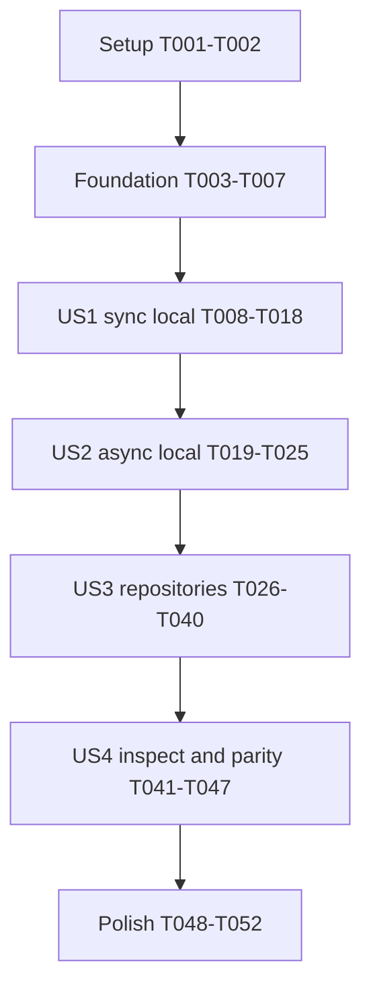

# Tasks: Chart Support

**Input**: Design documents from `specs/003-chart-support/`.

**Prerequisites**: [plan.md](plan.md), [spec.md](spec.md), [research.md](research.md), [data-model.md](data-model.md), [chart-api.md](contracts/chart-api.md), [repository-format.md](contracts/repository-format.md), [parity-validation.md](contracts/parity-validation.md), and [quickstart.md](quickstart.md).

**Tests**: Included because FR-019 explicitly requires controlled CLI reference cases and the specification defines verifiable parity, failure, and cancellation outcomes. Write each listed contract/acceptance test before its corresponding implementation and establish the relevant failure. Normal tests use controlled transports and checked-in fixtures, with no CLI dependency or live platform account. CLI fixture capture is an explicit development action, and expected outputs must precede SDK expectation checks.

**Organization**: Tasks follow the four user stories in priority order. US1 delivers sync directory/archive use; US2 adds async local preparation and execution; US3 adds repository workflows in both modes; US4 completes public inspection, source diagnostics, and the six existing chart parity cases. Readiness/resource execution stays in the existing Appliers. Every checkbox is implementation work still to do.

## Format: `[ID] [P?] [Story] Description`

- `[P]` identifies tasks in different files that may proceed together once their stated prerequisites are complete. It does not override dependency order or authorize concurrent edits to one file.
- `[US1]`–`[US4]` map tasks to the matching story in the specification.
- Setup/foundation/polish tasks have no story label. All paths below are repository-relative.

## Path Conventions

- Runtime helpers: `rapyuta_io_sdk_v2/chart/`; new Pydantic contracts: `rapyuta_io_sdk_v2/models/chart.py`.
- Tests and controlled fixtures: `tests/chart/`; existing rendering references: `tests/apply/fixtures/parity/`.
- Examples: `examples/chart/`; capture tooling: `scripts/capture_apply_parity.py`.
- Existing clients, resource payload models, renderer, scheduler, dependency declarations, and lockfile are consumed unchanged. No new API operation, runtime dependency, implicit authentication, or release database is planned.

## Phase 1: Setup (Shared Infrastructure)

**Purpose**: Establish import/test locations without changing SDK behavior.

- [X] T001 Create the Chart helper package scaffold in `rapyuta_io_sdk_v2/chart/__init__.py` and the test/example directories `tests/chart/` and `examples/chart/`; keep imports free of I/O and defer public facade exports until their implementation tasks.
- [X] T002 Add shared local-chart, compressed-tar, delayed-worker, and controlled platform/HTTPX test builders in `tests/chart/conftest.py`; use synthetic names/credentials and explicit fixtures, snapshot caller-owned files/data for assertions, and prevent unintended live platform/network access without requiring sibling checkouts.

## Phase 2: Foundational (Blocking Prerequisites)

**Purpose**: Establish the shared source, input, metadata, and diagnostic contracts used by all stories.

**Gate**: Complete T001–T007 before story implementation. No package renderer, scheduler, or platform client orchestration is added here.

- [X] T003 Add shared model/input/error contract tests in `tests/chart/test_sources.py` for tagged source coherence and pure factories, selector spelling/colon validation, strict non-empty metadata identity, aliases/extras/timestamps, empty catalogs and duplicate versions, isolated snapshots, normalized singleton/iterable render inputs including `{}`, and source/stage diagnostics; exercise the constraints in `specs/003-chart-support/data-model.md` before implementing T004–T006.
- [X] T004 [P] Implement frozen `ChartSource`, `ChartMetadata`, `ChartEntry`, and `ChartIndex` in `rapyuta_io_sdk_v2/models/chart.py` after T003. Preserve `kind: Literal["directory", "archive", "repository"]`, nullable `path: Path | None` and `selector/repository/branch: str | None`, and `extra="forbid"` on sources; quote: "Directory/archive sources require a path and forbid repository fields. Repository sources require a non-empty selector and forbid a local path." and "Selector parsing preserves spelling and case, rejects more than one colon and empty name/version components, and does not infer a latest version." Add pure `from_directory/from_archive/from_repository` factories. Require name/version `StrictStr` with "Non-empty, not whitespace-only; spelling preserved." and "Non-empty, not whitespace-only; opaque exact version string."; preserve optional `description`, nullable `api_version` alias `apiVersion`, and "JSON-compatible extra fields" without changing global SDKModel configuration. Preserve `urls: tuple[str, ...] = ()`, `created: str | datetime | None`, `digest: str | None`, required `entries: dict[str, tuple[ChartEntry, ...]]`, nullable `api_version/generated` with `generated: str | datetime | None`, non-empty chart-name keys matching declared entry names, ordered duplicate versions, valid empty catalogs, and independent copies of mutable dictionaries/extras.
- [X] T005 [P] Implement `ChartError`, `ChartLoadError`, and `ChartVersionWarning` in `rapyuta_io_sdk_v2/chart/errors.py` after T003; preserve the data-model contract: "`stage` (`source`, `index`, `download`, `archive`, or `metadata`), `category`, `source`, and optional `selector`" and "Exceptions do not carry response objects, response bodies, or decoded template/value contents." Use stable categories distinguishing invalid input/missing sources, HTTP/network/timeouts, missing charts/versions, corrupt/unsafe packages, invalid metadata, and identity mismatch; the UserWarning identifies requested chart and selected version and never converts CLI-compatible first-entry selection into failure.
- [X] T006 [P] Implement frozen `ChartInputs` in `rapyuta_io_sdk_v2/chart/source.py` after T003; use typed `ValueInput | Iterable[ValueInput] | None` constructor inputs, `values/secrets: tuple[ValueInput, ...]`, nullable explicit `rio: Mapping[str, JsonValue]`, and nullable `DeviceInterfaceResolver`. Preserve "Snapshot input iterables once." and "Normalize through `ManifestSource` rather than implementing new merging/validation."; `{}` becomes one source, supplied mappings/context are deep-copied, the caller-owned resolver is retained, and independent copies are taken when building each load's manifest source.
- [X] T007 Export the shared source/input/model/error contracts through `rapyuta_io_sdk_v2/models/__init__.py`, `rapyuta_io_sdk_v2/chart/__init__.py`, and `rapyuta_io_sdk_v2/__init__.py` after T004–T006; retain existing import behavior and SDK payload serialization and run `tests/chart/test_sources.py` to establish the foundational contract checkpoint.

**Checkpoint**: Source configuration is unambiguous and free of I/O; inputs/errors/models satisfy the shared contracts. Repository behavior can build on the models later without blocking local chart use.

## Phase 3: User Story 1 — Use a packaged application from a synchronous program (Priority: P1, MVP)

**Goal**: Load a directory or local archive and apply/delete/recreate its prepared resources through the existing sync Applier.

**Independent Test**: Load a synthetic two-resource dependency chain from a directory and an equivalent archive, capture the controlled platform payloads/actions, and compare them with direct Applier use on the same files and effective values. Verify defaults replacement, retention/absence, recreation ordering, partial results, and caller ownership with no repository dependency. Public inspection is completed in US4; lifecycle previews already delegate existing behavior here.

### Tests for User Story 1

- [X] T008 [P] [US1] Add directory/archive loading and confinement acceptance tests in `tests/chart/test_loading.py` for direct-root and single-top-level layouts, missing/invalid metadata/templates, zero supported files versus empty rendered collections, deterministic nested YAML/YML/JSON discovery, unusable sources, local links/special files, malicious tar member types/traversal/foreign separators/duplicate destinations/file-directory collisions, eager cleanup, and unchanged caller files; fixtures from T002 must prevent network/platform access.
- [X] T009 [P] [US1] Extend `tests/chart/test_sources.py` with preparation-input acceptance cases for omitted/None/empty-sequence values versus explicit `{}`, two ordered complete values sources, recursive mapping merge and list/scalar replacement, missing/malformed needed defaults versus unused defaults, explicit rio/secrets/resolver context, existing filters, input-copy isolation, and plaintext/decrypted-secret inputs without automatic SOPS invocation.
- [X] T010 [P] [US1] Add sync lifecycle/recreation contract tests in `tests/chart/test_lifecycle.py` for existing Applier result/error identity and controlled payloads, apply/delete dependency order, retention/absence, worker/readiness forwarding, wrong/missing clients and active-loop rejection, unchanged/open caller clients, sequential scope rebinding, confirmed/uncertain partial writes, full-call concurrency rejection, both preview phases, delete failure preventing apply, and no stale phase snapshot after a previous successful call; record expected failures before T014–T016.

### Implementation for User Story 1

- [X] T011 [US1] Implement local chart-root validation, metadata loading, and recursive file discovery in `rapyuta_io_sdk_v2/chart/_package.py` after T008–T009; require "Read `Chart.yaml` as exactly one safe YAML mapping." and "Reject missing/invalid metadata."; validate chart descendants/ancestors without following links or special files, require `templates/` with at least one supported file, sort case-compatible `.yaml/.yml/.json` files by chart-relative POSIX path, and retain the original source descriptor and relative template paths for later diagnostics.
- [X] T012 [US1] Implement compressed-tar inventory validation and extraction in `rapyuta_io_sdk_v2/chart/_package.py` after T011; preflight every member before writing, reject absolute/parent-traversal/foreign-separator paths, links/special files/duplicate normalized destinations/collisions, explicitly apply `tarfile.data_filter` and abort on rejection, identify exactly one direct or top-level chart root, and extract solely into an owned `TemporaryDirectory` whose context encloses complete delegate preparation and cleanup.
- [X] T013 [US1] Implement synchronous directory/archive preparation in `rapyuta_io_sdk_v2/chart/_acquisition.py` after T011–T012; choose bundled `values.yaml` only when normalized values sources are empty, pass ordered individual paths and explicit inputs to `ManifestSource`, construct the existing Applier while extracted files exist, retain origin/relative-path attribution, and return prepared data with no transport or owned extraction directory. Preserve ordinary Apply validation exceptions and caller-authorized external values/secrets paths.
- [X] T014 [US1] Implement the local-source `Chart.load` factory and prepared facade properties in `rapyuta_io_sdk_v2/chart/chart.py` after T013; follow `contracts/chart-api.md`'s source/inputs/options/http_client signature, reject sync loading inside an active event loop before blocking work, construct one internal Applier, and expose independent metadata/entry snapshots plus source, relative template paths, existing frozen options, delegated `last_result`, and `phase_results: tuple[ApplierResult, ...]`. Constructors remain internal/free of I/O, and local loading uses no HTTP transport.
- [X] T015 [US1] Implement sync Chart apply/delete delegation and a nonblocking wrapper operation guard in `rapyuta_io_sdk_v2/chart/chart.py` after T014; pass the exact call-time client and dry-run flag to Applier, preserve existing empty-collection/capability/scope/retention/readiness/result/error behavior, reject overlapping operations before resetting progress, and release the guard in every exit path without retaining/configuring/closing platform clients.
- [X] T016 [US1] Add `apply(delete_existing=True)` and settled phase tracking in `rapyuta_io_sdk_v2/chart/chart.py` after T015; preserve "Recreation returns its final apply result and retains delete/apply results in `phase_results`, in execution order." and "A rejected preflight phase publishes no new result; it must not append a stale result from a previous call." Hold one guard across delete then apply, reset phase snapshots only after guard acquisition, append in finally only when delegate last_result identity changed, never enter apply after deletion failure, retain original errors and both dry-run plans, and rely on delegate fresh per-call state rather than constructing another scheduler.
- [X] T017 [US1] Export the completed sync Chart through `rapyuta_io_sdk_v2/chart/__init__.py` and `rapyuta_io_sdk_v2/__init__.py` after T014–T016; verify imports are free of acquisition/authentication/platform side effects and run the US1 source/loading/lifecycle tests.
- [X] T018 [US1] Add `examples/chart/sync_chart.py` for local directory/archive inspection-ready metadata and apply/delete/recreation previews or explicitly configured live execution; implement the applicable `quickstart.md` flags, require dry-run or an explicit config for lifecycle actions, demonstrate plain render inputs/results/phase error handling, preserve caller-owned client cleanup as in existing examples, and leave repository and public inspect integration to their story tasks.

**Checkpoint**: Sync directory/archive lifecycle and recreation are usable without repository code. Run `tests/chart/test_sources.py`, `tests/chart/test_loading.py`, and sync cases in `tests/chart/test_lifecycle.py`; existing Apply behavior remains unchanged.

## Phase 4: User Story 2 — Use the same chart in an asynchronous application (Priority: P1)

**Goal**: Prepare and manage local charts asynchronously while unrelated application work progresses and cancellation settles all owned work.

**Independent Test**: Load a local archive through AsyncChart while a controlled preparation worker is blocked, confirm an unrelated task progresses, cancel and then release the worker, and assert cancellation returns only after worker cleanup. Run equivalent controlled lifecycle responses in both modes. Remote HTTP progress/cancellation is completed with US3, not treated as a prerequisite for this local increment.

### Tests for User Story 2

- [X] T019 [P] [US2] Add asynchronous directory/archive preparation acceptance tests in `tests/chart/test_async.py` for event-loop progress during filesystem validation/extraction/rendering, interface resolver invocation on a preparation worker thread, cancellation and repeated cancellation during worker settlement, discarded worker outcomes/exception consumption, source preservation, zero remaining owned temp directories, and no active workers after return; do not rely on repository helpers.
- [X] T020 [P] [US2] Extend `tests/chart/test_lifecycle.py` with async result/payload equivalence, worker/readiness behavior, exact/open AsyncClient ownership, wrong mode, scope rebinding, operation overlap across recreation phases, delete cancellation preventing apply, apply cancellation preserving deletion and partial writes, original CancelledError, stale-result preflight cases, and guard release after failure/cancellation; US1 edits to this file must be complete first.

### Implementation for User Story 2

- [X] T021 [US2] Implement a tracked blocking-preparation worker and cancellation-safe settlement helper in `rapyuta_io_sdk_v2/chart/_acquisition.py` after T019; offload local validation/extraction and complete AsyncApplier construction/rendering with `asyncio.to_thread`, retain and shield the task, join running work under repeated cancellation instead of cancelling its executor future, retrieve/discard worker outcomes on cancelled loading, and let the worker's temporary-directory context finish before propagating the original cancellation. Keep this helper local to Chart acquisition and do not import private scheduler settlement code.
- [X] T022 [US2] Implement awaitable local-source `AsyncChart.load` in `rapyuta_io_sdk_v2/chart/chart.py` after T021, mirroring source/inputs/options validation and prepared properties from T014; call the tracked helper for every local source, keep constructors free of I/O, and document that the synchronous interface resolver must be thread-safe or provide prefetched data.
- [X] T023 [US2] Implement AsyncChart apply/delete/recreation and phase tracking in `rapyuta_io_sdk_v2/chart/chart.py` after T020–T022; await existing AsyncApplier methods, preserve the same wrapper guard and new-result identity checks across both phases, and expose original settled errors/cancellation without retaining any supplied platform client or running a sync event-loop bridge.
- [X] T024 [US2] Export AsyncChart through `rapyuta_io_sdk_v2/chart/__init__.py` and `rapyuta_io_sdk_v2/__init__.py` after T022–T023; verify sync/async public signature and result equivalence and run async local loading/lifecycle cases alongside the existing sync checks.
- [X] T025 [US2] Add `examples/chart/async_chart.py` after T024 with the same applicable local-source/action/input/config arguments as the sync example, native awaited loading and lifecycle methods, explicit caller client cleanup, structured phase/cancellation handling, and no implicit CLI configuration or platform access on import.

**Checkpoint**: Both local Chart modes satisfy the same lifecycle/input contract. Async cancellation leaves no preparation worker or extraction artifact running after return. Remote acquisition is added in the next phase.

## Phase 5: User Story 3 — Obtain a published chart by name and version (Priority: P2)

**Goal**: Retrieve standard/custom/branch repository charts and catalog metadata through native sync/async acquisition with CLI-compatible selection and complete cleanup.

**Independent Test**: Serve a controlled HTTPX index and package with multiple versions/URLs, load an exact or unversioned selection in each mode, and compare selected name/version/templates with the equivalent local bundle. Verify branch URL choice, warning semantics, caller/owned HTTP transport lifetimes, failure paths, and cancellation with zero platform access.

### Reference Inputs and Tests for User Story 3

- [X] T026 [US3] Add controlled repository/workflow descriptors in `tests/chart/fixtures/workflows/cases.yaml` for default/custom/branch selection, four branch encoding cases plus empty selection, repository/version ordering and duplicates, catalog optional metadata/timestamps, first package URL/no fallback, values forwarding, ordinary lifecycle, and recreation/dry-run/deletion failure. Copy real pinned metadata into `tests/chart/fixtures/metadata/postgis/Chart.yaml`, `tests/chart/fixtures/metadata/gateway/Chart.yaml`, and `tests/chart/fixtures/metadata/gostproxy/Chart.yaml`, recording chart revision/source hashes; keep existing Apply fixture sources and expectations unchanged.
- [X] T027 [US3] Implement the explicit `--suite chart-workflows` capture/verify path in `scripts/capture_apply_parity.py` after T026; import the selected CLI checkout and reject ambient shadowing, use callback recording fakes only for Chart input forwarding, and execute the real CLI apply callback with controlled underlying Applier/config/context/presentation to capture recreation order and deletion-failure short-circuiting. Prevent all live network/platform actions, normalize only declared temporary path/argument/timestamp presentation, record CLI/environment/input/source hashes and capture command, reject provenance drift before replay, and preserve all existing suite/default/verify interfaces.
- [X] T028 [US3] Capture CLI-produced expectations and provenance into `tests/chart/fixtures/workflows/outputs.yaml` and `tests/chart/fixtures/workflows/provenance.json` through T027's explicit `--write` mode, then replay with `--verify` against the recorded environment/revision; include real metadata source hashes from T026 and generate expectations before writing SDK comparisons. Never synthesize workflow expectations from SDK output or recapture existing manifest fixtures to force agreement.
- [X] T029 [P] [US3] Add capture-tool regression tests in `tests/chart/test_capture_chart_workflow.py` after T028 for two oracle layers, blocked live access, selected-checkout attribution, case/source/environment/revision drift, read-only replay, explicit write behavior, and preservation of original capture suites/defaults.
- [X] T030 [P] [US3] Add repository API/transport acceptance tests in `tests/chart/test_repository.py` after T028 for pure constructors/index_url, exact CLI constants and four branch encodings, empty branch/default/custom precedence, fetch/find/list independent typed data, first-version matching and stable listing order, unknown names/versions, malformed indexes/metadata, redirects, owned closure and injected-client usability/timeouts, and native sync/async methods.
- [X] T031 [P] [US3] Add SDK-to-CLI workflow fixture comparisons in `tests/chart/test_workflow_parity.py` after T028 for index/entry/URL/catalog decisions, default versus explicit file-input forwarding, worker/readiness/dry-run flags, non-fatal ambiguity diagnostics, and observed lifecycle/recreation ordering. Compare structured decisions against the independent oracle, keeping CLI presentation/error classes outside SDK equality, and assert no rio import or live request during ordinary tests.
- [X] T032 [P] [US3] Extend `tests/chart/test_loading.py` with sync/async directory/archive/repository equivalence, first package URL and no retry/fallback, missing/unusable first URL, unversioned warning and exact-first-match behavior, source metadata identity mismatch, index/download/archive-stage failures, owned cleanup, and acquisition/platform client mode separation; earlier local-file edits must be complete first.
- [X] T033 [P] [US3] Extend `tests/chart/test_async.py` with delayed index/package/parsed-index progress, cancellation at both native HTTP boundaries and preparation, repeated cancellation during tracked preparation and owned transport closure, original cancellation propagation, no active task/request/temp artifact after return, and provided HTTPX/client data preservation; earlier local-file edits must be complete first.

### Implementation for User Story 3

- [X] T034 [US3] Implement fixed constants, `branch_repository_url`, index selection, and pure reference parsing in `rapyuta_io_sdk_v2/chart/repository.py` after T030; use the exact CLI standard URL and branch base, match `quote(branch, safe="/")`, preserve slash/unreserved characters and encoded spaces/query/Unicode, give non-empty branch precedence over index overrides, and avoid version/branch spelling normalization or fallback.
- [X] T035 [US3] Implement scoped synchronous HTTPX ownership and index/package requests in `rapyuta_io_sdk_v2/chart/_acquisition.py` after T030–T032; use one owned client across a load with finite 30-second HTTPX inactivity timeout and explicit redirects, allow the matching caller client without mutation/closure, validate successful responses and absolute HTTP(S) source/first package URLs, map stage/category errors without response bodies, and introduce no retries/cache/platform transport reuse.
- [X] T036 [US3] Implement matching native async HTTPX acquisition and owned-client closure in `rapyuta_io_sdk_v2/chart/_acquisition.py` after T033 and T035; await network methods, offload YAML index parsing through the tracked worker helper, reuse the same acquired transport across a load, settle owned async closure under repeated cancellation, leave injected clients open with their policy intact, and prohibit detached acquisition tasks or first-URL/repository fallback.
- [X] T037 [US3] Implement `ChartRepository` and `AsyncChartRepository` in `rapyuta_io_sdk_v2/chart/repository.py` after T034–T036; constructors/index_url perform no I/O, fetch_index returns independent ChartIndex snapshots, find_chart returns all exact-name versions in index order or only the first exact-version match, list_charts stably sorts flattened entries by lowercase name, and each method scopes owned transports with no persistent cache. Preserve native timestamp fields, optional metadata/extras, valid empty catalogs, and source-attributed missing-name/version errors; merely returning all matches does not warn.
- [X] T038 [US3] Integrate repository loading into both factories in `rapyuta_io_sdk_v2/chart/_acquisition.py` and `rapyuta_io_sdk_v2/chart/chart.py` after T037; select the first returned entry, warn only on multiple unversioned matches, download only its first advertised usable URL, prepare inside the existing safe package context, require exact package metadata name/version agreement, retain selected source/entry snapshots and diagnostics, and close only owned acquisition transports before exposing the fully prepared facade.
- [X] T039 [US3] Export completed repository classes, errors/warning, and public chart types through `rapyuta_io_sdk_v2/chart/__init__.py` and `rapyuta_io_sdk_v2/__init__.py` after T038, with constants/branch function in the Chart namespace and chart model exports in `rapyuta_io_sdk_v2/models/__init__.py`; verify signature/runtime imports and run repository/loading/capture/workflow tests against the checked-in CLI expectations.
- [X] T040 [US3] Extend `examples/chart/sync_chart.py`, `examples/chart/async_chart.py`, and `README.md` after T039 with mutually exclusive directory/archive/chart selection, branch/repository flags and their precedence, explicit version/unversioned-warning behavior, programmatic catalog lookup/listing, and remote previews without platform clients; preserve the exact quickstart argument contract and explicit request boundaries.

**Checkpoint**: Standard, custom, and branch chart distribution works in both modes, matching the CLI's selection/order/URL behavior. Native request and offloaded preparation cancellation settle before return; normal regression tests use fixtures without the CLI or account access.

## Phase 6: User Story 4 — Inspect and preview a chart before changing resources (Priority: P2)

**Goal**: Expose independent prepared inspection and useful chart source diagnostics, validate both previews, and prove rendering parity through real packaged examples.

**Independent Test**: Disable platform transports, load a complete local chart, inspect metadata/resources/dependencies and preview apply/delete/recreation, compare documents/plans with direct Applier output, and verify malformed templates/values preserve source attribution. Run all six pre-existing CLI output cases through both Chart variants and directory/archive bundles.

### Tests for User Story 4

- [X] T041 [P] [US4] Add inspection/preview contract tests in `tests/chart/test_inspection.py` for unchanged InspectionResult and pre-model documents, independent metadata/entry/nested manifest/graph snapshots, ordered relative template_paths/original source, repeatable previews and later live calls without state loss, loaded use after source removal, local zero-network and remote zero-platform previews, and both recreation plans; do not treat planned actions as completed writes.
- [X] T042 [P] [US4] Add all six fixture comparisons in `tests/chart/test_parity.py` using T026's recorded real metadata and the unchanged existing `tests/apply/fixtures/parity/` case descriptors/outputs. Stage complete directory/archive roots, copy each chart's base file to values.yaml including postgis values.sample.yaml, supply complete merged explicit case inputs rather than only overrides, pass recorded rio/project/resolver context, and compare both facades' rendered_documents with type-sensitive document/key/scalar/list equality and expected counts 2/4/2/4/3/4, ignoring only YAML formatting and mapping-key order.
- [X] T043 [P] [US4] Extend `tests/chart/test_loading.py` with undefined/filter errors, unreadable/non-mapping values/secrets, duplicate identities, dependency cycles, source/stage diagnostics and original archive/repository plus relative-template exception notes; verify existing Apply validation/error fields/types remain intact, no decoded contents/raw HTTP bodies are newly attached, and all invalid preparation stops before platform mutation. US3 loading edits must be complete before this task.

### Implementation for User Story 4

- [X] T044 [US4] Implement shared public `inspect()` and finalize independent metadata/entry/template/source read access in `rapyuta_io_sdk_v2/chart/chart.py` after T041–T042; delegate to existing inspect without reparsing models, preserve source locations/pre-model documents/graph metadata, use independent copies for mutable snapshots, and expose synchronous read-only inspection on both prepared facade variants without I/O or an operation guard.
- [X] T045 [US4] Finalize source-attribution mapping and context notes in `rapyuta_io_sdk_v2/chart/_package.py`, `rapyuta_io_sdk_v2/chart/_acquisition.py`, and `rapyuta_io_sdk_v2/chart/chart.py` after T043–T044; supplement staged-path errors with original source and chart-relative template names, preserve existing Apply exception classes/result/cause/source fields and cancellation, and keep chart load errors source/stage/category-based without retaining response/data bodies or delaying eager cleanup.
- [X] T046 [US4] Finish `README.md`, `examples/chart/sync_chart.py`, and `examples/chart/async_chart.py` after T044–T045 with offline public inspection, previews, metadata/catalog usage, defaults replacement including empty mappings, explicit rio/resolver worker-thread requirements, separate acquisition/platform ownership, phase-results/partial error/cancellation handling, and explicitly invoking existing sync/async decryption helpers for caller-selected encrypted secret sources before ChartInputs. Use a clearly explicit repeatable encrypted-secret example flag separate from plain --secrets, and retain no implicit CLI authentication/config discovery.
- [X] T047 [US4] Add executable example/import smoke tests in `tests/chart/test_examples.py` after T046 for both CLI argument parsers and the applicable quickstart directory/archive/remote-mock inspect/preview/recreation commands, explicit source/action/config constraints, plain versus explicitly decrypted inputs, and no platform/CLI import side effects; assert both examples use the same argument contract and data outcome semantics.

**Checkpoint**: All stories are independently demonstrable from their own controlled inputs. Public inspection/previews preserve existing data/results, source failures remain actionable after extraction cleanup, and both wrappers match every selected real chart case.

## Phase 7: Polish & Cross-Cutting Concerns

**Purpose**: Check the completed implementation against the public contracts, constitution, regressions, and documented validation workflow.

- [X] T048 Review final exported signatures/models/errors in `rapyuta_io_sdk_v2/chart/`, `rapyuta_io_sdk_v2/models/chart.py`, and package export modules against `specs/003-chart-support/contracts/chart-api.md` and `data-model.md`; complete typed public docstrings, fresh snapshot behavior, valid serialization/aliases, and constitution module separation, resolving implementation omissions without altering established platform payload/client/lifecycle contracts or weakening Ruff settings.
- [X] T049 Run focused `tests/chart/`, existing `tests/apply/`, and then the repository regression suite defined by `specs/003-chart-support/quickstart.md`; resolve failures in the affected helpers/tests and confirm all four story checkpoints, all nine success criteria, source confinement, eager cleanup, original error/cancellation types, and client ownership. Avoid live endpoints and broaden/repeat tests only for new changes or unresolved failures.
- [X] T050 Execute read-only CLI workflow `--verify` for `tests/chart/fixtures/workflows/` and unchanged chart fixture `--suite charts --verify` for `tests/apply/fixtures/parity/` through `scripts/capture_apply_parity.py` using explicitly selected pinned checkouts and recorded environment; run the corresponding quickstart example scenarios with test-controlled inputs, confirm hashes/expectations remain unchanged, and do not silently refresh mismatched provenance or substitute SDK-generated output.
- [X] T051 Run pinned `ruff==0.16.9 check .` and `ruff==0.16.9 format --check .` from `pyproject.toml`/constitution over the finished changes; refactor the new code/tests/examples to satisfy argument/complexity/format constraints, retain narrowly documented suppressions only when necessary, and rerun affected tests if substantive fixes were required.
- [X] T052 Record actual story checkpoint, parity/capture, regression, Ruff, and post-implementation constitution results in completion notes in `specs/003-chart-support/tasks.md`; identify any real remaining limitations accurately, verify no source/client/payload changes escaped scope, and mark tasks complete only after their described work and checks actually pass.

## Dependencies & Execution Order

### Phase Dependencies

- Setup T001–T002 precedes foundation T003–T007.
- Foundation blocks all story implementation. US1 then provides the shared package preparation/facade mechanics required by US2.
- US2 reuses US1's completed local preparation and state contracts; US3 extends both completed facades with repository acquisition, so its integration/async tests depend on US1 and US2.
- US4 completes inspection/diagnostics/parity using the completed facades and T026's metadata fixtures. Its local test drafts can be prepared after US2 and T026, but editing shared runtime/loading files waits for US3's changes to finish.
- Polish T048–T052 follows completion of all story phases. It validates the actual implementation rather than generating more feature scope.

### Within Each Story

- Write the story's listed tests before the behavior they verify; tests may initially fail on a missing public interface, then must fail for the relevant behavior until implemented.
- Complete prerequisite schemas/fixtures and the independent CLI capture before SDK fixture comparisons.
- Preparation owns file lifetime; delegated execution owns resource state. Keep async file/network settlement in acquisition and recreation guarding in the Chart facade.
- A `[P]` task starts only once its common prerequisites are complete. Do not parallelize mutations to `chart.py`, `_acquisition.py`, `repository.py`, the export modules, capture tool, or any test file with another task touching that same file.
- Commands at checkpoints validate completed work; they do not require waiting for later stories unless explicitly named.

### Parallel Opportunities and Examples

Foundation: after T003, T004 (model module), T005 (error module), and T006 (input module) are independent files. Merge all three before T007 export integration.

| Story | Ready wave | Parallel work in separate files |
| --- | --- | --- |
| US1 | After T007 | T008 loading/confinement tests, T009 input tests, T010 lifecycle tests. |
| US2 | After T018 | T019 local async preparation tests and T020 async lifecycle tests. |
| US3 | After T028 | T029 capture tests, T030 repository tests, T031 workflow comparisons, T032 remote loading tests, T033 remote async tests. |
| US4 | After T040 | T041 inspection tests, T042 six-case manifest parity, T043 preparation diagnostics. |

These are task scheduling examples, not commands to spawn agents or execute parallel edits automatically. Each implementation phase stays sequential where files/dependencies overlap.

## Requirement and Outcome Coverage

| Requirement | Tasks |
| --- | --- |
| FR-001 source kinds/equivalence | T004, T008, T013–T014, T019, T022, T032, T038 |
| FR-002 metadata/identity | T003–T004, T011, T026, T032, T038 |
| FR-003 deterministic discovery | T008, T011–T012, T042 |
| FR-004 defaults/replacement | T006, T009, T013, T028, T031, T042 |
| FR-005 input/filter parity and explicit decryption | T006, T009, T013, T042, T046–T047 |
| FR-006 existing lifecycle settings/order | T010, T015–T016, T020, T023, T031 |
| FR-007 results/partial progress/cancellation | T010, T016, T020, T023, T041, T046 |
| FR-008 paired async progress/settlement | T019–T025, T033, T036, T038 |
| FR-009 caller ownership/scope/guard | T010, T015–T016, T020, T023, T035–T036 |
| FR-010 inspection/previews/offline | T041, T044, T047 |
| FR-011 index/version selection | T026–T031, T034, T037–T039 |
| FR-012 requests/index/package failures | T005, T027–T033, T035–T038 |
| FR-013 root confinement | T008, T011–T012, T032 |
| FR-014 cleanup/usability | T008, T012–T014, T019, T021–T022, T032–T033, T035–T038, T041 |
| FR-015 source preparation diagnostics | T005, T009, T013, T043, T045 |
| FR-016 examples/docs | T018, T025, T040, T046–T047, T050 |
| FR-017 branch construction/selection | T026–T031, T034, T037–T040 |
| FR-018 recreation | T010, T016, T020, T023, T027–T031, T041, T046–T047 |
| FR-019 independent CLI parity | T026–T031, T039, T042, T050 |
| FR-020 catalog metadata/ordering | T004, T026–T031, T037, T040 |

SC-001/SC-002 are proved by T009/T042; SC-003 by T010/T020/T041; SC-004 by T008/T032; SC-005 by T019/T020/T033; SC-006 by T008/T010/T020/T032/T043; SC-007 by T018/T025/T040/T046–T047/T050; SC-008/SC-009 by T026–T031/T039/T050. Final evidence is consolidated by T049–T052.

## Implementation Strategy

### MVP First

Complete setup/foundation and US1 (T001–T018). Demonstrate sync directory/archive application, deletion, recreation, values replacement, and original partial results using controlled clients. This is the first usable increment; repository distribution and the async facade are required for the full feature and remain scheduled.

### Incremental Delivery

1. Foundation establishes typed pure configuration, snapshots, and errors.
2. US1 delivers local synchronous packaging/lifecycle.
3. US2 delivers the matching local async workflow and settled cancellation; both P1 stories form the smallest increment satisfying the user's explicit two-facade requirement.
4. US3 adds native repository acquisition/catalogs and independent CLI workflow expectations, including branch previews.
5. US4 adds complete public inspection, useful source context, and all six real-chart comparisons.
6. Polish verifies the full feature, documents actual evidence, and preserves existing SDK behavior.

## Notes

- Progress markers reflect completed implementation and checks. Tasks are grouped by user story and every task contains a concrete target/check path.
- The four story test checkpoints are usable independently of later phases' functionality; necessary shared implementation dependencies are explicit above.
- Expected CLI workflow evidence is generated by the reference before SDK checks. Preserve existing fixture provenance, scalar types, ordering, and independent oracle decisions.
- Frozen dataclasses/Pydantic models are not deeply immutable by themselves. Public/input snapshots and nested-copy tests enforce isolation; callers must supply stable local inputs and must not mutate configurations during loading.
- Caller-provided synchronous resolver work runs on the AsyncChart preparation worker and can delay cancellation until it finishes. Do not introduce detached work, fake thread cancellation, automatic SOPS, implicit platform authentication, or automatic rollback.
- Use the current constitution and pinned Ruff configuration. No exception to client one-to-one behavior, typed payloads, module separation, or supported Python versions is needed.

## Implementation Completion Evidence — 2026-10-13

- All 52 tasks are complete. Public `Chart`/`AsyncChart`, typed source/input/metadata/index contracts, paired repository helpers, safe eager package preparation, original lifecycle results/errors, guarded recreation, and settled async acquisition are implemented and exported.
- Chart acceptance suite: **117 passed**. Six existing CLI-rendered cases each pass through sync/async directory/archive loading (24 packaged comparisons), alongside source/input, catalog, ownership, scope rebinding, diagnostics, cancellation, and executable-example checks.
- Combined Chart + Apply checkpoint before final supplementary cases: **415 passed**. Final whole-repository regression suite including those cases: **1,182 passed**. Both pinned Ruff 0.16.9 checks pass; 188 Python files are formatted.
- New `chart-workflows --verify` replays successfully against CLI revision `27bb77bb912705b58a5de0a2e99848dc023ba322` with recorded Python 3.13.9, Ansible 2.21.5, and Jinja 3.1.6. The oracle validates real CLI decision code and separates Chart forwarding from real Apply callback recreation orchestration.
- Existing `--suite charts --verify` replays unchanged at the original fixture chart revision `f52c0c64866b30beddad619d84e4a912c5c7b744` using an isolated temporary local clone. The user's chart checkout remains at `94e456aea0dcdd7d4493aa57662cc0b8815df0ef`, which is also the recorded source for new chart metadata. No existing fixture was rewritten.
- Post-design and post-implementation constitution gates pass: no platform API/client/resource/payload changes; orchestration stays in `chart/`; public contracts are typed; Python >=3.13 and pinned Ruff settings remain unchanged. Small `_http.py` and `_async.py` helpers split acquisition ownership and settlement to preserve import/complexity boundaries. Test modules use `tests/chart/__init__.py` for distinct pytest identities.
- All checklist files/markers remain unchanged. No pre/post-implementation hooks are registered. No platform request or live account was used for validation.
- Environment constraint: sandbox socket restrictions prevent asyncio thread wakeups. Offline pytest runs used automatically approved execution outside that sandbox; Chart fixtures explicitly block live HTTP. Runtime code required no sandbox-specific workaround.
- Documented limits remain: explicit secret decryption/authentication/context, opaque first-entry version selection, no URL/repository fallback, no release history or rollback, and cancellation waits for started local preparation/user resolver callbacks to finish. Source edits after loading require another load. CLI directory discovery excludes hidden templates.

## Phase 8: Convergence

**Audit date**: 2026-10-13. Assessed all existing tasks regardless of completion markers against current code. Existing Chart tests: 117 passed; pinned Ruff lint and format checks passed. The findings below identify two incomplete error/confinement boundaries and six incomplete validation obligations. Earlier completion notes remain preserved; these unchecked tasks describe the remaining work. No application code was changed by convergence.

- [X] T053 **HIGH — F1:** Normalize malformed acquisition inputs in `rapyuta_io_sdk_v2/chart/_package.py` and, if appropriate for pure configuration validation, `rapyuta_io_sdk_v2/models/chart.py`: invalid `Chart.yaml` encoding currently raises raw `UnicodeDecodeError`, and a NUL-containing local path raises raw `ValueError`. Preserve identifiable metadata/source boundaries through `ChartLoadError` or the specified source-configuration validation contract, without masking unrelated programmer errors or newly attaching decoded contents. Add sync/async directory/archive/repository metadata-encoding cases and invalid-path regressions in `tests/chart/test_loading.py`/`tests/chart/test_sources.py`, asserting original source, correct stage, no platform calls, unchanged caller inputs, and eager archive cleanup per FR-002, FR-012, FR-015, T005, and T011 (partial).
- [X] T054 **HIGH — F2:** Validate local directory and archive source ancestors before following or resolving them in `rapyuta_io_sdk_v2/chart/_package.py`; `prepare_local()` currently checks only the final path, then resolves or reads through symlinked parents. Reject unsafe ancestor links/special components before external files are read, retain the separately authorized external values/secrets behavior, and add both-mode direct-link/ancestor-link regressions in `tests/chart/test_loading.py` proving source-attributed rejection and unchanged external files per FR-013 and T011 (partial).
- [X] T055 **HIGH — F3:** Complete the required preparation acceptance matrix in `tests/chart/test_sources.py`, `tests/chart/test_loading.py`, and `tests/chart/test_inspection.py` for both facades: direct-root archives and invalid/ambiguous chart structure; defaults replacement including empty mappings; actual nested mapping, list, and scalar merge assertions; supplied secrets/rio/resolver and supported filters; plain/decrypted secret mappings without implicit helper invocation; unreadable/non-mapping values/secrets, malformed needed defaults, filter failures, and dependency cycles. Compare prepared data with direct Applier behavior where appropriate, preserve original error fields plus original chart/relative-template or values-source attribution, and assert cleanup and zero platform mutation per FR-002–FR-005, FR-015, SC-002, US4/AC3, T008, T009, and T043 (partial).
- [X] T056 **HIGH — F4:** Complete sync/async lifecycle acceptance in `tests/chart/test_lifecycle.py` using controlled multi-resource dependency graphs and direct Applier comparisons: apply/delete order, retained and already-absent resources, confirmed and uncertain partial writes, successful deletion followed by failed apply, actual worker/readiness delegation, sequential scope rebinding in both modes, wrong/missing clients, and sync overlap rejection. Assert original result/error identity, complete phase snapshots, unchanged/open exact call-time clients, fresh execution state, no stale results after rejected preflight, and guard release on every exit per FR-006–FR-009, FR-018, SC-003, SC-006, T010, and T020 (partial).
- [X] T057 **HIGH — F5:** Extend `tests/chart/test_async.py` with controlled cancellation during actual archive extraction and rendering, plus parsed-index preparation and acquisition cancellation with owned transports. The current delayed local test blocks before directory preparation and never owns an extraction directory. Exercise repeated cancellation while workers settle, including worker failure after caller cancellation; demonstrate unrelated task progress and assert consumed/discarded outcomes, original cancellation, unchanged caller sources, no unhandled task exceptions, no active requests/workers, and zero owned staging directories before return per FR-008, FR-014, SC-005, T019, and T033 (partial).
- [X] T058 **HIGH — F6:** Complete paired repository/acquisition contracts in `tests/chart/test_repository.py` and `tests/chart/test_loading.py`: compare directory/archive/repository prepared documents and order in both modes; test redirects, network errors/timeouts, unsuccessful package responses, missing/empty/unusable first URLs with no second-URL or repository fallback, corrupt packages, owned transport closure on failure, and acquisition/platform mode rejection before requests. Verify full async fetch/find/list behavior, selected version/warning semantics, optional metadata/timestamps/extras, deep snapshot isolation, and injected transport configuration/lifetime per FR-001, FR-011, FR-012, FR-020, SC-004, T030, and T032 (partial).
- [X] T059 **HIGH — F7:** Complete independent workflow evidence in `scripts/chart_workflow_oracle.py`, `tests/chart/fixtures/workflows/`, `tests/chart/test_capture_chart_workflow.py`, and `tests/chart/test_workflow_parity.py`: record controlled branch-fetch failure without fallback and unusable first-package URL without retry, then compare every required recorded decision in both SDK modes, including ambiguity diagnostics, metadata, defaults/secrets forwarding, ordinary execution, recreation, and failed-delete short-circuiting. Add regression tests that exercise both oracle layers instead of replacing `_capture`, reject ambient checkout imports and source/environment/revision drift before replay, block live access, and preserve original suite/default and read-only verify contracts. Refresh only new workflow expectations through explicit CLI capture with recorded provenance; preserve existing manifest fixtures per FR-019, SC-008, SC-009, T026, T029, and T031 (partial).
- [X] T060 **MEDIUM — F8:** Complete executable example coverage in `tests/chart/test_examples.py` for `examples/chart/sync_chart.py` and `examples/chart/async_chart.py`: directory/archive/controlled remote inspection and previews, branch/custom selection, recreation phase order, source/action/config constraints, repeatable plain inputs, explicit encrypted-secret helper invocation distinct from plain secrets, failure handling, and import side effects. Verify matching argument/data semantics and no live platform or CLI dependency; make example changes only if these checks expose a specified behavior gap per FR-016, SC-007, and T047 (partial).

### Convergence Implementation Completion Evidence — 2026-10-13

- T053–T060 are complete. Metadata decoding failures retain the metadata/source error boundary; NUL-containing paths fail pure source configuration validation. Local directory/archive ancestor checks run before resolving or reading sources, preserving separately authorized values/secrets paths.
- Chart acceptance coverage is now **339 tests**, including both execution modes for input/default/secret semantics, preparation diagnostics, source equivalence, catalog snapshots, transport failures and ownership, dependency ordering, confirmed/uncertain partial writes, recreation, client reuse, worker/readiness behavior, and executable examples. Existing serialized sync scheduling and bounded native async scheduling are preserved.
- Cancellation tests enter actual archive extraction/rendering and parsed-index workers, repeat cancellation during settlement, consume worker failures, and assert eager staging cleanup and owned transport closure. The test fixtures block live HTTP; the CLI oracle additionally blocks socket connections.
- Final full SDK regression suite: **1,404 passed in 13.04 seconds**, including all 339 Chart cases. Pinned Ruff 0.16.9 `check .` and `format --check .` pass; all 189 Python files are formatted. The final small input additions were included in this full run.
- New workflow expectations were captured explicitly from the selected pinned CLI checkout before SDK comparisons, adding optional metadata extras and branch/first-package failure boundaries. `chart-workflows --verify` passes with recorded provenance; regression checks cover both oracle layers, selected/ambient checkout attribution, source/input/environment/revision drift, read-only replay, and original suite dispatch.
- Existing `--suite charts --verify` passes against the isolated `/tmp/chart-parity-snapshot-3000wz3g` checkout of the original fixture revision. Existing Apply manifest fixtures, platform client modules, Apply implementation, dependency declarations, and lockfile remain unchanged.
- Both executable examples pass local/archive/controlled repository inspection and previews, branch/custom selection, recreation, parser parity, plain versus explicitly decrypted inputs, import boundaries, source errors, and configured partial-failure reporting with example-owned client cleanup. No live account, platform request, or implicit CLI authentication/decryption was used.
- All 60 task markers are checked. The 16/16 requirements checklist remains unchanged. No pre/post-implementation extension hooks are registered. Constitution gates remain satisfied without rule suppressions or configuration relaxation added for this pass.

## Phase 9: Convergence

**Audit date**: 2026-10-14. Existing Chart/Apply checks: 650 passed; pinned Ruff lint/format checks and workflow source/input provenance checks pass. One corrupt-package error boundary remains incomplete; all prior task content is preserved.

- [X] T061 **HIGH — F9:** Translate gzip payload corruption raised as `zlib.error` during archive inventory/extraction into source-attributed `ChartLoadError(stage="archive", category="invalid_archive")` in `rapyuta_io_sdk_v2/chart/_package.py`. A valid gzip/tar prefix followed by a corrupt later DEFLATE block currently escapes the documented chart error boundary. Catch the specific decompressor failure without blanket exception handling or conversion of existing Apply validation errors/cancellation. Add deterministic real-decompression regression cases in `tests/chart/test_loading.py` for sync/async local archives and controlled repository packages, with a valid uncorrupted control; assert original path/selector attribution, eager staging cleanup, unchanged caller sources/open acquisition clients, no fallback, and zero platform mutation per FR-012, SC-006, T005, T012, and T058 (partial).

### Phase 9 Implementation Completion Evidence — 2026-10-14

- T061 is complete. Archive preparation now translates the specific `zlib.error` decompressor failure into `ChartLoadError(stage="archive", category="invalid_archive")` with the original chart path/selector. Existing Apply errors and cancellation remain unchanged; no blanket exception handler or new dependency was introduced.
- Eight real-decompression cases cover sync/async local archive and controlled repository loading with both a valid gzip/tar control and a damaged later DEFLATE block. The four corruption cases reproduced raw `zlib.error` before the fix while all four valid controls passed. All eight now pass, assert eager staging cleanup and unchanged caller archive bytes/open clients, and verify that an advertised fallback URL is not attempted. Existing offline fixtures prevent live/platform requests.
- Focused loading/inspection/cancellation checkpoint: **139 passed**. Full SDK regression suite: **1,420 passed in 14.57 seconds**, including the eight new cases. The final eight cases were also rerun successfully after explicitly advertising the unused fallback URL in their transport fixture. Pinned Ruff 0.16.9 lint and format checks pass; 189 Python files are formatted.
- All **61 tasks** are checked. The requirements checklist remains 16/16 and unchanged. No pre/post-implementation extension hooks are registered; constitution, client/module separation, existing payload contracts, and explicit input/ownership rules remain satisfied.

## Phase 10: Convergence

**Audit date**: 2026-10-14. Assessed all 61 existing tasks and the current feature contracts. Existing Chart/Apply checks: 658 passed; pinned Ruff checks and workflow provenance hashes pass. Gzip payload corruption is normalized; an accepted XZ package still exposes an unnormalized decompression error. Prior task content remains unchanged.

- [X] T062 **HIGH — F10:** Normalize `lzma.LZMAError` from accepted XZ-compressed chart archives into original-source `ChartLoadError(stage="archive", category="invalid_archive")` in `rapyuta_io_sdk_v2/chart/_package.py`, preserving existing Apply errors/cancellation and avoiding blanket exception handling or format expansion. A valid concatenated XZ archive loads successfully, but corruption in its later compressed stream currently raises raw `LZMAError` during inventory reading. Complete real-compression regression coverage in `tests/chart/test_loading.py` for the already accepted gzip, bzip2, and XZ formats with valid controls, truncation, and payload corruption, including corruption beyond initial header reading; exercise sync/async local and controlled repository paths and assert source/stage attribution, eager cleanup, caller-source/client preservation, no fallback, and zero platform mutation per FR-012, SC-006, T005, T012, and T058 (partial).

### Phase 10 Implementation Completion Evidence — 2026-10-14

- T062 is complete. Archive preparation translates the specific `lzma.LZMAError` decompressor failure into `ChartLoadError(stage="archive", category="invalid_archive")` with the original source. Existing Apply errors/cancellation remain unchanged; no blanket exception handling, format expansion, or dependency change was introduced.
- Added 36 real-compression cases covering valid, truncated, and corrupt gzip, bzip2, and XZ packages through sync/async local archives and controlled repositories. Corruption occurs after valid initial compressed data; valid concatenated bzip2/XZ controls load successfully. Before the fix, the four XZ corruption cases exposed raw `LZMAError` while the other 32 cases passed. All 36 now pass, including source/stage attribution, eager staging cleanup, unchanged caller archives, open caller acquisition clients, and no fallback. Existing offline fixtures block live/platform requests.
- Focused loading/inspection/cancellation checkpoint: **175 passed**. Full SDK regression suite: **1,456 passed in 14.12 seconds**, including all 36 new cases. Pinned Ruff 0.16.9 `check .` and `format --check .` pass; 189 Python files are formatted.
- All **62 tasks** are checked. The requirements checklist remains 16/16 and unchanged. No pre/post-implementation extension hooks are registered. Constitution, module/client separation, existing payload contracts, and explicit ownership rules remain satisfied.

## Phase 11: Convergence

**Audit date**: 2026-10-14. Assessed 20 functional requirements, nine success criteria, 24 acceptance scenarios, all 62 existing tasks, 11 buildable plan decisions, and five constitution principles. Existing Chart/Apply checks: 694 passed; pinned Ruff lint/format checks and workflow descriptor/oracle/reference/metadata provenance hashes pass. One compressed-stream validation boundary remains incomplete. No application code was changed; all preceding task content is preserved.

- [X] T063 **HIGH — F11:** Validate accepted compressed chart streams through their end before exposing a prepared chart in `rapyuta_io_sdk_v2/chart/_package.py`; tar inventory/extraction currently stops at tar end markers without ensuring decompressor EOF/trailer validation. A small otherwise valid chart with the final compressed byte removed, or with a corrupted compression checksum/footer, loads successfully for gzip, bzip2, and XZ despite each format's full decompressor rejecting those bytes. Public sync/async local archive and controlled repository probes accept all 24 damaged combinations; all 12 valid controls also load. Reject these packages with original-source `ChartLoadError(stage="archive", category="invalid_archive")`, preserving existing Apply errors, cancellation settlement, eager staging cleanup, caller-owned sources/clients, and the currently accepted valid concatenated compressed streams. Avoid new compression formats, repository digest enforcement, blanket exception handling, and unnecessary unbounded decompressed-data buffering. Add deterministic real-compression regression cases in `tests/chart/test_loading.py` for missing trailers and corrupted checksums/footers after all chart members and tar end markers, with valid controls for gzip/bzip2/XZ in both facades and both source paths; assert source/stage attribution, no prepared chart/platform mutation on failure, cleanup before return, unchanged caller bytes/open clients, and no fallback per FR-012, FR-014, SC-004, SC-006, the truncated-package edge case, T012, and T062 (partial).

### Phase 11 Implementation Completion Evidence — 2026-10-14

- T063 is complete. Archive preparation validates the complete accepted compressed stream after safe inventory validation and before extraction/rendering. Gzip reads through decompressor EOF; bzip2/LZMA use public incremental decoders to check every member explicitly, including trailing streams that standard file readers can otherwise ignore on corruption. Compressed input and decompressed output use bounded 64 KiB chunks, without collecting the decompressed archive in memory. Valid concatenated streams and XZ stream padding remain accepted.
- Added 80 compression cases: 72 single/concatenated gzip/bzip2/XZ valid/truncated/corrupt trailer cases and eight valid XZ padding controls, through both facades and local/controlled repository sources. Before implementation, all 48 damaged trailer cases failed because loading returned a prepared chart; the 60 existing/valid controls passed. The final complete compression matrix has **116 passing cases**, with failure source/stage attribution, no exposed prepared chart, staging cleanup before return, unchanged caller bytes/open clients, and no fallback. Offline fixtures block live/platform requests.
- Added two cancellation cases entering the new stream-validation phase, covering successful and failed worker settlement under repeated cancellation. Existing original Apply errors, cancellation, exact client ownership, source confinement, and lifecycle delegation remain intact. No blanket exception handler, new compression format, repository digest enforcement, dependency, platform client/payload change, or Ruff relaxation was introduced.
- Focused loading/inspection/cancellation checkpoint: **257 passed**. Final full SDK regression suite: **1,538 passed in 21.75 seconds**, including all 82 new cases. Pinned Ruff 0.16.9 `check .` and `format --check .` pass; 189 Python files are formatted.
- All **63 tasks** are checked. The requirements checklist remains 16/16 and unchanged. No pre/post-implementation extension hooks are registered. Constitution and the specified module, client, input, and ownership boundaries remain satisfied.

## Phase 12: Convergence

**Audit date**: 2026-10-14. Assessed 20 functional requirements, nine success criteria, 24 acceptance scenarios, all 63 existing tasks, 11 buildable plan decisions, and five constitution principles. Existing Chart/Apply checks: 816 passed; pinned Ruff lint/format checks and workflow input/oracle/reference/metadata provenance hashes pass. UTF-8 metadata decoding, invalid calendar/time construction, and invalid PAX timestamp extraction errors are normalized. Malformed explicit YAML scalar tags still expose native constructor exceptions. No application code was changed; all preceding task content is preserved.

- [X] T064 **HIGH — F12:** Normalize malformed built-in YAML scalar constructor failures at both `rapyuta_io_sdk_v2/chart/repository.py` and `rapyuta_io_sdk_v2/chart/_package.py` parsing boundaries. Public directory loading and repository fetching reproduce raw `AttributeError` for `!!timestamp not-a-timestamp`, `KeyError` for `!!bool maybe`, and `IndexError` for empty `!!int`/`!!float` scalars; all eight probes bypass `ChartError` and lose source/stage attribution. Scope handling specifically to YAML reading/construction, preserving typed model validation, valid safe-YAML scalar semantics, existing Apply exceptions/cancellation, and unrelated programmer failures; avoid blanket exception handling around rendering or lifecycle operations. Add real-PyYAML regressions in `tests/chart/test_repository.py` and `tests/chart/test_loading.py` for all four malformed scalar forms through sync/async repository APIs and directory/archive/controlled repository metadata loads, alongside valid explicit scalar controls in fields permitted by the typed models. Assert `ChartLoadError(stage="index", category="invalid_index")` or `ChartLoadError(stage="metadata", category="invalid_metadata")` with original source attribution, no newly exposed decoded contents, eager staging cleanup, unchanged caller files/open clients, no fallback, and zero platform mutation per FR-002, FR-012, FR-014, SC-006, US3/AC3, US4/AC3, T005, T011, T030, T045, and T053 (partial).

### Phase 12 Implementation Completion Evidence — 2026-10-14

- T064 is complete. Shared private `chart/_yaml.py` uses the existing safe YAML loader and translates the specific native scalar-constructor failures (`AttributeError`, `IndexError`, `KeyError`, and `ValueError`) to a body-free YAML error. Both metadata and index boundaries retain their documented source/stage/category errors. Handling surrounds only YAML construction; model validation remains outside it, with specific Pydantic validation errors normalized and unrelated programmer failures preserved. Explicit UTF-8 metadata decoding and the existing single-document/typed-model contracts remain intact.
- Added **56 regression cases**: 32 malformed explicit timestamp/bool/int/float cases through sync/async repository APIs and directory/archive/controlled repository metadata; eight valid explicit scalar controls preserving boolean/integer/float/string types and native repository timestamps; and 16 checks preserving exact unrelated model exception identity in both parsers and execution modes. Before implementation, the malformed cases and four previously misclassified model ValueErrors failed (**36 failed, 20 passed**); all 56 now pass.
- The cases verify original source/stage attribution, source-only diagnostics, cleanup before return, unchanged caller chart/archive bytes, open caller clients, no package/repository fallback, and zero platform mutation. Existing offline transports block live HTTP. Original Apply validation, execution, and cancellation behavior remains unchanged, and existing metadata encoding/calendar and archive compression/PAX timestamp regression cases continue to pass.
- Focused loading/repository checkpoint: **366 passed**. Final full SDK regression suite after the test refinements: **1,634 passed in 18.02 seconds**, including all 56 new cases. Pinned Ruff 0.16.9 `check .` and `format --check .` pass; 190 Python files are formatted. No runtime dependency, platform payload/client change, or Ruff rule relaxation was introduced.
- All **64 tasks** are checked. The requirements checklist remains 16/16 and unchanged. No pre/post-implementation extension hooks are registered. Constitution and the specified module, client, input, and ownership boundaries remain satisfied.
